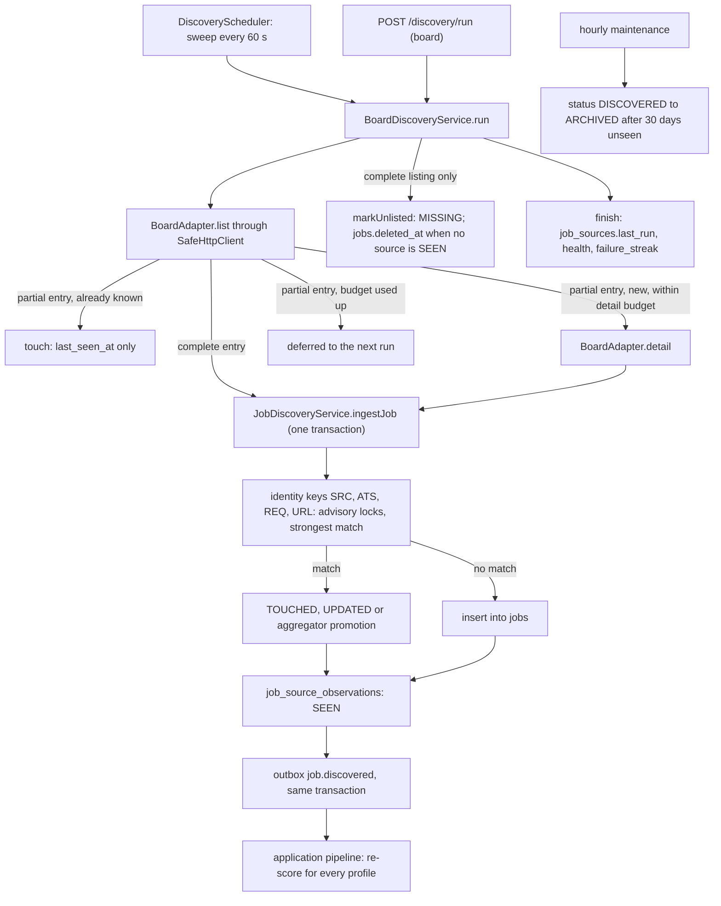

# Robin — Phase 22 Discovery Evidence Audit

**Prepared:** 2026-11-17.
**Baseline:** `master` at `ad4f2c71d044280ca2f128931c7572c04a269549` (the PR #14 merge, which follows the PR #11 merge). The audit ran on branch `phase22-discovery-evidence-audit` in a separate worktree.
**Status:** Phase 22 is **OPEN**. This document is evidence for Phase 22. It does not complete the phase (see §9).

**Boundaries kept:**
- No application code, schema, migration or configuration was changed.
- Nothing connected to production or Supabase. No backup, export, migration or deployment was run.
- No live-network test was enabled: the four `live.discovery` ITs stayed skipped.
- The operator scripts under `scripts/db-migration/oracle/` were read, not run.

**Evidence labels used throughout:**

| Label | Meaning |
|---|---|
| **MEASURED (historical)** | Read-only production counts already recorded in repository documents, with their dates. Not a statement of current production state. |
| **TEST** | Executed on 2026-11-17: unit tests, and Testcontainers ITs on PostgreSQL 16. Exact results in §5. |
| **PROBE** | Executed on 2026-11-17: deterministic calls into Robin's compiled classes through JShell. No database, no network, no repository change. Output in Appendix B. |
| **SOURCE** | Traced in source and not executed. File and line references point at the baseline commit. |
| **NOT MEASURABLE** | Cannot be measured with today's instrumentation, or not without data access outside this audit's boundaries. |

---

## 1. Executive summary

Robin's discovery is built for **precision**:

- A posting merges into an existing job only on strong identity evidence: the source's own id, a platform job id embedded in a URL, an employer requisition id, or a normalised URL.
- Identity keys are advisory-locked, so concurrent ingestion cannot create two jobs.
- A job is removed only after a *complete* listing shows that no source still lists it.

These properties are tested, and the tests pass. On 2026-11-17: 313 discovery unit tests and 62 integration tests ran (54 discovery, feed, pipeline and outbox ITs plus 8 review-queue ITs) on PostgreSQL 16, with 0 failures. The 4 live-network ITs were skipped by design.

The measurable weaknesses are in what happens **over time and across sources**, and in **measurement** itself:

1. **Removal authority (P1).** Aggregator observations are never marked missing, because aggregator listings are never complete. So once an aggregator has seen a job, the employer's own complete listing can no longer remove it. A later aggregator re-observation also clears an earlier removal (`deleted_at`). Six of the 25 registered adapters can never drive a removal at all. *(SOURCE; the keep-alive behaviour is pinned by a passing IT.)*
2. **Re-observation churn (P1).** Every unchanged re-ingestion emits `job.discovered` and re-scores the job for every profile. *MEASURED (historical):* on 8 Nov 2026, **85.14 %** (656,990) of the 771,636 pending `job.discovered` events were `TOUCHED`, meaning unchanged, observations.
3. **Cross-source duplicate recall (P1).** Adzuna and Arbeitnow postings can never join the same role's ATS posting: 0 of 3 fixture postings each yield an ATS key (PROBE). Recruitee and Phenom have no ATS key, and Greenhouse embed URLs and employer-hosted `?gh_jid=` URLs do not map to the board key. Only Tsenta is recognised as an aggregator host.
4. **Content freshness (P1).** 12 of the 25 adapters never re-fetch a posting they already know, so description edits and detail-page closure signals are never picked up. No adapter refreshes salary, location, remote type or employment type after the first insert. *(SOURCE)*
5. **Generic URL path (P1, latent).** The manual URL-discovery path builds a missing external id with a normaliser that drops the whole query string. Two different jobs identified only by a query parameter (for example `?gh_jid=111` and `?gh_jid=222`) therefore collapse into one job. *(PROBE + SOURCE)*
6. **Measurement (P1).** Board runs keep only a last-run snapshot per source, the only run metric is a since-restart counter with no source tag, and there is no labelled duplicate sample. As a result, **duplicate-job rate, stale-job rate and per-source success rates are NOT MEASURABLE today**.

**No P0 was established.** The 30-day freshness guard on `last_seen_at` is enforced when a candidate approves an application (`ReviewQueueIT.stalePostingCannotBeApproved` passed). That bounds the user-facing impact of finding 1, but does not remove it: an aggregator that keeps listing a closed job keeps `last_seen_at` fresh.

**Phase 22 exit criteria are not met** (§9). No duplicate or stale-job rate is stated anywhere in this document, because none could be established from the available evidence.

---

## 2. Discovery architecture and data flow

### 2.1 Entry points

| Entry point | Path | Notes |
|---|---|---|
| Scheduler | `DiscoveryScheduler.runDueSources` → `BoardDiscoveryService.run(…, SCHEDULED)` | Fixed-delay sweep every 60 s. A source is due when its cron (server timezone) has fired since `last_run_at`. Per-source `rate_limit_per_min`. Paused in maintenance mode. |
| Manual board run | `POST /api/v1/discovery/run?sourceId=` | Same `BoardDiscoveryService` path, mode `MANUAL`. |
| Health check and URL import | `BoardDiscoveryService` modes `HEALTH_CHECK` and `IMPORT` | A health check uses at most 2 pages and 5 detail fetches. |
| Generic URL discovery | `POST /api/v1/discovery/run?sourceId=&url=` → `DiscoveryOrchestrator.discover` | Primary and secondary scraper providers. **Manual only; never scheduled.** |
| Direct ingest | `POST /api/v1/discovery/ingest` | An `IngestJobCommand` goes straight into `JobDiscoveryService.ingestJob`. |
| LinkedIn search | `POST /api/v1/discovery/linkedin/search` | `LinkedInDiscoveryService`; outside the three components audited in depth. |
| Maintenance | hourly cron and `POST /api/v1/discovery/maintenance` | The 30-day `ARCHIVED` sweep. |

### 2.2 Flow



### 2.3 Stage by stage

| Stage | Where | Behaviour | Evidence |
|---|---|---|---|
| Source ingestion | `BoardAdapter` implementations; `adapters/Crawl.java`; `SafeHttpClient.java` | A listing is **complete** only when the adapter's own end-of-list signal is reached. A page cap, budget, timeout or parse error makes it partial. Postings are de-duplicated by external id within a run. HTTP goes through an SSRF guard with up to 3 redirect hops, each re-validated. Each request gets up to 3 attempts with exponential backoff plus jitter (base 500 ms) on 429, 502, 503, 504 and timeouts; `Retry-After` is honoured up to 10 s. Each run is limited to 400 requests by default, at least 250 ms apart, with a 20 s timeout and an 8 MiB response cap. | SOURCE, TEST (`SafeHttpClientTest` 34/34, `PlatformAdapterFixtureTest` 37/37) |
| Normalisation | `NormalizedJob.java`; `Normalize.java` | Unknown or ambiguous values become null and are never guessed. A salary is dropped without an ISO-4217 currency. Posting dates are parsed only from ISO and epoch values; relative and locale-ambiguous dates are not parsed, and dates more than a day in the future are rejected. | SOURCE, TEST |
| Deduplication | `JobDiscoveryService.ingestJob` (`:134–217`); `JobIdentity.keys` | `dedup_key` is computed and **stored only**: its index is not unique and it never merges jobs. Merging uses `job_identity_keys` (primary key `key`), strongest key first. Keys are locked with `pg_advisory_xact_lock` in sorted order (`:224`). The first writer of a key wins (`:261`). A cross-source match never rewrites content, but it may upgrade the application URL and promote a Tsenta-first job to its ATS source. | SOURCE, TEST (`CrossSourceDiscoveryIT` 10/10, `JobIdentityTest` 29/29) |
| Persistence | V001 `jobs unique(source_id, external_id)`; V037 `job_identity_keys`; V018 `job_source_observations unique(provider, source_url, external_job_id)` | One transaction per posting. The outbox event is written in the same transaction as the job row. | SOURCE, TEST |
| Scheduling and retries | `DiscoveryScheduler.java` | "The next scheduled run IS the retry" (class comment). `failure_streak` increments on failure, and `health.circuit` reads `open` once the streak reaches 10. That flag is **advisory**: the sweep query (`:95`) does not filter on it. | SOURCE, TEST (`DiscoverySchedulerTest` 8/8) |
| Freshness and expiry | `BoardDiscoveryService` `touch`/`closeObservation`/`markUnlisted` (`:258–301`); `JobRepository.STALE_AFTER_DAYS = 30`; `JobDiscoveryService.scheduledDiscoveryMaintenance` (`:343–356`) | Removal (`deleted_at`) happens only after a complete listing, or when the source marks the posting closed; a job is restored when any source lists it again. `stale` means `last_seen_at` is older than 30 days. It is shown on the job detail page, and approval is refused for stale jobs (`job_stale` is computed at `ApplicationDecisionService.java:491` and enforced as tested by `ReviewQueueIT.stalePostingCannotBeApproved`). The hourly sweep moves `DISCOVERED` jobs unseen for 30 days to `ARCHIVED`. | SOURCE, TEST (`JobFeedIT` 19/19, `ReviewQueueIT` 8/8) |
| Error handling and recovery | `BoardDiscoveryService.run` (`:166–212`); `DiscoveryScheduler.runDueSources` | An adapter exception is recorded as `MALFORMED_RESPONSE` and is never propagated. Detail failures are counted. A 429, 401/403 or exhausted budget stops further detail requests in that run. An exception thrown out of a run is caught by the scheduler, which records it as a failure and continues the sweep. A partial or failed listing never removes anything. URL and ATS keys are backfilled at startup (`JobIdentityBackfill`). | SOURCE, TEST |

---

## 3. Source-by-source findings

The registry (`PlatformRegistry`) has 25 adapters: 21 ATS platforms and 4 aggregators. Nine further platforms are recognised from their URLs but have no adapter: BambooHR, ADP, Dover, CareerPlug, Dayforce, Hireology, Polymer and SAP SuccessFactors are `UNVERIFIED`, and BrassRing is `BLOCKED`.

Column meanings:

- **Can drive removal:** whether a complete listing from this source can ever mark postings missing.
- **Known-posting refresh:** whether a posting the source already knows has its content re-checked on later runs.
- **ATS key:** whether `JobIdentity.atsKey` derives a platform job id from its URLs, which is what lets an aggregator posting join it.

| Source | Group | Listing | Can drive removal | Known-posting refresh | ATS key | Closure signal read | Seeded by migration |
|---|---|---|---|---|---|---|---|
| Greenhouse | ATS | complete (board API) | yes | yes, re-hashed every run | yes; **not** for `/embed/job_app?token=` or employer-hosted `?gh_jid=` URLs (PROBE) | none; removal by listing | Stripe, every 15 min (V028) |
| Ashby | ATS | complete | yes | yes | yes | none | — |
| Lever | ATS | complete | yes | yes | yes | none | — |
| Workday | ATS | listing plus detail | yes | **no** (touched only) | yes | `posted` flag, at detail | — |
| Rippling | ATS | listing plus detail | yes | **no** | yes | none | — |
| iCIMS | ATS | listing plus detail | yes | **no** | yes | JSON-LD `validThrough`, at detail | — |
| Workable | ATS | complete | yes | yes | yes | none | — |
| JazzHR | ATS | complete feed | yes | yes | yes | feed skips non-open jobs | — |
| Jobvite | ATS | listing plus detail | yes (partial when pagination is unrecognised) | **no** | yes | none | — |
| BreezyHR | ATS | listing plus detail | yes | **no** | yes | none | — |
| Oracle Cloud | ATS | listing plus detail | yes | **no** | yes | none | — |
| SmartRecruiters | ATS | listing plus detail | yes | **no** | yes | `active` flag, at detail | — |
| Paylocity | ATS | listing plus detail | yes | **no** | yes | JSON-LD `validThrough`, at detail | — |
| UltiPro | ATS | listing plus detail | yes | **no** | yes | `OpportunityIsClosed`, at detail | — |
| Gem | ATS | complete | yes | yes | yes | none | — |
| Zoho Recruit | ATS | complete payload, **reported partial by design** (pagination unverified) | **no** | yes | yes | none | — |
| Join | ATS | listing plus detail | yes | **no** | yes | JSON-LD `validThrough`, at detail | — |
| Phenom | ATS | listing plus detail | yes | **no** | **no** | JSON-LD `validThrough`, at detail | — |
| Pinpoint | ATS | complete | yes | yes | yes | `deadline_at` not read | — |
| Recruitee | ATS | complete | yes | yes | **no** | `close_at` not read | — |
| Teamtailor | ATS | RSS, **reported partial by design** (not documented as exhaustive) | **no** | yes | yes | none | — |
| Tsenta | aggregator | listing plus detail, never complete; 3 pages and 40 details per run | **no** | **no** | via the employer apply URL on its detail page | `active` flag and JSON-LD | none in migrations |
| FreeHire | aggregator | complete entries, never a complete listing; 100 per page | **no** | yes | only when its URL is the employer's ATS: 3 of 4 fixture postings (Zoho); the 4th is a SEEK job-board URL | `closed_at` absent from search results | 5 overlapping category sources, every 30 min (V044) |
| Arbeitnow | aggregator | complete entries, never a complete listing | **no** | yes | **no**: arbeitnow.com URLs, 0 of 3 fixture postings | none | every 30 min (V045) |
| Adzuna | aggregator | complete entries, never a complete listing; 50 per page | **no** | yes | **no**: redirect URLs, 0 of 3 fixture postings | none | GB, every 6 h (V048); needs an app id and key |

Source-level observations behind the table:

- **Six adapters can never drive removal:** Tsenta, FreeHire, Arbeitnow, Adzuna, Zoho Recruit and Teamtailor. Their postings leave the visible catalogue only through the 30-day stale flag (not removal), and only if no source re-observes them.
  - *Where:* `TsentaJobSource.java:119`, `FreeHireAdapter.java:184`, `ArbeitnowAdapter.java:168`, `AdzunaAdapter.java:152`, `SinglePayloadAdapters.java:291–297`, `MarkupAdapters.java:384–386`. *(SOURCE; Teamtailor pinned by `teamtailorRssIsNeverTreatedAsACompleteListing`.)*
- **Twelve adapters re-fetch nothing they already know:** Workday, Rippling, iCIMS, Jobvite, BreezyHR, Oracle Cloud, SmartRecruiters, Paylocity, UltiPro, Join, Phenom and Tsenta. A known external id is only `touch`ed, which updates `last_seen_at` (`BoardDiscoveryService.java:185–187, 258–265`). For these platforms, the closure signals in the table are seen only on the *first* detail fetch. *(SOURCE)*
- **Only Tsenta hosts count as aggregator URLs** (`JobIdentity.java:40`).
  - Adzuna redirect URLs, Arbeitnow job pages, and FreeHire's non-ATS URLs such as SEEK are ranked as employer pages (rank 2), and are shown to candidates as the application URL (`JobsController.java:222–224`).
  - For Adzuna and Arbeitnow this is a documented adapter decision, because those sources never expose the employer URL.
  - The identity consequence: such a posting can never share a key with the employer's ATS posting, so the two stay separate jobs. *(PROBE, SOURCE)*
- **Every FreeHire posting is listed by up to five sources every 30 minutes**, because the five seeded category sources (software_engineering, backend, frontend, fullstack, devops) overlap. They are merged by their shared URL key and counted as cross-source duplicates, but each sighting still emits an outbox event (§4.1). *(SOURCE)*
- **Configuration defaults** come from code `@Value` defaults; `application.yml` overrides none of them: 50 pages, 150 detail fetches and 400 requests per run; Tsenta 3 pages and 40 details; circuit label after 10 consecutive failures; sweep every 60 s. The **sources actually enabled in production today are not visible to this audit**: the migrations seed the rows above, and operators can add more. *(SOURCE)*

---

## 4. Duplicate and freshness measurements

### 4.1 Measured (historical)

These are read-only aggregates recorded in `docs/ROBIN_DB_MIGRATION_PHASE2_PLAN.md` during the database-migration work. Ratios marked *derived* are computed here from those exact counts.

| Recorded on | Fact | Source |
|---|---|---|
| 6 Nov 2026, about 13:27 UTC | 771,389 pending `job.discovered`: TOUCHED 656,694 (*derived* 85.13 %), UPDATED 56,355 (7.31 %), INSERTED 58,340 (7.56 %) | DB plan §1.5 |
| 6 Nov 2026 | The same reading concluded that "the 656,694 TOUCHED events are re-observations of jobs that had not changed". | DB plan §1.5 |
| 2–6 Nov 2026 | The oldest pending event is from 2 Nov 18:46:02 UTC and the newest from 6 Nov 13:31:17 UTC. Still-pending outbox rows created per day: 3 Nov **318,690**, 4 Nov **316,160** (both "mostly writable" days). | DB plan §1.2, §1.5 |
| 8 Nov 2026 (restored copy) | 771,636 pending `job.discovered`: TOUCHED **656,990** (*derived* **85.14 %**), INSERTED 58,292 (7.55 %), UPDATED 56,354 (7.30 %). The three parts sum exactly to the total. | DB plan §10.15 |
| 8 Nov 2026 (restored copy) | 60,960 jobs, of which 60,723 (*derived* 99.61 %) carry at least one pending event. *Derived:* **12.71** pending events, 10.82 of them TOUCHED, per job that carries one. | DB plan §10.15 |
| 6 Nov 2026 | The outbox was estimated to grow by about 100 MB a day. "Stop emitting a `job.discovered` event for unchanged jobs" was recorded as a separate, later change. | DB plan §5 |

**What these numbers show:** discovery re-observed unchanged jobs far more often than it found new or changed ones, and every re-observation became an outbox event and a re-score. This is consistent with the source (`JobDiscoveryService.java:168–176, 190`).

**What they cannot show:**

- **Duplicate rate:** `TOUCHED` mixes same-source re-sightings with cross-source matches, and the recorded counts do not separate them.
- **Stale rate:** nothing in these counts measures staleness.
- **Per-source volume:** there is no per-source breakdown.
- **Edits vs reposts:** `UPDATED` mixes description edits, true reposts and aggregator promotions. UPDATED (56,354) was 0.97 × INSERTED (58,292). That is unexplained: it may be real edits or unstable content hashing (open question 4).

The counts describe a backlog window when dispatch was failing and the database was intermittently read-only. They are **not** current production behaviour.

### 4.2 Test-only and probe results

- **Identity correctness on controlled data** (TEST, `CrossSourceDiscoveryIT`, all 10 passed):
  - an aggregator posting and its ATS posting become one job with both provenances;
  - a Tsenta-first job is promoted to its ATS source;
  - two different roles with the same employer, title and location stay separate;
  - re-ingestion is idempotent;
  - **16 concurrent ingestions of one posting from two sources create exactly one job**;
  - only a complete listing removes a job, and only when no source still lists it.
- **Re-run behaviour** (TEST, `GreenhouseDiscoveryIT`, 5/5): a second run deduplicates to `TOUCHED` with no new rows, and changed content bumps `repost_count` as `UPDATED`.
- **Feed freshness** (TEST, `JobFeedIT` 19/19, `ReviewQueueIT` 8/8): the stale flag uses the review-queue threshold, soft-deleted postings are hidden from the feed but flagged on the detail page, re-ingestion keeps a single feed entry, and stale postings cannot be approved.
- **Aggregator joinability on captured fixtures** (PROBE; tiny samples, not rates):

  | Aggregator | Fixture postings | Postings with an ATS key | Note |
  |---|---:|---:|---|
  | FreeHire | 4 | 3 | all three are Zoho Recruit URLs; the 4th is SEEK |
  | Arbeitnow | 3 | 0 | arbeitnow.com job pages |
  | Adzuna | 3 | 0 | adzuna.co.uk redirect URLs |

- **URL variation matrix** (PROBE; full output in Appendix B):

  | Variation | Outcome |
  |---|---|
  | Tracking parameters, fragments, trailing slashes, host case, default port, query order | normalise to the same identity key (correct) |
  | Lever `?lever-source=` vs `/apply`; Ashby `?utm_source=` vs `/application` | different URL keys, but the same ATS key (correct) |
  | `www.` vs bare host; `http` vs `https`; path case; `%2D` vs `-` | **different keys**: missed duplicates |
  | Different jobs whose id is in `?ref=`, or differs only by case in a query value | **same identity key**: false-merge risk, because `ref` is treated as tracking and query values are lowercased |
  | Different jobs `?gh_jid=111` vs `?gh_jid=222` | identity keys differ (correct), but the generic-path normaliser maps both to the same string, the false merge in finding 5 |
  | The same URL through FIND (`JobIdentity`), APPLY (`ApplicationIdentityService`) and the generic path (`JobDeduplicationService`) | **three different results** for `?trk=`, `?in_iframe=`, `%2D`, `ftp:` and `?gh_jid=` inputs |

### 4.3 Metric-by-metric status

| Metric | Status | Best available evidence | What would make it measurable |
|---|---|---|---|
| Duplicate-job rate | **NOT MEASURABLE** | Identity design (SOURCE); controlled tests (TEST); joinability probe (PROBE) | Query A.1 for duplicates caught. A labelled sample from query A.5 for duplicates missed. |
| Stale-job rate | **NOT MEASURABLE** | Stale and archive logic (SOURCE); feed and review-queue tests (TEST) | Queries A.2 to A.4 on a restored copy |
| Discovery success and failure rates | **NOT MEASURABLE** over time | Per-source last-run snapshot in `job_sources.last_run`/`health` (SOURCE). `robin_discovery_runs_total{outcome}` counts scheduled runs since the JVM started and has no source or kind tag (`AutomationMetrics.java:108`). | Persist a run history and tag the metric by kind (§8). Query A.6 gives a point-in-time snapshot. |
| Source-specific ingestion volume | **NOT MEASURED** per source | Aggregate event volume (MEASURED, historical, §4.1); configured cadence and per-run caps (SOURCE, §3) | Run history, or query A.6 |
| Duplicate-detection accuracy | **TEST and PROBE only** | §4.2 | Precision and recall on a labelled real sample |
| Job expiry and refresh behaviour | **TEST and SOURCE** | §2.3, §3, §6 | ITs for the missing scenarios in §6, then queries A.3, A.4 and A.7 |

---

## 5. Existing test coverage

### 5.1 Runs executed on 2026-11-17

The runs used JDK 21.0.12, Maven 3.9.16 in offline mode and Docker 29.0.1, with Testcontainers `postgres:16` from the local image cache. `-Dmaven.gitcommitid.skip=true` was set because the audit ran in a git worktree. The commands are in Appendix C.

| Run (UTC) | Scope | Result |
|---|---|---|
| 20:25:36–20:28:44 (3 min 4 s) | Surefire: `com/personal/jobagent/discovery/**/*Test` (33 test classes, counting nested ones) | **313 run, 0 failures, 0 errors, 0 skipped** |
| same Maven run | Failsafe: discovery `**/*IT`, plus `JobFeedIT`, `DiscoveryToApplicationIT` and `OutboxDiscoveryExclusionIT` | **58 run, 0 failures, 0 errors, 4 skipped.** The skips are `AdzunaLiveIngestionIT`, `ArbeitnowLiveIngestionIT`, `FreeHireLiveIngestionIT` and `PlatformLiveIT`, gated by `-Dlive.discovery=true`. |
| 20:33:22–20:34:48 | Failsafe: `ReviewQueueIT` | **8 run, 0 failures, 0 errors, 0 skipped** |

The executed ITs, run against Testcontainers PostgreSQL 16 unless noted:

| IT | Run | Result |
|---|---:|---|
| `CrossSourceDiscoveryIT` | 10 | pass |
| `JobFeedIT` | 19 | pass |
| `OutboxDiscoveryExclusionIT` | 8 | pass |
| `ReviewQueueIT` | 8 | pass |
| `GreenhouseDiscoveryIT` | 5 | pass |
| `PreferredSourcesDiscoveryIT` | 5 | pass |
| `ProductionDiscoverySourceIT` | 4 | pass |
| `DiscoveryToApplicationIT` | 3 | pass |
| the 4 live-network ITs | 4 | skipped by design |

`JobDiscoveryServiceTest` (11 tests) and `DiscoverySchedulerTest` (8) are mock-level unit tests, not database-backed. The database-backed identity evidence is `CrossSourceDiscoveryIT`.

**Not run:**
- the full `mvn -B verify`;
- `ExternalDatabaseCompatibilityIT` and `ExternalDatabaseFlywayIT`, which connect to an external database when their system properties are set;
- the Oracle operator scripts.

### 5.2 What the suites cover

| Area | Tests | What they establish |
|---|---|---|
| Identity keys and URL normalisation | `JobIdentityTest` (29) | ATS keys for 23 URL shapes; tracking, case, fragment, port and trailing-slash normalisation; titles never form keys |
| Cross-source dedup and removal | `CrossSourceDiscoveryIT` (10) | the six behaviours listed in §4.2, plus run metadata and SSRF safety |
| Run contract | `BoardDiscoveryServiceTest` (17) | complete vs partial listings; detail budget and deferral; throttling; closed postings; aggregator URL rules; adapter bugs recorded and not propagated; refusals; recorded metadata carries no secrets |
| Adapter parsing on captured fixtures | `PlatformAdapterFixtureTest` (37), adapter and provider tests | per-platform parsing, pagination, completeness rules, error categories, duplicate pages |
| Coverage manifest | `PlatformCoverageAuditTest` (31) | readiness and adapter-registration consistency |
| HTTP safety and retries | `SafeHttpClientTest` (34) | SSRF guard, redirects, size and content-type limits, retry and backoff, budget |
| Scheduling | `DiscoverySchedulerTest` (8), `DiscoverySchedulerMaintenanceTest` (3) | due and rate-limit logic, failure recording, malformed cron, maintenance pause |
| Ingestion semantics (mocked) | `JobDiscoveryServiceTest` (11) | the dedup-key hierarchy; same title without strong evidence is a new job; cross-source refresh-only; aggregator URLs never stored; lock order |
| Freshness in the product | `JobFeedIT` (19), `ReviewQueueIT` (8) | stale flag, soft-delete hiding, stale approval refused |
| Outbox during migration | `OutboxDiscoveryExclusionIT` (8) | V052 exclusion batches |

---

## 6. Adversarial scenarios: covered and missing

| Scenario | Already covered | Missing or weak | Evidence |
|---|---|---|---|
| Same job through multiple sources | aggregator plus ATS become one job; Tsenta promotion; FreeHire employer URLs carry ATS keys | Adzuna and Arbeitnow can never join an ATS posting; Recruitee and Phenom have no ATS key; Greenhouse embed and `gh_jid` URLs; FreeHire's own five-way category overlap is not tested as such | TEST, PROBE, SOURCE |
| Same job with different URLs | tracking, case, fragments, trailing slash, port, query order; Lever and Ashby variants through ATS keys | `www.`, `http`/`https`, path case and percent-encoding variants are not unified; Adzuna's per-posting `se=` parameter is kept in the URL key | PROBE |
| Tracking parameters and URL variations | the tracking list is tested | `ref`, `source` and `src` are stripped even when they identify a job; query values are lowercased; the generic path drops every query parameter; FIND and APPLY disagree on `trk` and `in_iframe` | PROBE |
| Changed job descriptions | a same-source content change gives `UPDATED` and `repost_count + 1`; cross-source never rewrites | 12 detail-fetch adapters never re-fetch known postings; structured fields are never refreshed; `repost_count` counts edits as reposts; content-hash stability is unknown (UPDATED ≈ INSERTED in §4.1) | TEST, SOURCE, MEASURED |
| Reposted and expired jobs | complete-listing removal and automatic restore; closed postings; partial listings never remove; stale flag and approval refusal | an aggregator keeps an ATS-removed job alive forever; an aggregator re-observation clears `deleted_at`; a repost under a new external id is not linked to the old job; `ARCHIVED` is one-way and applies only to `DISCOVERED` jobs; Recruitee `close_at` and Pinpoint `deadline_at` are ignored | SOURCE (keep-alive pinned by `aJobStillListedByAnotherSourceIsNotRemoved`) |
| Missing employer or location | configured employer name takes precedence; parsers keep unknowns null; an aggregator posting without an employer URL is skipped | no ingest-level test of identity with no employer (the REQ key is then absent); the `skipped_invalid` path (no title or external id) is untested | TEST, SOURCE |
| Concurrent discovery runs | 16 concurrent ingestions from two sources create one job | overlapping runs of the **same** source (a scheduled and a manual run) and `markUnlisted` under that overlap; no per-source run lock; no distributed lock if more than one backend instance runs the scheduler | TEST, SOURCE |
| Retry after ingestion failure | the scheduler records a failure and continues; detail failures are counted and throttling stops detail requests; HTTP retries and backoff; partial listings never remove | a database error mid-run (manual runs record no failure on the source, and `last_run` keeps the previous counters); an open circuit does not pause a source; `recordObservation` swallows an exception inside a PostgreSQL transaction (`JobDiscoveryService.java:329`), where a failed statement aborts the whole transaction, so the later outbox insert would fail anyway | SOURCE |

---

## 7. Prioritised gaps

Severity follows the gap register:

- **P0:** user-facing truthfulness or safety defect;
- **P1:** blocks a core promise or the phase exit;
- **P2:** genuine but not a current phase blocker.

### P0

None established. The candidate-facing stale guard is enforced and tested (§4.2). P1-1 and P1-6 are the findings most likely to surface as user-facing defects; each should be confirmed by a test before any fix (§8, step 2).

### P1

| ID | Gap | Evidence |
|---|---|---|
| P1-1 | **Aggregators override removal.** Aggregator observations stay `SEEN` forever, because their listings are never complete. Removal requires that no source is `SEEN` (`BoardDiscoveryService.java:278, 299`), and a cross-source `TOUCHED` match sets `deleted_at = null` (`JobDiscoveryService.java:171`). So a job the employer's ATS has dropped stays live while any aggregator ever saw it, and a lagging aggregator can resurrect a removed job, which is then never removed again. Six adapters never remove anything (§3). | SOURCE; keep-alive pinned by `CrossSourceDiscoveryIT.aJobStillListedByAnotherSourceIsNotRemoved`; resurrection traced, not executed |
| P1-2 | **No measurement instrument.** No board-run history table: `last_run` is overwritten on every run. One since-restart counter with no source tag. No labelled duplicate sample. The Phase 22 rates cannot be produced. | SOURCE |
| P1-3 | **Re-observation churn.** Every unchanged re-ingestion emits `job.discovered` (`JobDiscoveryService.java:190`) and triggers a full re-score for every profile. 85.14 % of the recorded backlog was `TOUCHED`, and the pattern fed the historical outbox growth. | MEASURED (historical), SOURCE |
| P1-4 | **Cross-source recall.** `isAggregatorUrl` knows only Tsenta (`JobIdentity.java:40`). Adzuna and Arbeitnow can never join an ATS posting (0 of 3 fixture postings each). Recruitee and Phenom have no ATS key. Greenhouse embed and `gh_jid` URLs are not mapped to the board key. | PROBE, SOURCE |
| P1-5 | **Content freshness.** 12 adapters never re-fetch known postings, so description edits and detail-page closure signals are missed. On every platform, the same-source update path refreshes only title, description and `posted_at` (`JobDiscoveryService.java:179–186`); salary, location, remote type, employment type and skills keep their first-seen values. | SOURCE |
| P1-6 | **Generic URL path false merge (latent).** `DiscoveryOrchestrator.toCommand` (`:248–249`) uses `JobDeduplicationService.normalizeUrl` (`:19`), which drops the query string, to build a missing external id. Different jobs identified by a query parameter share one `src:` key, so the second job's title and description overwrite the first's while the first's application URL stays. Each later run rewrites the row once per colliding job and increments `repost_count` each time. This affects only the manual `POST /discovery/run?url=` path. | PROBE, SOURCE |

### P2

| ID | Gap | Evidence |
|---|---|---|
| P2-1 | Three divergent URL normalisers: `JobIdentity`, `ApplicationIdentityService` and `JobDeduplicationService`. They differ on raw vs decoded path, non-http schemes, and the tracking list (`trk`, `in_iframe`, `oga`). | PROBE |
| P2-2 | `ref`, `source` and `src` are treated as tracking parameters, and query values are lowercased: a false-merge risk for sites that use those parameters as identifiers, or case-sensitive ids. | PROBE |
| P2-3 | `www.`, `http`/`https`, path-case and percent-encoding variants are not unified. | PROBE |
| P2-4 | `ARCHIVED` is one-way (nothing writes `DISCOVERED` again), covers only `DISCOVERED` jobs (scored and filtered jobs are never archived), and the default feed does not filter on it. It overlaps with the `stale` flag. | SOURCE |
| P2-5 | `repost_count` counts content edits as reposts (pinned by `GreenhouseDiscoveryIT`); a repost under a new external id is not linked to the earlier job. | TEST, SOURCE |
| P2-6 | The `job_source_observations` uniqueness includes a nullable `source_url`, and PostgreSQL treats NULLs as distinct. A null URL, or one that varies between runs, inserts a new observation row on every run instead of updating the existing one. How often this happens is unknown (open question 3). | SOURCE |
| P2-7 | The circuit breaker is advisory: an `open` source still runs every cron tick. A malformed-cron health write resets the `health.failure_streak` and `circuit` fields (`DiscoveryScheduler.java:193`); the `failure_streak` column itself is unchanged. | SOURCE |
| P2-8 | No per-source run lock and no distributed scheduler lock; overlapping same-source runs are untested. | SOURCE |
| P2-9 | `scripts/db-migration/oracle/test-discovery-dryrun.ps1` re-implements and compares `dedup_key`, which no longer merges jobs, so it cannot detect cross-source duplicates. No result of either Oracle script is recorded in the repository. | SOURCE |
| P2-10 | Source expiry fields are unused: Recruitee `close_at` and Pinpoint `deadline_at`. | SOURCE |
| P2-11 | `recordObservation`'s swallowed exception (`JobDiscoveryService.java:329`) cannot keep the PostgreSQL transaction usable. | SOURCE |
| P2-12 | A manual run that throws records no failure on the source; only the scheduler path calls `recordFailure`. | SOURCE |

---

## 8. Recommended implementation sequence

Each step should be its own reviewed PR, with tests first. No production data change without explicit approval, and no schema change without a reviewed migration. **Nothing below has been implemented; this audit waits for review.**

1. **Measurement first (P1-2), which unblocks the exit criteria.**
   - Add a board-run history: one row per run with source, mode, start and finish times, status, failure category and the existing counters. *Schema change.*
   - Tag `robin_discovery_runs_total` by kind.
   - Run the read-only queries in Appendix A on a **restored copy**, not production.
   - Draw a labelled sample of about 200 candidate pairs from query A.5 to estimate duplicate precision and recall.
2. **Confirm P1-1 and P1-6 with failing tests** before changing behaviour. Testcontainers ITs should cover:
   - an aggregator that stops listing a job;
   - an aggregator re-observation after an ATS removal;
   - the generic-path `?gh_jid=` collision.
3. **Decide removal authority (P1-1).**
   - Options include expiring aggregator observations that are not re-seen within N days, and not clearing `deleted_at` from an aggregator-only re-observation once the employer's ATS has marked the posting missing.
   - Keep the stale guard as the backstop.
4. **Reduce churn (P1-3).**
   - Stop emitting `job.discovered` for `TOUCHED` (the change the DB plan already recorded), or coalesce those events.
   - Keep a periodic self-heal re-score instead of one per sighting.
5. **Identity recall and precision (P1-4, P1-6, P2-1 to P2-3).**
   - Recognise all aggregator hosts.
   - Add ATS keys for Recruitee, Phenom, Greenhouse embed and `gh_jid`.
   - Use one shared URL normaliser.
   - Review the tracking list and stop lowercasing query values.
   - Derive generic-path ids with the identity normaliser.
6. **Content refresh (P1-5, P2-5).**
   - Add a budgeted re-fetch of known detail-platform postings, oldest first.
   - Refresh structured fields on a same-source change.
   - Count edits and reposts separately.
7. **Lifecycle tidy-up (P2-4, P2-6 to P2-8, P2-10 to P2-12).**
   - Archive semantics.
   - Observation uniqueness: `NULLS NOT DISTINCT` or a coalesced key. *Migration.*
   - Circuit behaviour and per-source run locks.
   - Expiry fields.
   - Failure recording for manual runs.
8. **Measure again with the run history and labelled sample,** then reassess the Phase 22 exit (§9).

---

## 9. Phase 22 exit-criteria assessment

The roadmap's Phase 22 goal is:

- read `JobDeduplicationService`, `DiscoveryScheduler` and `BoardDiscoveryService` fully;
- run the existing discovery tests;
- establish real freshness and dedup numbers from authoritative fixtures or audit evidence.

The exit criterion: *"evidence-backed duplicate and stale-job rates, not estimates."*

| Criterion | Status | Evidence |
|---|---|---|
| Read the three components fully and trace the flow | **Met** | §2, §3 |
| Run the existing discovery tests | **Met** | §5: 313 unit tests and 62 ITs executed with 0 failures; 4 live ITs skipped by design |
| Evidence-backed duplicate-job rate | **Not met** | Not measurable without a restored-copy query and a labelled sample (§4.3) |
| Evidence-backed stale-job rate | **Not met** | Not measurable without a restored-copy query (§4.3) |
| Freshness and dedup behaviour understood, with gaps prioritised | **Met for this audit** | §6, §7 |

**Phase 22 remains OPEN.** The next phase step is §8, step 1, after review.

---

## Unresolved questions

1. Is the generic URL path (`POST /api/v1/discovery/run` with `url=`) used in production? This decides how urgent P1-6 is.
2. Which `job_sources` are enabled in production today, beyond the migration seeds (for example Tsenta sources or operator-added boards)?
3. Does Adzuna's `redirect_url` `se=` value change between API calls for the same posting? If it does, every run adds URL keys and observation rows (P2-6).
4. Why was UPDATED (56,354) almost equal to INSERTED (58,292) in the recorded backlog: real edits, or unstable content (for example per-request text in descriptions)?
5. Will the backend run as a single instance on its current hosting? This decides whether P2-8 needs a distributed lock.
6. Who may run the Appendix A queries, and where (a restored copy is recommended)?
7. What removal authority should an aggregator have relative to the employer's own ATS listing (P1-1)?

---

## Appendix A. Proposed read-only queries (NOT executed)

These are for an operator, on a **restored copy** or with explicit approval. All are `SELECT`s; none writes. None was run for this audit.

**A.1 Jobs seen by two or more sources (cross-source duplicates that were caught):**

```sql
select count(*) as jobs_seen_by_2plus_sources
from (
  select o.job_id
  from job_source_observations o
  where o.source_id is not null
  group by o.job_id
  having count(distinct o.source_id) >= 2
) t;
```

**A.2 Visible jobs, and how many are stale:**

```sql
select count(*) as visible,
       count(*) filter (where last_seen_at < now() - interval '30 days') as stale
from jobs
where deleted_at is null;
```

**A.3 Visible jobs kept alive only by aggregator observations:**

```sql
select count(*) as aggregator_only_visible
from jobs j
where j.deleted_at is null
  and exists (select 1 from job_source_observations o
              where o.job_id = j.id and o.source_id is not null and o.source_status = 'SEEN')
  and not exists (select 1 from job_source_observations o
                  join job_sources s on s.id = o.source_id
                  where o.job_id = j.id and o.source_status = 'SEEN'
                    and s.kind not in ('TSENTA','FREEHIRE','ARBEITNOW','ADZUNA'));
```

**A.4 Jobs an ATS source marked MISSING or CLOSED that an aggregator still keeps visible (the P1-1 symptom):**

```sql
select count(distinct j.id) as kept_alive_by_aggregator
from jobs j
join job_source_observations ats on ats.job_id = j.id and ats.source_status in ('MISSING','CLOSED')
join job_sources sa on sa.id = ats.source_id and sa.kind not in ('TSENTA','FREEHIRE','ARBEITNOW','ADZUNA')
where j.deleted_at is null
  and exists (select 1 from job_source_observations o
              join job_sources s on s.id = o.source_id
              where o.job_id = j.id and o.source_status = 'SEEN'
                and s.kind in ('TSENTA','FREEHIRE','ARBEITNOW','ADZUNA'));
```

**A.5 Candidate missed duplicates for manual labelling.** These are candidates only: by design, the same title is not an identity.

```sql
select lower(coalesce(company_name_raw, '')) as employer,
       lower(title) as title,
       lower(coalesce(location_raw, '')) as location,
       count(*) as jobs,
       count(distinct source_id) as primary_sources
from jobs
where deleted_at is null
group by 1, 2, 3
having count(*) > 1 and count(distinct source_id) > 1
order by jobs desc
limit 200;
```

**A.6 Per-source last-run snapshot (a single point in time, not a history):**

```sql
select kind, org_identifier, enabled, failure_streak, last_attempted_at, last_success_at,
       health->>'status' as status,
       last_run->>'listed' as listed, last_run->>'created' as created,
       last_run->>'duplicates' as cross_source_duplicates,
       last_run->>'removed' as removed, last_run->>'complete' as complete
from job_sources
order by kind, org_identifier;
```

**A.7 Status mix of visible jobs (archived jobs still visible), and observation-row growth:**

```sql
select status, count(*) from jobs where deleted_at is null group by status order by 2 desc;

select count(*) as job_source_pairs_with_multiple_rows
from (
  select job_id, source_id
  from job_source_observations
  where source_id is not null
  group by job_id, source_id
  having count(*) > 1
) t;
```

## Appendix B. Probe output (2026-11-17)

`jshell` ran with `--class-path backend/target/classes` plus the runtime dependency classpath, and called `JobIdentity`, `JobDeduplicationService` and, by reflection, `ApplicationIdentityService.normalizeUrl`. The fixture URLs were extracted unchanged from `backend/src/test/resources/discovery/platforms/{freehire-search-page1,freehire-search-page2,arbeitnow-page1,adzuna-search-page1}.json`.

```text
FIXTURE URLS: kind | atsKey | isAggregatorUrl | applicationUrlRank
FREEHIRE  | zoho_recruit:681293000002210024 | false | 3
FREEHIRE  | zoho_recruit:611421000011722083 | false | 3
FREEHIRE  | zoho_recruit:611421000011530094 | false | 3
FREEHIRE  | null (www.seek.co.nz/job/95337782) | false | 2
ARBEITNOW | null | false | 2   (x3, arbeitnow.com job pages)
ADZUNA    | null | false | 2   (x3, adzuna.co.uk/land/ad redirects)

PAIRS: case | identity URL key equal | ATS key equal | generic-path normalizeUrl equal
tracking params                          | true  | n/a   | true
fragment + trailing slash                | true  | n/a   | true
host case + default port                 | true  | n/a   | true
query param order                        | true  | n/a   | true
www vs bare host                         | false | n/a   | false
http vs https                            | false | n/a   | false
path case                                | false | n/a   | false
percent-encoded path (%2D vs -)          | false | n/a   | true
DIFFERENT jobs, id in gh_jid             | false | n/a   | TRUE  (both -> https://www.acme.com/careers)
DIFFERENT jobs, id in ref                | TRUE  | n/a   | TRUE
DIFFERENT jobs, id differs only by case  | TRUE  | n/a   | TRUE
Greenhouse embed vs board URL            | false | false (null / greenhouse:acme:4567) | false
Greenhouse employer-hosted vs board URL  | false | false (null / greenhouse:acme:4567) | false
Lever ?lever-source= vs /apply           | false | true  | false
Ashby ?utm_source= vs /application       | false | true  | false
Adzuna redirect, different se= values    | false | n/a   | true
Adzuna redirect vs employer ATS          | false | false | false

AGGREGATOR HOSTS recognised: adzuna=false arbeitnow=false freehire=false seek=false tsenta=true

NORMALISER DIVERGENCE: FIND (JobIdentity) | APPLY (ApplicationIdentityService) | generic (JobDeduplicationService)
...jobs/123?trk=public_jobs | .../jobs/123             | .../jobs/123?trk=public_jobs | .../jobs/123
...jobs/123?in_iframe=1     | .../jobs/123             | .../jobs/123?in_iframe=1     | .../jobs/123
...jobs/a%2Db               | .../jobs/a%2Db           | .../jobs/a-b                 | .../jobs/a-b
ftp://.../jobs/123          | null                     | ftp://.../jobs/123           | ftp://.../jobs/123
...jobs/123?gh_jid=9        | .../jobs/123?gh_jid=9    | .../jobs/123?gh_jid=9        | .../jobs/123
```

## Appendix C. Commands

Run from `backend/` in the audit worktree:

```bash
mvn -o -B -ntp verify -Dmaven.gitcommitid.skip=true "-Dtest=com/personal/jobagent/discovery/**/*Test" -Dsurefire.failIfNoSpecifiedTests=false "-Dit.test=com/personal/jobagent/discovery/**/*IT,com/personal/jobagent/jobs/JobFeedIT,com/personal/jobagent/application/DiscoveryToApplicationIT,com/personal/jobagent/events/OutboxDiscoveryExclusionIT" -Dit.failIfNoSpecifiedTests=false -Dmaven.test.failure.ignore=true
```

```bash
mvn -o -B -ntp verify -Dmaven.gitcommitid.skip=true -Dtest=NONE -Dsurefire.failIfNoSpecifiedTests=false "-Dit.test=com/personal/jobagent/application/ReviewQueueIT" -Dit.failIfNoSpecifiedTests=false -Dmaven.test.failure.ignore=true
```

`-Dmaven.test.failure.ignore=true` was set so that both phases always ran. The results above are read from the Surefire and Failsafe output, not from the build status.
