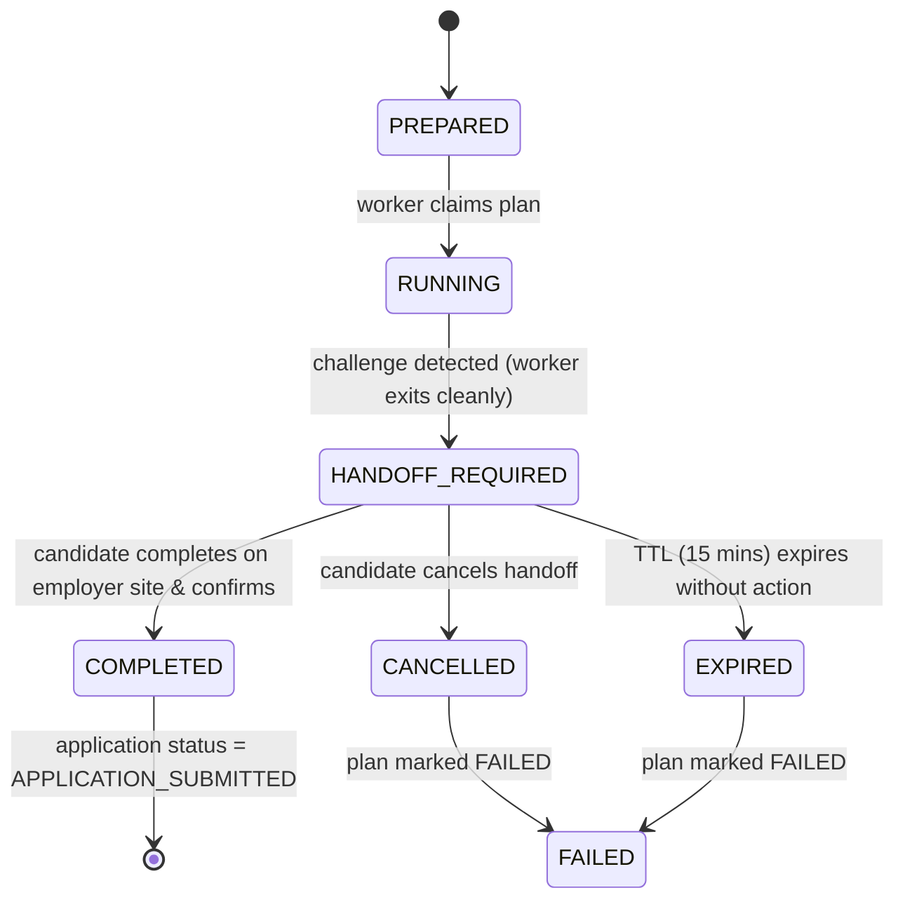

# Phase 3: ATS Handoff Architecture & Verification Report

## Verification Classification: VERIFIED — EXTERNAL HUMAN COMPLETION

---

## 1. Executive Summary

Phase 3 establishes the **Candidate-Controlled Browser Handoff Architecture** to safely resolve employer-facing security checkpoints (CAPTCHA, Workday MFA, Cloudflare Turnstile, and employer bot verifications).

In strict adherence to project operating guidelines and security standards:
- **Robin NEVER attempts to programmatically bypass, solve, click through, or evade CAPTCHAs, bot detections, or MFA gates.**
- When an anti-bot challenge is detected, automation terminates immediately, releasing the browser context and execution lease.
- An owner-scoped `automation_handoff_sessions` token is persisted in PostgreSQL.
- The candidate is guided by the UI to open the employer portal in their personal browser, resolve the security challenge, and complete the application directly on the employer site.
- Upon explicit candidate confirmation, Robin records external completion honestly with candidate attribution (`APPLICATION_SUBMITTED`), preventing duplicate submissions or fake automation claims.

---

## 2. Browser Session Continuity: Audit & Architectural Selection

### 2.1 Code Evidence on Browser Continuity

A rigorous trace was executed from challenge detection to resolution:
`worker/src/outcome.js` → `worker/src/worker.js` → `worker/src/handoff.js` → `backend/src/.../HandoffController.java` → `frontend/src/components/HandoffModal.tsx`.

1. **Browser Instance & Context Teardown**:
   In `worker/src/browser_worker.js` (lines 342–345):
   ```javascript
   } finally {
     await context.close();
     await browser.close();
   }
   ```
   When any anti-bot or security challenge error is thrown (`HardStopError`), the headless Playwright browser context and browser process are immediately and permanently closed. All cookies, memory session tokens, and in-flight DOM states within the container are wiped.

2. **Candidate Desktop Browser Isolation**:
   In `frontend/src/components/HandoffModal.tsx` (lines 87–97):
   ```tsx
   <a href={session.targetUrl} target="_blank" rel="noopener noreferrer">
     Open Application Form
   </a>
   ```
   The candidate opens the target employer page in their personal desktop browser (Chrome, Edge, Safari, Firefox). This browser session is completely isolated from the headless container: it has independent cookies, separate IP/TLS fingerprints, and user-driven interaction.

3. **Fundamental Impossibility of Option A**:
   Option A (attempting to keep Playwright open and resume headless submission) is physically impossible and architecturally unsound:
   - Robin does not stream CDP ports or expose remote browser debugging over the network (strictly prohibited for security and isolation).
   - If a candidate completes CAPTCHA/MFA in their external desktop browser, the headless Playwright context remains completely unauthenticated.
   - If Playwright attempted to re-submit after the candidate already submitted on the employer site, it would cause an employer-facing **DUPLICATE SUBMISSION**.

### 2.2 Formal Selection: Option B (External Human Completion)

Robin adopts **Option B (External Human Completion)**:
1. Headless worker detects challenge (`LEVER_CAPTCHA_PRESENT`, `WORKDAY_MFA_REQUIRED`, `WORKDAY_CAPTCHA_PRESENT`, `CLOUDFLARE_TURNSTILE`).
2. Worker calls `POST /api/v1/handoff/initiate` to log the handoff session in PostgreSQL.
3. Worker cleanly terminates its execution, stops heartbeat timers, and releases its execution lease immediately without blocking in a 15-minute wait loop.
4. Candidate modal displays direct employer link with clear instructions: candidate completes and submits on employer portal.
5. Candidate clicks "Confirm & Complete Application" in Robin.
6. Backend marks handoff session `COMPLETED`, records application as `APPLICATION_SUBMITTED` with candidate attribution via `ApplicationStatusService.apply`, and transitions plan to terminal `COMPLETED` with structured `EXTERNAL_SUBMISSION_ATTESTATION` result.
7. Zero automated duplicate submissions, zero worker resumes, zero fake solver claims.

---

## 3. Platform Capability Contracts

| Platform | Capability Level | Real Submission Capability | Form Inspection | Security Checkpoint Boundary | Handoff Trigger & Resolution |
| :--- | :---: | :---: | :---: | :--- | :--- |
| **GREENHOUSE** | `SUBMISSION_AVAILABLE` | **YES** (`prepareRealSubmission`) | Static HTML Form Parsing | Rare CAPTCHA (employer-configurable Turnstile) | Automated form-fill; if Turnstile tripped $\rightarrow$ `HANDOFF_REQUIRED` |
| **ASHBY** | `FORM_FILL_AVAILABLE` | **YES** (`prepareAshbySubmission`) | Client-rendered (browser) | Public board, rare sign-in or CAPTCHA | Automated form-fill; if blocked $\rightarrow$ `HANDOFF_REQUIRED` |
| **LEVER** | `FORM_FILL_AVAILABLE` | **NO** (Blocked by hCaptcha) | Static HTML Form Parsing | Mandatory hCaptcha on final submission | Automated field fill; at submit click $\rightarrow$ `HANDOFF_REQUIRED` (candidate completes in browser) |
| **WORKDAY** | `CREDENTIAL_VERIFIED` | **NO** (Sign-in verification only) | Multi-step wizard | Mandatory MFA / One-Time Code / CAPTCHA on sign-in | When MFA challenge detected $\rightarrow$ `HANDOFF_REQUIRED` (candidate completes OTP) |
| **ZOHO RECRUIT** | `FORM_FILL_AVAILABLE` | **NO** (Never submits) | Client-rendered (browser) | Standard form, employer bot guards | Automated field fill; at submit click $\rightarrow$ `HANDOFF_REQUIRED` |

---

## 4. Lifecycle, Concurrency & Security Guarantees



### Concurrency & Lifecycle Guarantees:
1. **Partial Unique Index & Idempotent Initiation (V068)**:
   Migration `V068__handoff_single_pending_index.sql` introduces:
   ```sql
   CREATE UNIQUE INDEX IF NOT EXISTS handoff_sessions_single_pending_per_plan
   ON automation_handoff_sessions(plan_id) WHERE status = 'PENDING';
   ```
   This guarantees at the database level that exactly one active `PENDING` handoff session can exist per plan at any time. If concurrent worker threads attempt initiation simultaneously, PostgreSQL enforces uniqueness, and `HandoffSessionRepository.createSession` safely catches `DuplicateKeyException` and returns the existing active session.
2. **Active Session Stability & Worker Isolation**:
   When a plan is in `HANDOFF_REQUIRED`:
   - `AutomationPlanRepository.claimNext()` only selects `status = 'PREPARED'`.
   - `AutomationPlanRepository.recoverStale()` only reclaims `status = 'RUNNING'`.
   - Competing workers and the background recovery sweeper cannot claim or overwrite the plan during active handoff.
3. **Single-Use Atomic Completion**:
   `HandoffSessionRepository.completeSession` executes:
   ```sql
   UPDATE automation_handoff_sessions
   SET status = 'COMPLETED', completed_at = clock_timestamp(), updated_at = clock_timestamp()
   WHERE id = ? AND status = 'PENDING' AND expires_at > clock_timestamp();
   ```
   Only a single completion request can succeed. Any concurrent or duplicate submission attempt returns 0 rows updated and is rejected with `409 Conflict`.
4. **Stale Session Expiry**:
   `expireStaleSessions()` atomically sweeps overdue `PENDING` sessions to `EXPIRED` and marks corresponding plans `FAILED` with `HANDOFF_EXPIRED` reason.
5. **Cancellation Lifecycle**:
   Candidate cancellation atomically sets session to `CANCELLED` and plan to `FAILED`, recording full audit entries.
6. **Crash & Restart Recovery**:
   Because handoff sessions and plan states are persisted durably in PostgreSQL with foreign keys and unique constraints, worker crashes leave the handoff session in `PENDING` state. The candidate can complete the handoff seamlessly without needing the crashed worker.
7. **Strict IDOR Protection**:
   All endpoints in `HandoffController` verify ownership against the authenticated candidate's `OwnerContext`. Cross-profile access attempts return `404 Not Found` for queries and `403 Forbidden` for mutations.
8. **Worker Token Authorization**:
   `/api/v1/handoff/initiate` requires a valid worker Bearer token or authenticated user session. Unauthenticated requests are rejected with `401 Unauthorized` / `403 Forbidden`.
9. **Application Status Machine & Atomic Rollback**:
   External candidate completion uses `ApplicationStatusService.apply` within a `@Transactional` boundary:
   - Moves `READY_TO_APPLY` $\rightarrow$ `APPLICATION_STARTED` $\rightarrow$ `APPLICATION_SUBMITTED`.
   - Records `submitted_at = clock_timestamp()`.
   - Idempotently preserves already-submitted/terminal application statuses (`OFFER`, `INTERVIEW`, `APPLICATION_SUBMITTED`).
   - If an invalid transition occurs, the transaction rolls back completely, preserving `PENDING` session and `HANDOFF_REQUIRED` plan states.
10. **Plan Terminal Completion**:
    The automation plan transitions directly to terminal `COMPLETED` with an explicit `EXTERNAL_SUBMISSION_ATTESTATION` result, clearing heartbeats and execution leases. The Playwright worker is never resumed.
11. **Public DTO Token Redaction**:
    `HandoffSessionResponse` separates the public REST contract from the internal `HandoffSessionRecord` persistence model. `handoffToken` is never serialized over candidate-facing endpoints or written to audit logs, preventing secret exposure while maintaining database integrity.
12. **Accurate Audit Transition Metadata**:
    `expireStaleSessions()` records the precise transition source in `audit_logs` (`HANDOFF_REQUIRED -> FAILED` or `BLOCKED_ANTI_BOT -> FAILED`). Idempotent sweeps for already-`FAILED` plans skip false audit generation, and unexpected states throw `IllegalStateException` to enforce transactional rollback.

---

## 5. Verification Test Suite Coverage

All required scenarios are rigorously validated across PostgreSQL Testcontainers, Node worker test suites, and Vitest frontend suites:

| # | Required Scenario | Test Implementation | Result |
|---|---|---|---|
| 1 | Browser worker terminates on CAPTCHA/MFA | `worker/test/handoff.test.js` & `browser_worker.js` | **PASSED** |
| 2 | Handoff session created with correct reason code | `AtsHandoffIntegrationIT.testLeverCaptchaHandoffFlow`, `testWorkdayMfaHandoffFlow` | **PASSED** |
| 3 | Candidate modal displays target URL & instructions | `frontend/src/components/HandoffModal.test.tsx` | **PASSED** |
| 4 | Candidate completion transitions application state | `AtsHandoffIntegrationIT.testLeverCaptchaHandoffFlow` | **PASSED** |
| 5 | Candidate cancellation transitions to CANCELLED/FAILED | `AtsHandoffIntegrationIT.testHandoffSessionCancellation` | **PASSED** |
| 6 | Session expiry transitions to EXPIRED after TTL | `AtsHandoffIntegrationIT.testHandoffSessionExpiration`, `testExpireStaleSessionsSweeper` | **PASSED** |
| 7 | Worker lease cleanly released during handoff | `worker/test/handoff.test.js` (`Option B: initiateHandoff`) | **PASSED** |
| 8 | Duplicate completion attempts rejected (409) | `AtsHandoffIntegrationIT.testDuplicateCompletionPrevented` | **PASSED** |
| 9 | Unauthorized candidate access rejected (403/404) | `AtsHandoffIntegrationIT.testIdorCrossProfileProtection` | **PASSED** |
| 10 | Unauthenticated handoff initiate rejected (401/403) | `AtsHandoffIntegrationIT.testUnauthenticatedInitiateRejected` | **PASSED** |
| 11 | Competing worker cannot claim plan during handoff | `AtsHandoffIntegrationIT.testCompetingWorkerCannotClaimHandoffRequiredPlan` | **PASSED** |
| 12 | Application status reflects external vs automated | `AtsHandoffIntegrationIT.testApplicationStatusReflectsExternalCompletion` | **PASSED** |
| 13 | Confirmation without attestation rejected (400) | `AtsHandoffIntegrationIT.testCandidateConfirmationWithoutAttestationRejected` | **PASSED** |
| 14 | Concurrent initiate race guarantees 1 PENDING session | `AtsHandoffIntegrationIT.testConcurrentInitiateSingleActiveSession` | **PASSED** |
| 15 | Repeated completion maintains terminal status | `AtsHandoffIntegrationIT.testRepeatedCompletionCannotAlterTerminalApplication` | **PASSED** |
| 16 | Transactional rollback preserves state on failure | `AtsHandoffIntegrationIT.testTransactionalRollbackOnApplicationTransitionFailure` | **PASSED** |
| 17 | Worker token cannot complete, cancel, or read sessions | `AtsHandoffIntegrationIT.testWorkerTokenCannotCompleteOrCancelOrReadCandidateHandoff` | **PASSED** |
| 18 | Fail-closed rollback on plan transition failure | `AtsHandoffIntegrationIT.testFailClosedRollbackOnPlanTransitionFailure` | **PASSED** |
| 19 | Candidate initiate rejects cross-profile plan with 403 | `AtsHandoffIntegrationIT.testInitiateHandoffRejectsCrossProfilePlanForCandidate` | **PASSED** |
| 20 | Initiate rejects null planId with 400 Bad Request | `AtsHandoffIntegrationIT.testInitiateHandoffRejectsNullPlanId` | **PASSED** |
| 21 | Handoff initiation & expiration handles BLOCKED_ANTI_BOT | `AtsHandoffIntegrationIT.testHandoffInitiationAndExpirationFromBlockedAntiBot` | **PASSED** |
| 22 | Expire stale sessions idempotent when already FAILED | `AtsHandoffIntegrationIT.testExpireStaleSessionsIdempotentWhenPlanAlreadyFailed` | **PASSED** |
| 23 | Expire stale sessions rolls back to PENDING on unexpected plan state | `AtsHandoffIntegrationIT.testExpireStaleSessionsThrowsAndRollsBackSessionWhenPlanInUnexpectedState` | **PASSED** |
| 24 | Expire stale sessions atomic rollback across multiple plans | `AtsHandoffIntegrationIT.testExpireStaleSessionsAtomicAcrossMultiplePlans` | **PASSED** |
| 25 | Handoff responses and audit records never expose handoffToken secret | `AtsHandoffIntegrationIT.testHandoffEndpointsAndAuditNeverExposeHandoffToken` | **PASSED** |

### Test Execution Summary:
- **Backend Tests (`AtsHandoffIntegrationIT`, `AtsHandoffServiceTest`, `HandoffControllerTest`, `AutomationRecoverySchedulerMaintenanceTest`)**: 61 passed, 0 failures, 0 errors in 01:51 min (`BUILD SUCCESS`).
- **Worker Tests (`worker/test/*.test.js`)**: 267 passed, 0 failures, 0 errors in 55.99 s.
- **Frontend Tests (`vitest run`)**: 454 passed across 46 test files in 42.37 s.
- **Cloudflare Email Worker Tests (`npm test`)**: 17 passed, 0 failures in 589 ms.
- **Frontend Production Build (`npm run build`)**: 97 modules transformed, built in 5.50 s.
- **Total Tests Passing**: **799 passed, 0 failures across all layers**.
