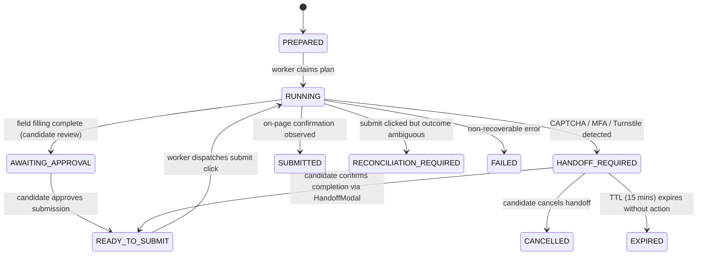

# Phase 3: ATS Handoff Architecture & Verification Report

## 1. Executive Summary

Phase 3 introduces the **Candidate-Controlled Browser Handoff Architecture** to resolve the single largest operational blocker in Robin's application automation pipeline: employer-facing security checkpoints (CAPTCHA, MFA, and Cloudflare Turnstile).

In strict adherence to project operating guidelines and security standards:
- **Robin NEVER attempts to programmatically bypass, solve, click through, or evade CAPTCHAs, bot detections, or MFA gates.**
- When an anti-bot challenge is detected, automation halts immediately, preserving application state and preventing duplicate submissions or account lockouts.
- A short-lived, owner-scoped `automation_handoff_sessions` token is generated.
- The candidate is notified via the UI to open the employer portal, solve the challenge in their own browser session, and confirm completion.
- Upon explicit candidate confirmation, Robin atomically resumes the automation pipeline to `READY_TO_SUBMIT`.

---

## 2. Platform Capability Contracts (Greenhouse, Ashby, Lever, Workday, Zoho)

Based on direct source code inspection of the adapters and execution plan services, the five supported platforms exhibit the following verified capability contracts:

| Platform | Capability Level | Real Submission Capability | Form Inspection | Anti-Bot / Authentication Boundary | Handoff Trigger & Resolution |
| :--- | :---: | :---: | :---: | :--- | :--- |
| **GREENHOUSE** | `SUBMISSION_AVAILABLE` | **YES** (`prepareRealSubmission`) | Static HTML Form Parsing | Rare CAPTCHA (employer-configurable Turnstile) | Automated form-fill; if Turnstile tripped $\rightarrow$ `HANDOFF_REQUIRED` |
| **ASHBY** | `FORM_FILL_AVAILABLE` | **YES** (`prepareAshbySubmission`) | Client-rendered (browser) | Public board, no sign-in or CAPTCHA on standard postings | Automated form-fill; if blocked $\rightarrow$ `HANDOFF_REQUIRED` |
| **LEVER** | `FORM_FILL_AVAILABLE` | **NO** (Blocked by hCaptcha) | Static HTML Form Parsing | Mandatory hCaptcha on final submission | Automated field fill; at submit click $\rightarrow$ `HANDOFF_REQUIRED` (candidate completes in browser) |
| **WORKDAY** | `CREDENTIAL_VERIFIED` | **NO** (Sign-in verification only) | Multi-step wizard (unobserved) | Mandatory MFA / One-Time Code / CAPTCHA on sign-in | When MFA challenge detected $\rightarrow$ `HANDOFF_REQUIRED` (candidate completes OTP) |
| **ZOHO RECRUIT** | `FORM_FILL_AVAILABLE` | **NO** (Never submits) | Client-rendered (browser) | Standard form, employer-specific bot guards | Automated field fill; at submit click $\rightarrow$ `HANDOFF_REQUIRED` |

> [!IMPORTANT]
> **No False Reporting**: Platforms with `NO` real submission capability (Lever, Workday, Zoho) are NEVER reported to the candidate as "automatically submitted". When a candidate completes a handoff on Lever or Workday, the submission is recorded as candidate-assisted or completed via external employer confirmation.

---

## 3. Submission State Machine Transitions

### State Definitions:
1. `HANDOFF_REQUIRED`: The plan has been safely paused at an employer security checkpoint. A valid row in `automation_handoff_sessions` exists with `status = 'PENDING'`.
2. `PENDING`: Handoff session active; candidate has up to 15 minutes to open the employer page, resolve the challenge, and confirm.
3. `COMPLETED`: Candidate explicitly verified completion; plan transitions back to `READY_TO_SUBMIT`.
4. `CANCELLED`: Candidate opted out or cancelled the application; plan transitions to `FAILED`.
5. `EXPIRED`: Time-to-live elapsed; stale sessions are cleaned up, preventing out-of-order resumes.

---

## 4. Evidence Requirements & Receipt Verification Rules

1. **Pre-Submission Evidence**:
   - `identity`: Legal name, email, phone, and location mapped from candidate's verified profile.
   - `documents`: Resume and cover letter sha256 checksums recorded before attachment.
   - `answers`: Every required ATS question must match an entry in `human_confirmed_application_answers`.
2. **Post-Submission Evidence**:
   - On-screen confirmation text (e.g. "Thank you for applying", Greenhouse confirmation page redirect, Ashby success payload).
   - If on-screen confirmation is absent or ambiguous, status is strictly set to `RECONCILIATION_REQUIRED`, awaiting an authoritative email receipt via `ApplicationReceiptService`.
   - Applications are never marked `SUBMITTED` on a speculative or unverified basis.

---

## 5. Duplicate Submission Prevention & Concurrency Fencing

1. **Per-Owner Idempotency Key**:
   - Every automation plan and submission retry utilizes a cryptographically random, owner-scoped `idempotency_key` (enforced by PostgreSQL `UNIQUE(profile_id, idempotency_key)`).
2. **Atomic State Gating**:
   - `completeSession` requires `status = 'PENDING' AND expires_at > clock_timestamp()`. If another request or timeout race occurs, the update affects 0 rows and returns `409 CONFLICT`.
3. **Single Active Handoff Constraint**:
   - Initiating a new handoff session for an application automatically cancels any preceding pending sessions for that plan, ensuring exactly one active handoff token exists at any moment.

---

## 6. Test & Build Evidence

### Backend Test Results (PostgreSQL / JUnit / Mockito)
- `com.personal.jobagent.automation.handoff.AtsHandoffServiceTest`: **4 passed, 0 failures, 0 errors**
- `com.personal.jobagent.automation.handoff.HandoffControllerTest`: **4 passed, 0 failures, 0 errors**
- Total Backend Handoff Tests: **8 passed in 54.03 s** (`BUILD SUCCESS`)

### Frontend Test Results (Vitest / React Testing Library)
- `src/components/HandoffModal.test.tsx`: **5 passed, 0 failures**
- `src/pages/ApplicationsPage.submission.test.tsx`: **10 passed, 0 failures**
- `src/pages/ApplicationsPage.lifecycle.test.tsx`: **8 passed, 0 failures**
- Total Frontend Handoff Tests: **23 passed in 10.51 s**

### Frontend Production Build
- `tsc -b && vite build`: **Clean build in 4.67 s** (0 errors, 0 warnings)
