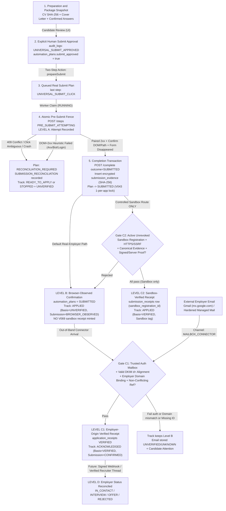

# STAGE 3H — Universal Receipt Verification & Evidence Trust Architecture Audit

**Repository:** `kirankumarJADA/job-agent`  
**Branch:** `integration/wave-3`  
**Verified Baseline HEAD:** `4fe364202343bc3921ab5894d0b6774eb58f1252` (`origin/integration/wave-3` matches local `HEAD`)  
**Pull Request:** `#21` (`OPEN`, `DRAFT`, base `master`)  
**Audit Date:** `2026-11-26`  
**Scope Rule:** Architecture audit & design only. No runtime code, trust policy, security fence, or database migration (`V001`–`V070`) was modified, and no external employer or staging website was accessed.

---

## 0. Preflight & Release Gate Verification

1. **Git & PR #21 State (Verified):**
   - Local worktree clean on `integration/wave-3`; `HEAD` and `origin/integration/wave-3` both equal `4fe364202343bc3921ab5894d0b6774eb58f1252`.
   - `gh pr view 21` confirms `state: OPEN`, `isDraft: true`, `baseRefName: master`, `headRefName: integration/wave-3`, `headRefOid: 4fe364202343bc3921ab5894d0b6774eb58f1252`.
2. **Stage 3G Commit CI Gate — Run `45856716570` (`completed` / `success`):**
   - `backend` (Job `140036916915`, `mvn verify` unit + ArchUnit + Testcontainers ITs): **success** (`2026-11-26T16:13:30Z`–`16:25:00Z`, 11m30s).
   - `frontend` (Job `140036917408`, type-check + unit tests + production build): **success** (`16:13:30Z`–`16:14:17Z`, 47s).
   - `worker` (Job `140036917598`, Playwright + worker unit/E2E suite): **success** (`16:13:30Z`–`16:14:45Z`, 1m15s).
   - `cloudflare-email-worker` (Job `140036917492`, worker tests + Phase 20 probe tests): **success** (`16:13:29Z`–`16:13:35Z`, 6s).

---

## 1. Executive Summary & Architectural Thesis

Robin already separates **internal workflow execution** from **candidate-facing submission truth**, yet applying the existing `GREENHOUSE` / ATS sandbox receipt model to `UNIVERSAL` browser submissions exposes fundamental mismatches and a critical pre-existing mail-authentication defect:

1. **Browser confirmation is an observation, not employer proof.** On arbitrary employer websites, HTTP `2xx` + DOM confirmation text/URL + form disappearance proves at most that *Robin's Playwright browser session saw a confirmation-like client state* (`Level B`). Unlike a candidate-owned sandbox or signed employer webhook, the target website's frontend scripts, proxies, or single-page error fallbacks can produce false positives (`HTTP 200` soft-errors, generic thank-you modals, analytics/echoed session IDs).
2. **A genuine `UNIVERSAL` real-employer receipt requires out-of-band cryptographic employer corroboration.** Outside an operator-controlled sandbox fixture, Robin only learns reliably that an employer accepted and recorded an application when a cryptographically authenticated server-to-mailbox acknowledgement (`Level C1`) — or future signed ATS webhook / authenticated candidate-portal readback — independently corroborates the submission and aligns with the target employer's domain.
3. **URGENT SECURITY DEFECT DISCOVERED (P0 — Live in Existing Managed Mail Path):** Any design relying on `MAILBOX_CONNECTOR` emails for Level C1 Universal receipts is **currently unsafe** because Cloudflare Managed Mail fabricates `dkim=pass` on the mere presence of *any* raw `DKIM-Signature` header (`cloudflare-email-worker/src/mime_parser.js:46-48`) and `ManagedInboundService.java:197-198` copies the sender-controlled `From:` domain (`message.senderDomain()`) into `dkimDomain` (and `dmarc = null`). Furthermore, `track/ReceiptVerificationPolicy.java` does not check alignment between `dkimDomain`/`fromDomain` and the target employer domain of the application.
4. **Architectural Defects Exposed by `UNIVERSAL` Plans:**
   - `JdbcReceiptTrustStore.STRICT_APPROVAL_SQL` omits `'UNIVERSAL_SUBMIT_APPROVED'`, causing human-approved `UNIVERSAL` plans to display `authorization.approved = false` (`MISSING_ATTESTATION`) in `ApplicationReceiptService`.
   - `ApplicationReceiptService.buildPlanReceipt` (`L337-340`) and `SubmissionReceiptModal.tsx` (`L84-88`) set `reconciliation.required = true` (`UNVERIFIED_RECEIPT_EVIDENCE`) whenever `submitted && !confirmation.confirmed()`, conflating a healthy **Level B unverified browser submission** with **`RECONCILIATION_REQUIRED`** (uncertain pre/mid-click state where retry risks duplicate submission).
   - `V069__durable_submission_receipts.sql` requires `employer_confirmation_id NOT NULL` and `sandbox_registration_id NOT NULL` on `submission_receipts`, blocking non-sandbox real-employer receipts from using `submission_receipts` without additive `V071+` schema evolution.

**Bottom Line:** Stage 3H defines a strict 4-level truth model (`Level A` Attempt Recorded -> `Level B` Browser-Observed -> `Level C` Independently Verified [C1 Employer Email / C2 Controlled Sandbox] -> `Level D` Employer Status Reconciled), preserves all `V001`–`V070` invariants untouched, and issues a **`BLOCKED — ARCHITECTURAL OR SECURITY DEFECTS`** verdict on claiming or enabling Universal verified receipts until Gate 0 fixes the P0 mail DKIM vulnerability and the prerequisite backend/worker contracts.

---

## 2. Audit of Existing Architecture & Actual Code Paths

Direct inspection of the codebase on `4fe364202343bc3921ab5894d0b6774eb58f1252` establishes how every layer behaves today:

### 2.1 Worker Submission & Evidence Generation
- **Pre-submit fencing (`worker/src/browser_worker.js:2792-2867`):** `#runUniversalSubmitClick` checks `#hasBackendPreSubmitAttempt(plan)`, checks CAPTCHA (`BLOCKED_ANTI_BOT`), MFA (`UNIVERSAL_MFA_REQUIRED`), login wall (`LOGIN_WALL`), unresolved `requiredGaps`, re-fills empty mapped controls, writes `REAL_SUBMIT_ATTEMPTING` locally, and synchronously posts `PRE_SUBMIT_ATTEMPTING` to `POST /api/v1/automation/plans/{id}/steps` (aborting with `PRIOR_ATTEMPT_UNVERIFIED` on HTTP 409). Only then does it invoke `executeAndVerifyUniversalSubmit(...)`.
- **Universal confirmation heuristics (`worker/src/universal_confirmation.js:16-205`):**
  - Captures `POST`/`PUT`/`PATCH` responses matching `universalPageIdentityMatches(expectedUrl, reqUrl, { allowLocalTestHosts })`, filtering `/analytics|/metrics|/telemetry|/beacon|segment|gtag/i`.
  - Rejects `securitySignals.captchaPresent`, `loginWallPresent`/`mfaPresent`, cross-origin `finalUrl`, HTTP `403`/`429`, HTTP `>= 400`, or JSON `data.success === false || data.ok === false || data.error`.
  - Marks `confirmed: true` when an `okPost` (`2xx`) pairs with (`hasConfirmationContainer` OR `CONFIRMATION_TEXT_RE` OR `CONFIRMATION_PATH_RE`) AND `formDisappeared`.
  - **Gap U-W1 (Weak ID extraction vs Greenhouse):** Line `168` sets `const rawId = data.reference ?? data.confirmationId ?? data.confirmationNumber ?? data.id;` and line `93` scans `bodyText` with `CONFIRMATION_ID_RE = /\b(?:EMP|APP|REF|CONF)-[A-Z0-9-]{4,32}\b/i`. Unlike `greenhouse_evidence.js:61-138` (`isDisqualifiedIdentifier`), `universal_confirmation.js` **does not reject `MOCK-*`/`TEST-*`/`REQ-*`/`RECEIPT-*` prefixes or `jobId`/`applicationId`/`planId` collision**, and accepts generic JSON `data.id`.
  - **Gap U-W2 (Non-canonical `rawEvidence`):** Lines `97-115` serialize `{ schema: 'robin-submission-evidence-v1', planType: 'UNIVERSAL', finalUrl, httpStatus, confirmationNumber, signals, bodyExcerpt }` using `JSON.stringify`, lacking `canonicalJson(...)`, `attemptCorrelation`, sanitized `confirmationContainerHtml` (`sanitizeContainerHtml`), and explicit `observedAt` timestamp present in `greenhouse_evidence.js:150-226`.
  - **Gap U-W3 (ATS receipt module exclusion):** `worker/src/receipt.js:31-37` (`GENUINE_ATS_PLATFORMS`) lists only `GREENHOUSE`, `WORKDAY`, `ASHBY`, `LEVER`, `ZOHO_RECRUIT` and mandates `sandboxPosting === true && candidateAuthorizedSandbox === true`.
- **Outcome reporting (`worker/src/outcome.js:148-159`, `worker/src/worker.js:753-867`):** `computePlanOutcome` emits `{ outcome: 'SUBMITTED', result: [submissionEvidenceResult('UNIVERSAL', submitResult)] }` when `confirmed === true`, else `RECONCILIATION_REQUIRED` with `SUBMISSION_RECONCILIATION`. When `/complete` returns `422` (`SUBMISSION_EVIDENCE_REQUIRED`), `worker.js` catches it cleanly and transitions local state to `RECONCILIATION_REQUIRED`.

### 2.2 Backend Plan Approval, Completion & V069 Receipt Storage
- **Two-step human authorization (`AutomationController.java:473-594`, `1050-1090`):**
  - `approve`: validates readiness + `packageDrift` + `universalApprovalPrecondition` (`no submit step`, no `PRE_SUBMIT_ATTEMPTING`, `UNIVERSAL_OUTCOME` present, zero `requiredGaps`, zero `countUnresolvedAnswers`, bound CV/cover-letter checksums), sets `submit_approved=true` and writes `audit_logs.action = planTypeOf(plan) + "_SUBMIT_APPROVED"` -> **`"UNIVERSAL_SUBMIT_APPROVED"`** with `{ approvedForSubmission: true, submissionEnabled: false }`.
  - `prepareSubmit`: re-checks readiness/drift and appends `UNIVERSAL_SUBMIT_CLICK` with `phase: PRE_SUBMIT_ATTEMPTING` (`AutomationPlanRepository.java:373-404`).
  - `step` (`AutomationController.java:336-348`): atomically inserts `pre-submit-attempting` via `recordPreSubmitAttemptIfAbsent`, returning `409 DUPLICATE_PRE_SUBMIT_ATTEMPT` on replay or non-`RUNNING` plans.
  - `reconcile` (`AutomationController.java:199-261`): allows retry plan creation for `UNIVERSAL` only when `SUBMISSION_RECONCILIATION.category` is `VALIDATION_ERROR` or `SUBMISSION_REJECTED`.
- **Completion (`SubmissionCompletionService.java:94-195, 270-282`):**
  - Recognizes `UNIVERSAL_SUBMIT_CLICK` (`isRealSubmitAttempt`), validates `SUBMISSION_EVIDENCE`, atomically inserts encrypted raw evidence into `submission_evidence` (`SubmissionEvidenceRepository.java`, SHA-256 server-computed, AES-GCM via `SecretCipher`, `recorded_via = "WORKER_COMPLETE_ENDPOINT"`, 512 KiB max), transitions `automation_plans` `RUNNING -> SUBMITTED` under V043 `automation_plans_one_submission_per_application`, and writes `AUTOMATION_PLAN_SUBMITTED`.
  - Calls `receipts.tryCaptureForPlan(...)` *after* commit; receipt rejection leaves `automation_plans.status = 'SUBMITTED'` and `submission_evidence` intact.
- **V069/V070 Durable Receipt Verification (`ReceiptCaptureService.java`, `JdbcReceiptTrustStore.java`, `JdbcReceiptStore.java`, `track/receipt/ReceiptVerificationPolicy.java`, `SandboxRegistrationPolicy.java`):**
  - Enforces 6 server-side trust checks before writing immutable `submission_receipts`: (1) `ownsPlan`, (2) idempotent lookup & field conflict check, (3) `verifiedApproval` via `STRICT_APPROVAL_SQL`, (4) `workerEvidence` in `submission_evidence`, (5) field-for-field digest/ID/platform/signal parity, (6) `ReceiptVerificationPolicy.validateOrThrow` + unrevoked `candidate_sandbox_registrations` lookup with `canonicalUrlsMatch` and `hostWithinRegisteredDomain`.
  - **Defect U-B1 (`STRICT_APPROVAL_SQL` omits `UNIVERSAL`):** `JdbcReceiptTrustStore.java:60` checks `al.action in ('GREENHOUSE_SUBMIT_APPROVED', 'ASHBY_SUBMIT_APPROVED', 'WORKDAY_SUBMIT_APPROVED')`. Because `ApplicationReceiptService.extractAuthorization` (`L570`) reuses `STRICT_APPROVAL_SQL`, **every human-approved `UNIVERSAL` plan renders `authorization = { approved: false, policy: "MISSING_ATTESTATION" }`** on `GET /api/v1/applications/{id}/receipt`.
  - **Defect U-B2 (`ALLOWED_ATS_PLATFORMS` & `SandboxRegistrationPolicy`):** `track/receipt/ReceiptVerificationPolicy.java:57-63` excludes `UNIVERSAL` (`UNSUPPORTED_ATS_PLATFORM`), and `SandboxRegistrationPolicy.java:258` rejects non-`GREENHOUSE` platforms.

### 2.3 TRACK Reconciliation, Email Connectors & Frontend Surface
- **Per-attempt receipt modal (`ApplicationReceiptService.java:316-365, 699-715`, `SubmissionReceiptModal.tsx:78-135, 275-305`):**
  - **Defect U-B3 (Semantics overload):** In `buildPlanReceipt` (`L337-340`), whenever `submitted && !confirmation.confirmed() && !reconciliation.required()`, the service forces `reconciliation = new ReconciliationDetails(true, "UNVERIFIED_RECEIPT_EVIDENCE", ...)`. `SubmissionReceiptModal.tsx:84-88` then sets `needsReconciliation = true`, rendering an amber warning banner titled **`"Unconfirmed Submission — Reconciliation Required"`** and pill `SUBMITTED — UNVERIFIED`. Users cannot tell whether the submit click *failed/crashed mid-flight* (`RECONCILIATION_REQUIRED`) vs *succeeded cleanly in the browser (`Level B`)* without an ATS sandbox receipt (`Level C`).
- **TRACK Timeline & Approval Projection (`TrackRepository.java:488-494`, `TrackTimelineMapper.java:86, 120-156`):**
  - **Defect U-B4:** `TrackRepository.PROJECTED_AUDIT_ACTIONS` omits `UNIVERSAL_FORM_REVIEWED`, `UNIVERSAL_SUBMIT_APPROVED`, `UNIVERSAL_SUBMIT_APPROVAL_REFUSED`, `UNIVERSAL_SUBMIT_QUEUED`, `AUTOMATION_PLAN_SUBMITTED`, `AUTOMATION_PLAN_RECONCILIATION_REQUIRED`. `TrackTimelineMapper#fromAudit` has no cases for `UNIVERSAL_*` or `AUTOMATION_PLAN_SUBMITTED` (showing generic `"Robin recorded an internal step"`), and line `138` hardcodes `"submission is disabled"` for `GREENHOUSE_SUBMIT_APPROVED`.
- **Reconciler (`ApplicationReconciler.java:276-291, 344-431`):**
  - Correctly treats `plan.status == "SUBMITTED" && !verifiedReceipt` as `Stage.APPLIED`, `Basis.UNVERIFIED`, `SubmissionState.UNVERIFIED`, `Attention("RECEIPT_UNVERIFIED")`.
  - Promotes `Stage.ACKNOWLEDGED` (`Basis.VERIFIED`, `SubmissionState.CONFIRMED`, `AcknowledgementState.VERIFIED`) when a `Verification.VERIFIED` row exists in V038 `application_receipts`.
- **Mailbox Connectors & Verification (`ApplicationTrackingService.java:110-145`, `GmailMessageMapper.java`, `ManagedInboundService.java`, `CloudflareInboundParser.java`, `cloudflare-email-worker/src/mime_parser.js`, `track/ReceiptVerificationPolicy.java`, `EmailApplicationMatcher.java`):**
  - **Defect U-B5 (`mailboxConnected()` blind to Managed Mail):** `ApplicationTrackingService.java:110-120` checks *only* `gmailConnections.find(profileId).map(active)`. Candidates using Cloudflare Managed Mail (`robin+<token>@mail.aplivenosi.com`) still see `mailbox.connected = false` and *"Robin cannot read your mailbox"* in `unknowns`, even though `ManagedInboundService` forwards into `EmailIntelligenceService.ingestFromMailboxConnector`.
  - **URGENT P0 SECURITY DEFECT (`U-SEC-1` — Managed Mail DKIM Spoofing):**
    1. `cloudflare-email-worker/src/mime_parser.js:39-48`: extracts `authResults` without validating `authserv-id` (unlike `GmailMessageMapper.java:20, 119-135`), takes the first header value, and at line `48` executes `else if (getHeader(headers, 'dkim-signature')) dkim = 'pass';` — treating the *presence of any sender-supplied `DKIM-Signature` header* as `dkim = 'pass'` with zero signature verification.
    2. `ManagedInboundService.java:197-199`: builds `new ReceiptVerificationPolicy.SenderAuthentication(dkim, message.senderDomain(), spf, null)` — passing the sender-supplied `From:` header domain (`message.senderDomain()`) as `dkimDomain` and omitting `dmarc`.
    3. Result: Any external sender crafting `From: hr@target-employer.com`, a dummy `DKIM-Signature: v=1; d=attacker.invalid; b=fake`, a target posting URL/req ID, and `"we have received your application"` can forge a `Verification.VERIFIED` row in `application_receipts` whenever Cloudflare Managed Mail is active.
  - **Defect U-SEC-2 (No Sender-to-Employer Domain Binding in `track/ReceiptVerificationPolicy.java:58-137`):** `SenderAuthentication#passesFor(fromDomain)` only confirms DMARC-like alignment between `dkimDomain` and `fromDomain`. It never checks whether `fromDomain` / `dkimDomain` relates to the application's target domain (`jobs.application_url` / `jobs.canonical_url` / `automation_plans.target_url` / known ATS/ESP whitelist). Any third party sending legitimately DKIM-signed mail on *its own* domain (`digest@random-aggregator.example`) that echoes the candidate's public `JOB_URL` and includes an acknowledgement phrase achieves `Verification.VERIFIED`.

---

## 3. End-to-End Evidence Lifecycle Architecture

Every Universal application moves through explicit trust boundaries where server state, worker observations, and external employer evidence remain cryptographically and semantically separated:



### Trust Boundaries Along the Lifecycle
1. **Boundary 1 (Candidate Approval):** Derived strictly from `automation_plans.submit_approved` joined against `audit_logs` (`UNIVERSAL_SUBMIT_APPROVED`) authored by the owning candidate principal (`users.email` / `users.id` / `profiles.id`), never from request JSON.
2. **Boundary 2 (Worker Origin):** Written exclusively by the authenticated machine `worker` role via `/api/v1/automation/plans/{id}/complete`, stored in immutable `submission_evidence` with server-computed SHA-256 and AES-GCM encryption.
3. **Boundary 3 (Employer Origin / Out-of-Band):** Derived exclusively by backend mailbox ingestion (`GmailSyncService` or cryptographically verified Managed Mail) or future signed employer webhooks / authenticated sandbox verification servers — never inferred by the worker DOM alone.

---

## 4. Universal vs ATS-Specific Verification Comparison

| Dimension | Greenhouse / ATS Sandbox (`GREENHOUSE`, `ASHBY`, `WORKDAY`) | Real-Employer Specific ATS (Future Production `GREENHOUSE` / `ASHBY`) | Universal Browser — Real Employer (`UNIVERSAL`) | Universal Browser — Controlled Synthetic / Staging (`UNIVERSAL` Sandbox) |
| :--- | :--- | :--- | :--- | :--- |
| **Target predictability** | Fixed canonical paths (`/{board}/jobs/{jobId}`), deterministic confirmation containers & JSON keys | Fixed vendor confirmation endpoints & ID schemas per ATS | Arbitrary HTML, SPAs, redirects, multi-step portals, third-party form widgets, inconsistent HTTP responses | Known operator-owned HTTPS synthetic fixture (e.g., Stage 3G Cloudflare Worker + DO) |
| **Immediate browser post-submit trust (`Level B`)** | Browser observes 2xx + confirmation DOM/ID; recorded in `submission_evidence` | Same: browser observes 2xx + confirmation DOM/ID -> `submission_evidence` | Same: paired non-analytics 2xx + safe origin + DOM/path + form disappearance -> `submission_evidence` | Same: `submission_evidence` encrypted + server SHA-256 |
| **Immediate Level C receipt at click time?** | **Yes (`C2`)** ONLY when backed by active `candidate_sandbox_registrations` row | **No** (blocked by `sandboxPosting = true` guard unless vendor API/HMAC receipt exists) | **NEVER** from DOM/2xx alone (`NON_SANDBOX_RECEIPT_REJECTED`) | **Conditional (`C2`)** ONLY after operator allowlists domain (`candidate_sandbox_registrations`) AND server-side fixture verification or signed assertion is added |
| **Real-world Level C source** | `candidate_sandbox_registrations` + V069 `submission_receipts` | V038 verified email acknowledgement OR signed ATS partner webhook | V038 `EMPLOYER_ACKNOWLEDGEMENT_EMAIL` (`C1`) passing trusted mail auth + employer-domain binding + non-conflicting ref | Controlled sandbox receipt tagged explicitly as synthetic/sandbox (never real-employer proof) |
| **Missing confirmation ID handling** | Rejected for V069 `submission_receipts` (`employer_confirmation_id NOT NULL`) | Stored in `submission_evidence` (`nullable`); verified later via email ref | **Expected & valid at Level B** (`employer_confirmation_id` nullable; many real sites say *"Thank you for applying"* with no ID) | Synthetic fixture may issue deterministic non-mock confirmation ID + out-of-band token |
| **Approval audit action** | `GREENHOUSE_SUBMIT_APPROVED` / `ASHBY_SUBMIT_APPROVED` / `WORKDAY_SUBMIT_APPROVED` | Same | `UNIVERSAL_SUBMIT_APPROVED` (currently missing from `STRICT_APPROVAL_SQL`) | `UNIVERSAL_SUBMIT_APPROVED` |
| **TRACK initial submission badge** | `CONFIRMED` (sandbox-scoped) when V069 receipt captured | `UNVERIFIED` / `BROWSER_OBSERVED` until email receipt arrives | `UNVERIFIED` / `BROWSER_OBSERVED` ("Observed in browser — awaiting employer email") | Explicit `SANDBOX_VERIFIED` (must not display misleading real-employer acknowledgement) |

---

## 5. Four-Level Verification & Evidence Trust Model

| Trust Level | Technical Name | What Actually Happened | Mandatory Invariants (Must ALL Hold) | What Must NEVER Be Claimed | Canonical UI & TRACK Mapping |
| :--- | :--- | :--- | :--- | :--- | :--- |
| **Level A** | **Attempt Recorded (`ATTEMPT_RECORDED`)** | Submit flow reached `PRE_SUBMIT_ATTEMPTING` fence or stopped at error/bot/redirect without confirmed completion | 1. `automation_plans.submit_approved = true` & human `UNIVERSAL_SUBMIT_APPROVED` audit log<br>2. Atomic `PRE_SUBMIT_ATTEMPTING` fence row or `FAILED`/`BLOCKED_ANTI_BOT`/`HANDOFF_REQUIRED` state<br>3. If click executed: immutable `RECONCILIATION_REQUIRED` status + `SUBMISSION_RECONCILIATION` | Never claim application was submitted or accepted by employer; never auto-retry unconfirmed/ambiguous attempts | Stage: `READY_TO_APPLY` or `STOPPED`<br>Submission: `UNVERIFIED` (`RECONCILIATION_REQUIRED`) or `UNKNOWN`<br>Pill: **Amber / Red** |
| **Level B** | **Browser-Observed Confirmation (`BROWSER_OBSERVED`)** | Worker finished `UNIVERSAL_SUBMIT_CLICK` and Playwright observed paired client acceptance signals; server archived encrypted evidence | 1. Verified human approval (`UNIVERSAL_SUBMIT_APPROVED`)<br>2. Worker principal + `WORKER_COMPLETE_ENDPOINT` provenance in `submission_evidence`<br>3. `raw_evidence_status = 'STORED_ENCRYPTED'` & valid server SHA-256<br>4. Same-origin/approved-origin non-analytics `2xx` POST/PUT/PATCH + confirmation DOM/path + form vanished, zero security/error banners<br>5. Plan atomic transition to `SUBMITTED` under V043 unique index | **NEVER** promote to `Basis.VERIFIED` or claim employer recorded the application; **NEVER** fabricate missing `confirmationId`; **NEVER** show `RECONCILIATION_REQUIRED` retry-failure UI if plan is cleanly `SUBMITTED` | Stage: `APPLIED`<br>Basis: `UNVERIFIED`<br>Submission: `BROWSER_OBSERVED` *(or API `UNVERIFIED` with sub-code `BROWSER_OBSERVED`)*<br>Acknowledgement: `NONE`<br>Pill: **Amber / Sky** (never Emerald) |
| **Level C1** | **Employer-Originated Receipt Verified (`EMPLOYER_EMAIL_VERIFIED`)** | Authenticated server mailbox connector received an employer email explicitly acknowledging *this* application, aligned to employer domain | 1. All Level B records exist OR candidate applied externally and plan/job metadata correlates strongly<br>2. Email ingested via trusted `MAILBOX_CONNECTOR` (Gmail `mx.google.com` or hardened Cloudflare/Mailgun with real cryptographic/`authserv-id` verification)<br>3. `dkim = 'pass'`, real extracted `dkimDomain` aligned to `fromDomain`, no `spf = 'fail'` / `dmarc = 'fail'`<br>4. **Employer-Domain Binding:** `dkimDomain`/`fromDomain` aligns with job/target domain (or vetted ATS/ESP delegation rule)<br>5. Temporal ordering (`receivedAt >= plan.createdAt`, and if post-Level B, within skew of `submitted_at`) + explicit receipt wording + non-conflicting reference against `submission_evidence.employer_confirmation_id` | Cannot verify from forwarded/pasted messages (`CANDIDATE_FORWARDED`), weak company-name match (`WEAK`), or unaligned third-party DKIM senders | Stage: `ACKNOWLEDGED`<br>Basis: `VERIFIED`<br>Submission: `CONFIRMED`<br>Acknowledgement: `VERIFIED`<br>Pill: **Emerald** |
| **Level C2** | **Controlled Sandbox Verified (`SANDBOX_VERIFIED`)** | Controlled staging/synthetic run executed against an operator-allowlisted candidate-owned sandbox target with independent verification | 1. Verified human `UNIVERSAL_SUBMIT_APPROVED`<br>2. `submission_evidence` `STORED_ENCRYPTED` + SHA-256 verified<br>3. Active, unrevoked `candidate_sandbox_registrations` row (`ats_platform = 'UNIVERSAL'`, SSRF + HTTPS + exact allowlisted host/path prefix)<br>4. Valid non-mock, non-requisition, non-internal `employer_confirmation_id`<br>5. Out-of-band server/DO verification token or signed fixture receipt (beyond mere browser DOM) | **NEVER** enabled for arbitrary domains; **NEVER** equated with real-employer acceptance in product metrics or user copy; `sandboxPosting = true` must be rendered visibly as `[SANDBOX]` | Stage: `APPLIED`<br>Basis: `VERIFIED` (with explicit `sandboxVerified: true` / `verificationTier: "SANDBOX_VERIFIED"`)<br>Pill: **Emerald (Sandbox badge)** — never claims real employer email ack unless C1 also exists |
| **Level D** | **Employer Status Independently Reconciled (`EMPLOYER_STATUS_RECONCILED`)** | Post-submission employer lifecycle status (`IN_CONTACT`, `ASSESSMENT`, `INTERVIEW`, `OFFER`, `REJECTED`) verified after submission | 1. Baseline Level C1/C2 exists (or authenticated C1 follow-up message establishes submission + later state)<br>2. Message/webhook passes C1 cryptographic auth + sender-domain binding + thread/reference correlation (`THREAD_REPLY` allowed *for follow-up status* only when parent was already C1-aligned, still subject to policy)<br>3. Critical state changes (`OFFER`, `REJECTED`) without signed ATS status API remain surfaced safely with contradiction checks (`OUTCOME_CONFLICT`) | Never silently overwrite a `WITHDRAWN` application or auto-promote weak inferred emails (`Basis.INFERRED` still holds pending candidate confirmation unless verified ATS status API is integrated) | Stage: `IN_CONTACT` .. `OFFER`/`REJECTED`<br>Basis: `CANDIDATE_CONFIRMED` (email confirmed) or `VERIFIED` (future signed ATS status proof) |

### Explicit Prohibition List (Invariants Preserved From Wave 3)
1. **UI DOM text, URL substring, screenshot bytes, HTTP 200 status, or browser click completion alone NEVER produce `Verification.VERIFIED` / Level C1.**
2. **A `CANDIDATE_REPORT` or `CANDIDATE_FORWARDED` message NEVER reaches Level C1/C2** (enforced at both policy level and `V038` PostgreSQL check constraints).
3. **Zero synthetic/fallback IDs (`MOCK-*`, `TEST-*`, `REQ-*`, `applicationId`, `jobId`, `planId`, URL slug) may ever enter `employer_confirmation_id`.** Absent confirmation numbers stay `null`.

---

## 6. Platform-Independent Universal Verification Contract & Field Ownership

### 6.1 Canonical Worker Evidence Payload (`robin-submission-evidence-v2` / Extension of `v1`)
To eliminate divergence between `greenhouse_evidence.js` and `universal_confirmation.js`, Universal workers should emit a canonical, sanitized payload using `canonicalJson(...)` for deterministic SHA-256 hashing across Node and Java:

```json
{
  "schemaVersion": "robin-submission-evidence-v2",
  "atsPlatform": "UNIVERSAL",
  "attemptCorrelation": {
    "planId": "<uuid>",
    "applicationId": "<uuid>",
    "jobId": "<uuid>"
  },
  "observedAt": "2026-11-26T16:30:00.000Z",
  "request": {
    "method": "POST",
    "url": "https://careers.example.com/apply/submit",
    "status": 200,
    "contentType": "application/json"
  },
  "finalPage": {
    "url": "https://careers.example.com/apply/thank-you",
    "originMatchesTarget": true,
    "formDisappeared": true,
    "redirectChainHosts": ["careers.example.com"]
  },
  "confirmationContainerHtml": "<section>Application submitted...</section>",
  "confirmationText": "Thank you for applying...",
  "confirmationNumber": null,
  "signals": [
    "UNIVERSAL_SUBMISSION_RESPONSE_2XX",
    "UNIVERSAL_CONFIRMATION_DOM_MATCHED",
    "UNIVERSAL_FORM_DISAPPEARED"
  ],
  "artifactDigestsSubmitted": {
    "cvSha256": "<64-hex>",
    "coverLetterSha256": "<64-hex-or-null>"
  },
  "clientCaptureHashes": {
    "postSubmitScreenshotSha256": "<64-hex-or-null>"
  }
}
```

#### Mandatory Universal Worker Rules Before Emitting `confirmed: true`
1. **Disqualified Identifier Guard:** Apply `isDisqualifiedIdentifier` (from `greenhouse_evidence.js`) + blocklist on generic numeric-only `"id": "1"` / session IDs / form IDs unless keyed explicitly (`confirmationId`, `confirmationNumber`, `applicationConfirmationId`, `referenceNumber`, or explicitly labelled confirmation text). When uncertain, emit `confirmationNumber: null` rather than risking false reference pollution or downstream `RECEIPT_REFERENCE_CONFLICT`.
2. **Same-Origin / Registered-Origin Strictness:** `finalUrl` AND the captured `okPost` `reqUrl` must both satisfy strict host/origin validation (never an unrelated analytics endpoint, never a downgraded `http://` URL in production, never a login/SSO bounce unless already authenticated on expected domain).
3. **HTML/DOM Size & Secret Redaction:** Strip `<script>`, `<style>`, `<iframe>`, inputs, event handlers, tokens, cookies, and `Bearer` headers via `sanitizeContainerHtml` + `sanitizeEvidenceText`, keeping total JSON comfortably below `SubmissionEvidenceRepository.MAX_RAW_EVIDENCE_BYTES` (512 KiB).
4. **No Worker Trust Assertions:** Worker output **never** sets `verified`, `sandboxPosting`, `candidateAuthorizedSandbox`, `approvalActor`, or `trustLevel`.

### 6.2 Strict Field Ownership Matrix

| Field / Claim | Authoritative Owner | Untrusted Sources Rejected | Server Derivation Mechanism |
| :--- | :--- | :--- | :--- |
| `profileId`, `applicationId`, `planId`, `jobId` | **Backend DB (`automation_plans` + `OwnerContext`)** | Worker payload, HTTP request body, page DOM | Joined on authenticated session / plan record |
| `workerPrincipal`, `recordedVia`, `recordedAt` | **Backend (`SecurityContext` / clock)** | Worker payload strings | Derived in `AutomationController#complete` -> `SubmissionCompletionService` |
| `rawEvidenceSha256`, `rawEvidenceStatus` | **Backend (`SubmissionEvidenceRepository`)** | Worker-supplied digest (checked only for parity) | Recomputed server-side from plaintext bytes via SHA-256 before AES-GCM encryption |
| `approvalAuditId`, `approvalActor`, `approvedAt` | **Backend (`audit_logs` + `automation_plans`)** | Request JSON, plan `result` JSON, worker state | `STRICT_APPROVAL_SQL` matching owning user identity and `<PLANTYPE>_SUBMIT_APPROVED` |
| `employerConfirmationId` | **Worker DOM/2xx -> Cross-checked by Email** | Synthetic prefixes, req/job/app/plan UUIDs | Extracted strictly with disqualification guard; nullable for Level B |
| `verificationTier` (`A`/`B`/`C1`/`C2`/`D`) | **Backend Policy Engine** | Worker `outcome`, candidate clicks, client JSON | Deterministic evaluation over `submission_evidence`, `application_receipts`, `candidate_sandbox_registrations` |
| Email `senderAuthentication` (`dkim`/`spf`/`dmarc`/`dkimDomain`) | **Trusted Mail Provider Only** | Email MIME `Date:`, `To:`, forged `Authentication-Results:`, raw `DKIM-Signature` header presence | `GmailMessageMapper` (`mx.google.com` authserv-id + `header.d=`/`header.i=`) OR Cloudflare Email Routing cryptographic/trusted receiver check |
| `expectedEmployerDomain` | **Backend (`jobs` + `automation_plans`)** | `From:` display name, email links | Derived canonically from `jobs.application_url`, `jobs.canonical_url`, `automation_plans.target_url` |
| `sandboxRegistrationId`, `permittedDomain` | **Backend (`candidate_sandbox_registrations`)** | Client payload, worker `planType` | Candidate registered via UI, validated against server allowlist + SSRF `AddressGuard` |

---

## 7. Threat Model & Mitigations (Including Urgent Security Defect)

### URGENT P0 SECURITY DEFECT — Pre-Existing Mail Receipt Forgery (`U-SEC-1`)

> [!CAUTION]
> **P0 Security Vulnerability Found in Codebase (`integration/wave-3`):**
> **Location 1:** [cloudflare-email-worker/src/mime_parser.js](file:///c:/Users/jadak/Documents/antigravity/peaceful-chandrasekhar/.claude/worktrees/wave3-integration/cloudflare-email-worker/src/mime_parser.js#L38-L49)  
> **Location 2:** [ManagedInboundService.java](file:///c:/Users/jadak/Documents/antigravity/peaceful-chandrasekhar/.claude/worktrees/wave3-integration/backend/src/main/java/com/personal/jobagent/mailbox/managed/ManagedInboundService.java#L195-L212)  
> **Evidence Observed Verbatim:**
> 1. `mime_parser.js:46-48` computes `let dkim = ''; if (authResults && /dkim=pass/i.test(authResults)) dkim = 'pass'; else if (getHeader(headers, 'dkim-signature')) dkim = 'pass';`. It never checks a trusted `authserv-id`, never extracts `header.d=`/`header.i=`, and promotes **any arbitrary `DKIM-Signature` header presence** to `dkim = 'pass'`.
> 2. `ManagedInboundService.java:197-198` constructs `new ReceiptVerificationPolicy.SenderAuthentication(dkim, message.senderDomain(), spf, null)`, copying the attacker-controlled `From:` domain (`message.senderDomain()`) into `dkimDomain` and omitting `dmarc`.
> 3. **Exploitability:** Any external sender mailing a managed address (`robin+<token>@mail.aplivenosi.com`) with `From: careers@employer.com`, a dummy `DKIM-Signature: v=1; d=evil.test; b=invalid`, the job posting link, and `"we have received your application"` will achieve `Verification.VERIFIED` in `application_receipts` (`V038`) and promote TRACK to `ACKNOWLEDGED — verified` + `SubmissionState.CONFIRMED`.
> 4. **Narrowly Scoped Recommended Fix (Gate 0 before enabling Managed Mail for C1):**
>    - Remove the `else if (getHeader(headers, 'dkim-signature')) dkim = 'pass'` fallback in `cloudflare-email-worker/src/mime_parser.js`.
>    - Verify DKIM/SPF/DMARC using Cloudflare's trusted Edge `Authentication-Results` (`authserv-id` configured/verified at the Cloudflare Email Routing worker boundary or verified crypto check in `mime_parser.js` + `headers` array) and extract exact `dkimDomain` (`header.d=`/`header.i=`) and `dmarc` verdict explicitly into `InboundMailMessage`.
>    - Stop defaulting `dkimDomain` to `message.senderDomain()` in `ManagedInboundService.java:198`; pass the actual verified `dkimDomain` (`null` if missing) and `dmarcResult` so unaligned signers fail `SenderAuthentication#passesFor`.
>    - Fail closed: if the inbound provider does not cryptographically verify DKIM with a trusted receiver `authserv-id` and report exact signing domain `d=`, Managed Mail messages remain `dkim = null` / `UNVERIFIED` and **never** promote `application_receipts` to `VERIFIED`.

### Comprehensive Threat & Mitigation Matrix

| # | Threat / Failure Mode | Concrete Attack / Failure Vector | Impact Without Mitigation | Required Stage 3H Mitigation |
| :--- | :--- | :--- | :--- | :--- |
| **T1** | **Forged DOM Thank-You Banner** | JS SPA, A/B overlay, or malicious career page renders `"Thank you for applying"` without persisting application | False `Level B -> VERIFIED` receipt | DOM + 2xx never leaves **Level B (`UNVERIFIED`)**; Level C requires out-of-band authenticated employer email (`C1`) or server sandbox proof (`C2`) |
| **T2** | **HTTP 200 Soft Error** | Server returns HTTP `200` with `{"error":"Try again"}` or HTML validation page and hides form controls via CSS | False Level B `SUBMITTED` | Enforce body JSON rejection parsing, error-banner/validation inspection, negative-phrase check (`"error"`, `"failed"`, `"try again"` inside confirmation text), and zero-verification escalation to Level C |
| **T3** | **Compromised Worker / Egress Proxy MITM** | Host-level or Playwright egress proxy injects synthetic `200` + thank-you HTML + fake JSON confirmation ID | Worker captures plausible-looking `rawEvidence` and marks `SUBMITTED` | Worker cannot mint Level C1 (email) receipts; cross-check worker `employerConfirmationId` against out-of-band DKIM-signed employer email; preserve Stage 3F TLS certificate validation (no `ignoreHTTPSErrors` in production) |
| **T4** | **Managed Mail DKIM Spoofing (`U-SEC-1`)** | Sender spoofs `From:` + dummy `DKIM-Signature` to Cloudflare Managed Mail address | **Mints fake `VERIFIED` email receipt today** | Remove `DKIM-Signature`-presence fallback; enforce trusted Edge `authserv-id` + real `header.d=`/`header.i=` signer extraction + `dmarc` check; stop aliasing `senderDomain` as `dkimDomain` |
| **T5** | **Third-Party Domain Quoting Public Job URL (`U-SEC-2`)** | Attacker or aggregator on `unrelated-mail.example` sends validly DKIM-signed mail quoting victim's `JOB_URL` + `"we have received your application"` | Passes `SenderAuthentication#passesFor(fromDomain)` -> fake `VERIFIED` email receipt | Add **Employer-Domain Binding** to `track/ReceiptVerificationPolicy`: `dkimDomain` / `fromDomain` must match eTLD+1/subdomain of `jobs.application_url`/`targetUrl` OR belong to an explicit allowlist of delegated ATS/ESP domains bound to that ATS (`greenhouse-mail.io`, `myworkday.com`, `ashbyhq.com`, `lever.co`, etc.). Unmatched domains downgrade to `UNVERIFIED` + candidate review attention |
| **T6** | **Confirmation ID Spoofing / UUID / Requisition Reuse** | Employer form echoes internal `jobId`, `applicationId`, `REQUISITION-123`, or `"id": "tmp_1"` | Pollutes `employer_confirmation_id`, triggers false conflicts or `MOCK-*` bypass | Enforce `greenhouse_evidence.js#isDisqualifiedIdentifier` parity inside `universal_confirmation.js`; never synthesize missing IDs; cross-check quoted email ref vs Level B ID (`RECEIPT_REFERENCE_CONFLICT`) |
| **T7** | **Cross-Origin / SSO / Subdomain Redirect Hijack** | Form submit redirects to `careers.partner-trap.evil/confirmation` or `auth.evil.com` returning `200` | Captures external page as employer confirmation | Enforce `universalPageIdentityMatches` on both XHR/fetch target AND final frame URL; strip/abort unexpected origins (`UNEXPECTED_ORIGIN_REDIRECT`); define strict Stage 3E/3F SSO subdomain policy before relaxing origin match |
| **T8** | **Duplicate Submission / Double Click / Worker Crash After Click** | Worker crashes right after HTTP POST completes, restarts, and re-clicks Submit | Candidate applies twice; violates single-submit guarantee | Keep `AutomationPlanRepository#recordPreSubmitAttemptIfAbsent` (`PRE_SUBMIT_ATTEMPTING`) + V043 unique `SUBMITTED` index + `Worker` `RECONCILIATION_REQUIRED` non-retry default on `CONFIRMATION_UNOBSERVED` |
| **T9** | **Post-Submit Payload / Artifact Drift** | Candidate alters CV or answers after `UNIVERSAL_SUBMIT_APPROVED` or during retry | Receipt attributes wrong CV SHA-256 to submitted attempt | `packageDrift` already checked at `approve` and `prepareSubmit`; capture exact submitted `artifactDigestsSubmitted` inside `submission_evidence` and verify parity on receipt read |
| **T10** | **Sandbox Registration Escape / Confusion** | Synthetic staging URL allowed to mint a real-looking employer receipt for production analytics or spoofing real job | Staging run counted as real application confirmation | Keep `candidate_sandbox_registrations` gated by `SandboxRegistrationPolicy` (explicit server `allowed-domains`, `allowed-path-prefixes`, `AddressGuard`, HTTPS, strict `hostWithinRegisteredDomain`); mark `submission_receipts` explicitly as `SANDBOX` verification channel cleanly separated from `EMPLOYER_EMAIL` |
| **T11** | **DB / Evidence / Audit Tampering** | Mutating `submission_evidence` plaintext/ciphertext or backdating `audit_logs` | Hidden evidence falsification | `V069` `BEFORE UPDATE` immutability triggers (`reject_receipt_record_update`) + `V008` `audit_logs` trigger + read-time AES-GCM decryption & SHA-256 recompute in `ApplicationReceiptService` & `ReceiptCaptureService#revalidateLoadedReceipt` |
| **T12** | **Clock Skew / Future-Dated Evidence** | Malicious email `Date:` header or skewed worker clock dates acknowledgement in past/future | Wrong ordering against `WITHDRAWN` or `submitted_at` | Gmail uses provider `internalDate` (`GmailMessageMapper.java:101-102`); Managed Mail uses server `signedAt`/`now`; reject email acknowledgements pre-dating `plan.createdAt` (beyond clock-skew margin) and keep `FUTURE_TOLERANCE` checks |

---

## 8. TRACK State, `SubmissionReceipt` API & UX Honest Presentation Contract

### 8.1 Fixing Three Active UI / DTO Truthfulness Mismatches

1. **Fix `authorization` Readback for `UNIVERSAL` (`JdbcReceiptTrustStore.java:60`):**
   - Add `'UNIVERSAL_SUBMIT_APPROVED'` to `STRICT_APPROVAL_SQL` (ONLY once `UNIVERSAL` plan receipt/display contract is wired safely — do NOT widen `ALLOWED_ATS_PLATFORMS` to mint fake Level C receipts). That immediately fixes `ApplicationReceiptService#extractAuthorization` so genuinely human-approved `UNIVERSAL` attempts show `Authorized` (`UNIVERSAL_SUBMIT_APPROVED`) instead of falsely displaying `Unconfirmed / MISSING_ATTESTATION`.
2. **Decouple Level B (`SUBMITTED + UNVERIFIED`) from `RECONCILIATION_REQUIRED`:**
   - **Today's bug (`ApplicationReceiptService.java:337-340` & `SubmissionReceiptModal.tsx:84-88`):** When `plan.status = "SUBMITTED"` and no V069 `submission_receipts` row exists, backend sets `reconciliation.required = true` (`"UNVERIFIED_RECEIPT_EVIDENCE"`) and modal renders **`"Unconfirmed Submission — Reconciliation Required"`**, indistinguishable from a broken/crashed mid-click submit (`RECONCILIATION_REQUIRED`)!
   - **Target Contract:**
     - Add an additive `verificationLevel` enum to `SubmissionReceipt` & `ApplicationTrack`:
       - `ATTEMPT_RECORDED` (Level A: `RECONCILIATION_REQUIRED` / `PRE_SUBMIT_ATTEMPTING`)
       - `BROWSER_OBSERVED` (Level B: `SUBMITTED` + encrypted `submission_evidence`, awaiting independent employer verification)
       - `EMPLOYER_EMAIL_VERIFIED` (Level C1: V038 verified email acknowledgement linked & domain-aligned)
       - `SANDBOX_VERIFIED` (Level C2: V069 sandbox receipt verified)
       - `EMPLOYER_STATUS_RECONCILED` (Level D: post-receipt verified lifecycle progression)
     - Keep `reconciliation.required = true` **strictly** for `plan.status == 'RECONCILIATION_REQUIRED'` (or actual `EvidenceIntegrityException` / tamper detection).
     - For `plan.status == 'SUBMITTED'` at Level B (`BROWSER_OBSERVED`):
       - `SubmissionReceipt`: `status = "SUBMITTED"`, `reconciliation.required = false`, `confirmation.confirmed = false`, `verificationLevel = "BROWSER_OBSERVED"`, explicit copy: *"Robin's browser observed the employer page confirm submission (raw DOM/network snapshot archived and encrypted). Independently awaiting employer acknowledgement email."*
       - `ApplicationTrackPanel`: Stage = `APPLIED`, Basis = `UNVERIFIED`, Submission pill (`amber`/`sky`): **"Submitted (browser observed — unverified)"**, Acknowledgement pill (`slate`): **"Awaiting employer confirmation"**. Reserve **`emerald`** (`Verified`) strictly for `Level C1` (`EMPLOYER_EMAIL_VERIFIED`) or explicitly labelled `Level C2` (`SANDBOX_VERIFIED`).
3. **Unify Mailbox Visibility & Timeline Projection:**
   - Update `ApplicationTrackingService#mailboxConnected()` to return `true` when EITHER an active Gmail OAuth connection OR an active Robin Managed Mail address (`managed_mail_addresses`) exists, returning structured channel metadata (`gmailConnected`, `managedMailActive`) so users using Managed Mail do not receive false *"no mailbox is connected"* warnings.
   - Add `UNIVERSAL_FORM_REVIEWED`, `UNIVERSAL_SUBMIT_APPROVED`, `UNIVERSAL_SUBMIT_APPROVAL_REFUSED`, `UNIVERSAL_SUBMIT_QUEUED`, `AUTOMATION_PLAN_SUBMITTED`, and `AUTOMATION_PLAN_RECONCILIATION_REQUIRED` to `TrackRepository.PROJECTED_AUDIT_ACTIONS` and `TrackTimelineMapper#fromAudit` (with neutral non-misleading copy).

### 8.2 State & Pill Color Contract (Preserving `trackShared.tsx` Tone Guarantee)

| State | Backend `Stage` + `Basis` | `SubmissionView.state` | `AcknowledgementView.state` | UI Pill Tone (`trackShared.tsx`) | User-Facing Summary Copy |
| :--- | :--- | :--- | :--- | :--- | :--- |
| Level A (`RECONCILIATION_REQUIRED`) | `READY_TO_APPLY` / `APPLYING` + `INTERNAL` | `UNVERIFIED` | `NONE` | `amber` (Warning) | *"Submission click attempted — outcome unconfirmed; verify directly with employer before retrying."* |
| Level B (`SUBMITTED`, no C1/C2) | `APPLIED` + `UNVERIFIED` | `UNVERIFIED` *(with `verificationLevel = BROWSER_OBSERVED`)* | `NONE` | `amber` (NEVER `emerald`) | *"Submitted in browser — observed confirmation page, not yet verified by employer."* |
| Level C1 (Verified Email Ack) | `ACKNOWLEDGED` + `VERIFIED` | `CONFIRMED` | `VERIFIED` | `emerald` | *"Employer acknowledgement verified via authenticated email from `<employer-domain>`."* |
| Level C2 (Sandbox Receipt) | `APPLIED` + `VERIFIED` *(sandbox-flagged)* | `CONFIRMED` | `NONE` *(unless C1 email also arrived)* | `emerald` + explicit `[SANDBOX]` tag | *"Verified synthetic sandbox submission receipt (not a live employer)."* |
| Contradiction (Ref mismatch / Weak email conflict) | `NEEDS_REVIEW` + `null` | `CONFLICTING` | `UNVERIFIED` | `red` | *"Conflicting confirmation evidence — employer references disagree; your review required."* |

---

## 9. Segregated Test & Verification Matrix

Live real-employer proofs MUST NEVER be mixed with mocked unit tests or local/synthetic fixtures. Five strictly segregated tiers are required:

| Tier | Environment & Network Rules | Required Test Scope (Universal Receipt Trust) | Must-Pass Negative Security Tests |
| :--- | :--- | :--- | :--- |
| **1. Unit Tests** (`worker/test/`, backend JUnit `src/test/`) | Zero network, zero browser/DB; deterministic mocks/fixtures only | - `universal_confirmation.js`: paired 2xx + DOM/path/form-gone rules; `isDisqualifiedIdentifier` parity<br>- `track/ReceiptVerificationPolicy`: C1 employer-domain binding rules (exact match, parent/subdomain, vetted ESP delegation, mismatched third-party reject)<br>- `ApplicationReconciler`: A vs B vs C1 vs C2 vs D derivation and conflict precedence<br>- `ManagedInboundParser` / `mime_parser.js`: strict DKIM header parsing | - Reject `data.id = applicationId/jobId/planId`<br>- Reject `MOCK-*`, `REQ-*`, `RECEIPT-*`<br>- Reject raw `DKIM-Signature` header presence without trusted pass verdict<br>- Reject unaligned third-party DKIM quoting `JOB_URL`<br>- Reject `candidateReport` / forwarded email -> `VERIFIED` |
| **2. Integration Tests** (`*IT.java`, Testcontainers PostgreSQL, Spring context) | Ephemeral real PostgreSQL with `V001`–`V070` (+ future `V071+`), zero external internet | - End-to-end `UNIVERSAL_SUBMIT_APPROVED` -> `PRE_SUBMIT_ATTEMPTING` -> `/complete` -> encrypted `submission_evidence` -> `ApplicationReceiptService` (`Level B`, `authorization.approved=true`, `reconciliation.required=false`)<br>- `TrackRepository` timeline projection of `UNIVERSAL_*` audit actions<br>- `GmailSyncService` & `ManagedInboundService` end-to-end receipt creation + domain binding + Level C1 upgrade<br>- Reference conflict (`submission_evidence` ID vs email ID) -> `NEEDS_REVIEW` | - Tampered `raw_evidence_ciphertext` or digest mismatch -> `409 Conflict` (`EvidenceIntegrityException`)<br>- Cross-profile `receipt` / `receipts/{id}/evidence` access -> `404`<br>- Concurrent `/complete` & concurrent `PRE_SUBMIT_ATTEMPTING` -> single winner + `409`<br>- Spoofed Cloudflare Managed Mail missing trusted `dkimDomain` stays `UNVERIFIED` |
| **3. Local Deterministic Fixture E2E** (Playwright + local loopback HTTP mock) | `allowLocalTestHosts=true` strictly inside test harness; zero external traffic | - Multi-step Universal form -> `PRE_SUBMIT_ATTEMPTING` -> confirm DOM + `submission_evidence` -> Level B TRACK state (`APPLIED`, not `VERIFIED`, not `RECONCILIATION_REQUIRED`)<br>- Soft HTTP 200 JSON error / form-still-present -> `RECONCILIATION_REQUIRED`<br>- Local stub mailbox -> C1 promotion when email references job URL/req & aligned domain | - Cross-origin redirect during submit -> `UNEXPECTED_ORIGIN_REDIRECT` -> `RECONCILIATION_REQUIRED`<br>- Crash after `PRE_SUBMIT_ATTEMPTING` -> second run refuses submit with `PRIOR_ATTEMPT_UNVERIFIED`<br>- Fake thank-you banner without POST 2xx -> refuses `SUBMITTED` |
| **4. Controlled External Synthetic E2E** (Stage 3G Cloudflare Worker + DO Staging Fixture) | Requires explicit operator authorization record, `allowLocalTestHosts=false`, dedicated staging allowlist, automated teardown | - Real TLS submission to synthetic DO fixture -> encrypted `submission_evidence` -> **if C2 enabled:** unrevoked `candidate_sandbox_registrations` (`UNIVERSAL`) + signed/out-of-band fixture receipt -> `Level C2 (SANDBOX_VERIFIED)`<br>- Staging synthetic inbound email -> `Level C1` end-to-end against Cloudflare Email Worker | - Revoke `candidate_sandbox_registrations` -> `revalidateLoadedReceipt` fails closed immediately<br>- Submit to non-allowlisted domain or wrong path prefix -> C2 refuses (`UNAUTHORIZED_SANDBOX`)<br>- Localhost/RFC1918/metadata URL -> blocked by `AddressGuard` & worker DNS/IP pin |
| **5. Future Controlled Real-Employer Pilot** (Candidate-Authorized Real Sites) | Explicit human standing permission / two-step approval, real candidate account & inbox, zero automated fake runs | - Submit stays strictly at **Level B (`BROWSER_OBSERVED`)** immediately post-click<br>- Upgrades to **Level C1** *only* after genuine DKIM-verified employer acknowledgement arrives in connected Gmail or hardened Managed Mail & correlates cleanly | - Verify UI never renders green `Verified` before out-of-band confirmation<br>- Verify confirmation email missing employer-domain alignment or strong app ID stays in review queue (`UNVERIFIED`/`PENDING_REVIEW`) rather than auto-promoting |

---

## 10. Migration & Backward Compatibility Assessment (`V001`–`V070`)

### 10.1 Preservation of `V001`–`V070`
- **All existing migrations `V001` through `V070` remain 100% immutable and untouched.** Existing Flyway checksum guards (`SandboxRegistrationIT`, `FlywayHandBuiltLockGuardTest`, `V064__application_follow_up_index_concurrent.sql.conf`) stay completely intact.

### 10.2 Table-by-Table Structural Fit & Required Additive `V071+` Evolution

| Migration / Table | Compatibility with Universal Design | Constraint / Gap Identified | Safe Additive Evolution Path (`V071+`) |
| :--- | :--- | :--- | :--- |
| **`V038` `application_receipts`** | **High compatibility for Level C1.** Already enforces `channel in ('MAILBOX_CONNECTOR', 'CANDIDATE_FORWARDED', 'CANDIDATE_ENTERED')` and DB-level invariant `channel = 'MAILBOX_CONNECTOR' or verification_status <> 'VERIFIED'`. | Stores *only* `EMPLOYER_ACKNOWLEDGEMENT_EMAIL` & `CANDIDATE_STATEMENT`; lacks target `plan_id` / `employer_domain` binding metadata. | Keep `V038` constraints strict! Optionally add nullable `plan_id uuid references automation_plans(id) on delete set null`, `matched_employer_domain text`, and `domain_alignment_status text` additively in `V071+`. |
| **`V038` `application_events`** | **Fully compatible.** Immutable append-only trigger (`application_events_verified_is_external_check`: `verification_status <> 'VERIFIED' or classification = 'EXTERNAL'`) directly protects Level B vs Level C separation in timeline history. | `PROJECTED_AUDIT_ACTIONS` in Java omits `UNIVERSAL_*` actions (code change, no DB migration needed). | No schema breaking change; keep trigger strict so internal/browser events (`INTERNAL` / browser `EXTERNAL-UNVERIFIED`) can never assert `VERIFIED`. |
| **`V043` / `V049` / `V067` `automation_plans`** | **Fully compatible.** `RECONCILIATION_REQUIRED`, `HANDOFF_REQUIRED`, and `automation_plans_one_submission_per_application` (`where status = 'SUBMITTED'`) work identically for `UNIVERSAL`. | None — already enforces single `SUBMITTED` plan per application. | No change needed; keep V043 unique index strict. |
| **`V069` `submission_evidence`** | **Fully compatible for Level B.** `employer_confirmation_id` is ALREADY nullable (`text`, L43), `raw_evidence_ciphertext` encrypted + SHA-256 checked, immutable `before update` trigger active, unique per `plan_id`. | Stores 1 row per submitted plan cleanly today for `UNIVERSAL`. | Add optional nullable column `evidence_schema_version text` or `evidence_tier text default 'BROWSER_OBSERVED'` only if needed; existing columns suffice for Level B! |
| **`V069` & `V070` `candidate_sandbox_registrations` & `submission_receipts`** | **Intentional Lock-In to Sandbox ATS Proofs.** `V070` fixed re-registration uniqueness cleanly (`revoked_at is null`). | **`submission_receipts` has `employer_confirmation_id text not null` (`V069:83`) and `sandbox_registration_id uuid not null references candidate_sandbox_registrations(id)` (`V069:89`).** Therefore real-employer `UNIVERSAL` receipts (no sandbox, optional confirmation ID) **cannot** insert into `submission_receipts` as currently constrained. | **Recommended Clean Split:** Leave V069 `submission_receipts` exclusively for **Level C2 (`SANDBOX_VERIFIED`)** proofs (reusing existing immutability & revocation revalidation intact!). Represent **Level B** directly via `submission_evidence` + `automation_plans.status = 'SUBMITTED'`, and represent **Level C1** via hardened V038 `application_receipts` (+ optional additive `V071` linking table `universal_verification_links` connecting `submission_evidence_id` <-> verified `application_receipts.id` / out-of-band proof without loosening `submission_receipts.sandbox_registration_id NOT NULL`!). |

---

## 11. Phased Implementation Plan (Stage 3I+ Roadmap)

> **Execution Constraint:** Stage 3H authorizes audit & design only. Each implementation phase below belongs to Stage 3I+ and must clear its own CI + Testcontainers verification gate before enabling downstream capabilities.

### Phase 0 — Security & Semantic Prerequisites (Mandatory Unblock Gate)
1. **Fix `U-SEC-1` (P0 Managed Mail DKIM Forgery):**
   - Remove `DKIM-Signature` header-presence fallback and untrusted `Authentication-Results` parsing in `cloudflare-email-worker/src/mime_parser.js`.
   - Update `CloudflareInboundParser` / `InboundMailMessage` / `ManagedInboundService` so `dkimDomain` is extracted only from verified receiver authentication headers (`header.d=`/`header.i=`) or stays `null`, NEVER copied from `message.senderDomain()`, and passes `dmarc` verdict faithfully.
   - Add regression tests proving forged `From:` + arbitrary `DKIM-Signature` or untrusted `Authentication-Results` produces `UNVERIFIED`, never `VERIFIED`.
2. **Fix `U-B1`, `U-B3`, `U-B4`, `U-B5` (Authorization, Reconciliation, Timeline & Mailbox Honesty):**
   - Update `JdbcReceiptTrustStore.STRICT_APPROVAL_SQL` to recognize `'UNIVERSAL_SUBMIT_APPROVED'` for `extractAuthorization` (while keeping `ALLOWED_ATS_PLATFORMS` unchanged in Phase 0 so `UNIVERSAL` never enters V069 `submission_receipts` prematurely).
   - Separate `Level B (BROWSER_OBSERVED)` from `RECONCILIATION_REQUIRED` in `ApplicationReceiptService`, `TrackModels`/`TrackVocabulary` DTOs, and `SubmissionReceiptModal.tsx` (`reconciliation.required` strictly false when `plan.status == 'SUBMITTED'`).
   - Fix `ApplicationTrackingService#mailboxConnected()` to check active Managed Mail addresses alongside Gmail.
   - Project `UNIVERSAL_FORM_REVIEWED`, `UNIVERSAL_SUBMIT_APPROVED`, `UNIVERSAL_SUBMIT_APPROVAL_REFUSED`, `UNIVERSAL_SUBMIT_QUEUED`, `AUTOMATION_PLAN_SUBMITTED`, `AUTOMATION_PLAN_RECONCILIATION_REQUIRED` into `TrackRepository` & `TrackTimelineMapper`.

### Phase 1 — Universal Level B Contract Hardening
1. Upgrade `worker/src/universal_confirmation.js` to match `greenhouse_evidence.js` security & hygiene: enforce `isDisqualifiedIdentifier` parity, negative-phrase/soft-error rejection, `sanitizeContainerHtml`, `canonicalJson`, and `robin-submission-evidence-v2` fields (`attemptCorrelation`, `artifactDigestsSubmitted`).
2. Add optional `verificationLevel` & sanitized evidence display cleanly to `GET /api/v1/applications/{id}/receipt` and `ApplicationTrackPanel`.
3. Validate fully with Worker unit + Local Fixture E2E + Spring `Testcontainers` integration tests.

### Phase 2 — Track C1: Out-of-Band Employer Email Receipt Verification & Domain Binding
1. Add **Employer-Domain Binding** to `EmailApplicationMatcher` / `track/ReceiptVerificationPolicy`: bind email `dkimDomain`/`fromDomain` against `jobs.application_url`, `jobs.canonical_url`, `automation_plans.target_url` (and `redirectChainHosts` stored in `submission_evidence`), plus an audited allowlist of verified multi-tenant ATS mail domains when applicable (`greenhouse-mail.io`, `ashbyhq.com`, `lever.co`, `myworkday.com`) coupled with strict posting/requisition ID correlation.
2. Add temporal validation (`receivedAt >= plan.createdAt - skew`) and confirmation-ID consistency check (`submission_evidence.employer_confirmation_id` vs `application_receipts.external_reference` -> `RECEIPT_REFERENCE_CONFLICT`).
3. Additive `V071` migration linking `application_receipts` (`C1`) and `submission_evidence` (`B`) immutably while keeping `V038` & `V069` constraints untouched.

### Phase 3 — Track C2: Controlled External Synthetic / Sandbox Verification (Optional Stage 3G/Staging Support)
1. Only when staging verification requires `submission_receipts` (`C2`): extend `SandboxRegistrationPolicy` to permit `atsPlatform = "UNIVERSAL"` *strictly* when `isConfigured()` has explicit `allowedDomains` + HTTPS + `AddressGuard` (and ideally explicit path-prefix restrictions), **never** on shared/arbitrary public domains.
2. Require Stage 3G Cloudflare Worker DO fixture to issue signed or server-verifiable confirmation receipts (`X-Sandbox-Receipt-Signature` or server-to-server verification token) alongside `submission_evidence`, tagged clearly as `SANDBOX_VERIFIED` in UI & metrics.

### Phase 4 — Track D: Employer Status Reconciliation & Future Webhooks
1. Support read-only ATS/webhook or verified follow-up email thread status transitions (`IN_CONTACT`, `ASSESSMENT`, `INTERVIEW`, `OFFER`, `REJECTED`) with domain binding and candidate confirmation / conflict controls cleanly separated from `Level B`/`C`.

---

## 12. Explicit Unresolved Assumptions & Open Decisions

1. **Cloudflare Email Routing `Authentication-Results` Behaviour in Production Domain (`mail.aplivenosi.com`):** Current tests do not verify live Cloudflare Edge header prepending/stripping on `message.raw` in `cloudflare-email-worker`. Must inspect live Edge headers / implement in-worker cryptographic RFC 6376 DKIM verification or Cloudflare-native SPF/DKIM metadata before treating Cloudflare Managed Mail as an authenticated `C1` connector.
2. **Delegated ATS/CRM Email Domains (SendGrid / Greenhouse / Workday / Custom Recruiting ESPs):** Many ordinary employer career sites submit through the company's web form (`careers.acme.com`) but send confirmation emails from `@acme.com`, `@greenhouse.io`, `@hire.lever.co`, or branded SendGrid/Mailgun subdomains (`em123.acme.com`). Stage 3I Phase 2 needs an explicit product/security policy defining when a mismatched `fromDomain` vs `targetUrl` is auto-accepted via vetted ATS mailer registry vs held as `UNVERIFIED` requiring candidate confirmation.
3. **Cross-Subdomain SSO Redirects vs Origin Strictness:** Unresolved since Stage 3E/3G (`login.employer.com` -> `careers.employer.com`): receipt domain binding must handle parent-domain (`eTLD+1`) vs exact-host equality consistently with worker SSO policy once defined.
4. **Controlled Sandbox Verification vs Email-Only Staging Proof:** Decide whether Stage 3G controlled staging needs `submission_receipts` (`Level C2` via `SandboxRegistrationPolicy` allowing `UNIVERSAL`) OR whether Stage 3G should verify `Level B` (`submission_evidence`) + `Level C1` (staging outbound confirmation email to Robin Managed Mail). Using `Level B` + `Level C1` avoids weakening `V069` sandbox scope at all and mirrors real employers faithfully.
5. **`ROBIN_WORKER_SESSION_KEY` & Host Egress Policy:** Remains an operational prerequisite from Stage 3F/3G external deployment readiness.

---

## 13. Final Verdict

**Verdict:** `BLOCKED — ARCHITECTURAL OR SECURITY DEFECTS`

### Blocking Evidence Summary
1. **Urgent P0 Security Defect (`U-SEC-1`):** `cloudflare-email-worker/src/mime_parser.js:46-48` (`dkim = 'pass'` on raw `DKIM-Signature` header existence + unauthenticated `Authentication-Results` regex) combined with `ManagedInboundService.java:197-198` (aliasing `message.senderDomain()` as `dkimDomain`, `dmarc = null`) lets any unauthenticated third party forge a `Verification.VERIFIED` email receipt in `application_receipts` whenever Managed Mail is active.
2. **Missing Employer-Domain Binding (`U-SEC-2`):** `track/ReceiptVerificationPolicy.java` checks DKIM alignment against `From:` only, not against the job/application domain, allowing unrelated DKIM-signed third-party domains quoting a public `JOB_URL` to verify a receipt.
3. **Backend & UI Contract Defects Blocking Honest Universal Rollout (`U-B1`..`U-B5`, `U-W1`, `U-W2`, `V069` coupling):**
   - `JdbcReceiptTrustStore.STRICT_APPROVAL_SQL` omits `'UNIVERSAL_SUBMIT_APPROVED'`.
   - `ApplicationReceiptService.java:337-340` & `SubmissionReceiptModal.tsx:84-88` overload `reconciliation.required = true` for `SUBMITTED` attempts lacking V069 receipts.
   - `ApplicationTrackingService#mailboxConnected()` ignores active Managed Mail addresses.
   - `TrackRepository.PROJECTED_AUDIT_ACTIONS` & `TrackTimelineMapper` omit `UNIVERSAL_*` & `AUTOMATION_PLAN_SUBMITTED` events.
   - `universal_confirmation.js` lacks `isDisqualifiedIdentifier` & canonical structured evidence parity with `greenhouse_evidence.js`.
   - `V069` `submission_receipts` mandates `NOT NULL` `sandbox_registration_id` and `employer_confirmation_id`, preventing real-employer Universal receipts from sharing that table without additive `V071+` architecture.

**Condition to Unblock Stage 3I:** Stage 3I implementation may execute safely by treating **Phase 0 (P0 mail DKIM fix + `STRICT_APPROVAL_SQL` / Level B separation / mailbox & timeline parity)** as its hard Gate 0 before enabling any Level C receipt promotion or Stage 3G external verification runs.
