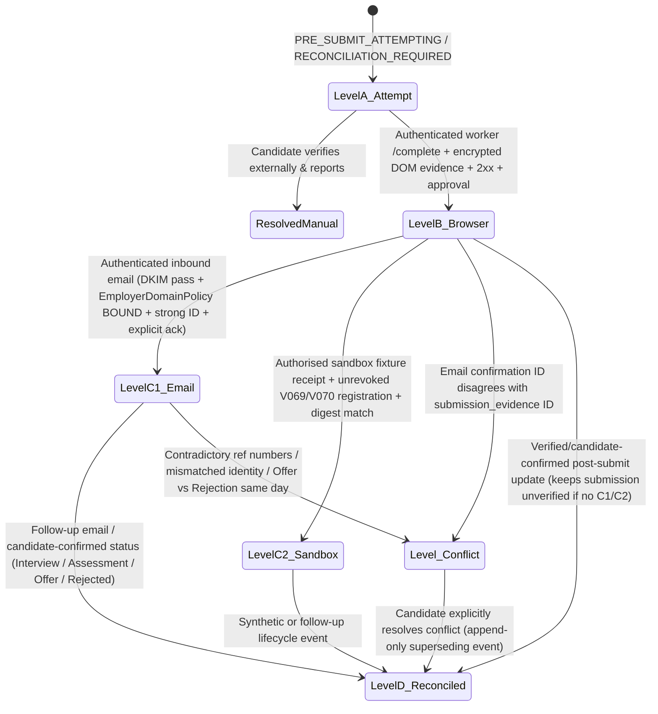
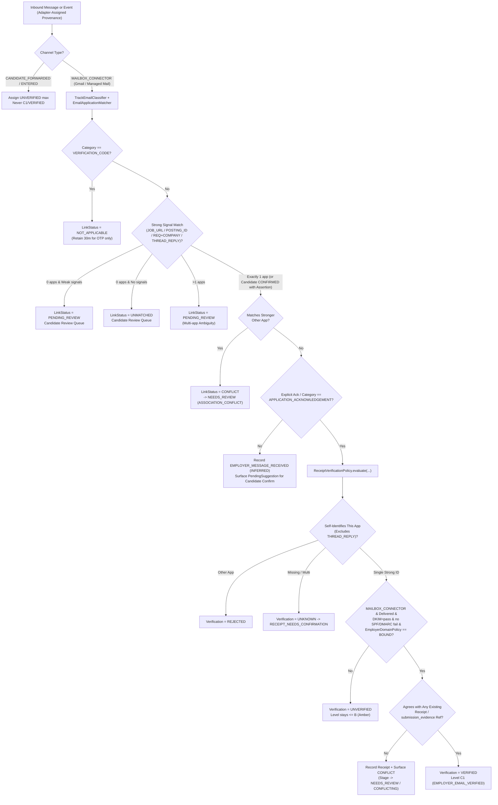
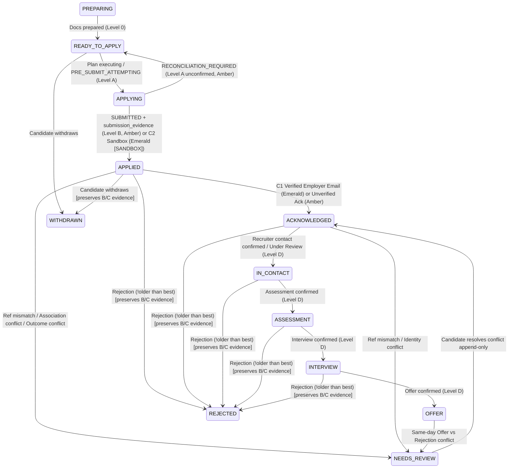

# ROBIN — STAGE 3I PHASE 1: MULTI-CHANNEL UNIVERSAL RECEIPT VERIFICATION & RECONCILIATION ARCHITECTURE

**Date:** 2026-11-26  
**Repository:** `kirankumarJADA/job-agent`  
**Branch:** `integration/wave-3`  
**PR:** `#21` (OPEN / DRAFT — unmerged, targeting `master`)  
**Phase 0 Baseline Commit:** `e1f23991e29cd4a8199a99b43015bfe5e8fff85e`  
**Audit / Prerequisite Reference:** [`docs/STAGE_3H_UNIVERSAL_RECEIPT_VERIFICATION_ARCHITECTURE_AUDIT.md`](./STAGE_3H_UNIVERSAL_RECEIPT_VERIFICATION_ARCHITECTURE_AUDIT.md), [`docs/STAGE_3I_PHASE_0_RECEIPT_TRUST_SECURITY_REMEDIATION.md`](./STAGE_3I_PHASE_0_RECEIPT_TRUST_SECURITY_REMEDIATION.md)  
**Stage Scope:** Phase 0 Cloudflare Edge `message.headers` Trust-Boundary Follow-Up (implemented & tested) + Multi-Channel Universal Receipt Verification, Deterministic Correlation & Reconciliation Architecture Design (Phase 2+ blueprint). **External validation & live employer contact remain blocked.**

---

## 0. Executive Summary

Stage 3I Phase 0 remediated the P0 Managed Mail DKIM forgery vulnerability (`U-SEC-1`), added server-owned employer-domain binding (`EmployerDomainPolicy`), and separated Universal `BROWSER_OBSERVED` (`Level B`) submissions from `RECONCILIATION_REQUIRED` (`Level A`) across backend and UI contracts.

Stage 3I Phase 1 completes two goals:

1. **Cloudflare `message.headers` Trust-Boundary Follow-Up (Implemented in this Stage):**
   - Inspection showed `cloudflare-email-worker/src/index.js` parsed `Authentication-Results` strictly from `message.raw` rather than Cloudflare's documented `ForwardableEmailMessage.headers` interface (`message.headers.get('authentication-results')`). Raw MIME stream header order is **not guaranteed** to preserve Cloudflare's prepended `mx.cloudflare.net` header in identical normalized form vs `message.headers`.
   - Updated `cloudflare-email-worker/src/index.js` and `cloudflare-email-worker/src/mime_parser.js` to extract authentication verdicts strictly from `message.headers`, ignore sender-injected auth headers in `message.raw`, fail closed if `message.headers` is missing/untrusted/conflicting, align `wrangler.toml` / `application.yml` trusted-receiver configuration (`TRUSTED_AUTHSERV_IDS` / `app.managed-mail.cloudflare.trusted-authserv-ids`, defaulting empty fail-closed), and harden `CloudflareInboundParser.java` to require `"authTrusted": true` explicitly.
2. **Unified Multi-Channel Receipt & Reconciliation Architecture (Design Blueprint for Phase 2+):**
   - Formalises the **5-level evidence trust model** (`ATTEMPT_RECORDED`, `BROWSER_OBSERVED`, `EMPLOYER_EMAIL_VERIFIED`, `SANDBOX_VERIFIED`, `EMPLOYER_STATUS_RECONCILED`), specifying trust actors, identity correlation fields, freshness/expiry, revocation, conflict handling, reversibility, and candidate-facing copy.
   - Defines a unified ingestion & verification contract across **7 channels**, clearly separating implemented connectors (Cloudflare/Mailgun Managed Mail, Gmail read-only sync, Universal browser evidence, ATS Sandbox receipts) from disabled/unimplemented channels (Outlook/IMAP stubs, Employer/ATS webhooks, optional Universal Level C2).
   - Maps all required reconciliation states onto Robin's **existing `TrackVocabulary` / `ApplicationReconciler` / `ApplicationReceiptService`** without introducing redundant state enums.
   - Proposes an **additive `V071+` schema evolution** (design only; `V001`–`V070` remain untouched and `V069` sandbox constraints remain strict).

---

## 1. Phase 0 Trust-Boundary Follow-Up: Cloudflare `message.headers` vs `message.raw`

### 1.1 Verification Result: Raw Stream vs Documented Interface

- **Question audited:** Is parsing the first `Authentication-Results` header from `message.raw` guaranteed to preserve the same ordering and value as Cloudflare's documented `message.headers` interface?
- **Finding:** **No.** Cloudflare Email Routing validates SPF/DKIM/DMARC before invoking the Worker, prepends its `Authentication-Results` header identifying `authserv-id = mx.cloudflare.net`, and documents `message.headers.get("Authentication-Results")` as the authoritative interface. Before this fix, `cloudflare-email-worker/src/index.js` passed only `rawText` (decoded from `message.raw`) to `parseMime(...)` and never consulted `message.headers`. Relying on `message.raw` alone diverges from the documented `ForwardableEmailMessage` contract when header ordering, CRLF/unfolding normalization, or mock/runtime envelopes populate `message.headers` independently of `message.raw`.
- **Workers Runtime Constraint:** In Cloudflare Workers, `Headers.prototype.getAll(...)` throws for any header other than `Set-Cookie`. Multi-header `Authentication-Results` values read via `message.headers.get('authentication-results')` are concatenated by Fetch `Headers` in header order using top-level commas (`", "`).

### 1.2 Controls Implemented in Phase 1

| Component | Hardening Applied | Fail-Closed Guarantee |
| :--- | :--- | :--- |
| `cloudflare-email-worker/src/index.js` | Calls `parseMime(rawText, { ignoreAuthHeaders: true })` for MIME body, subject, addresses, and threading hints; calls `extractAuthenticationFromHeaders(message.headers, env.TRUSTED_AUTHSERV_IDS)` strictly on `message.headers` for `spf`, `dkim`, `dkimDomain`, `dmarc`, `authServId`, `authTrusted`, `authConflict`. Checks `x-spam-flag` / `x-spam-status` from both `message.headers` and raw headers defensively (either `"yes"` demotes content retention). | If `message.headers` or `.get()` is absent, or `TRUSTED_AUTHSERV_IDS` is empty, `authTrusted=false` and `spf`/`dkim`/`dkimDomain`/`dmarc` all fail closed to `""` regardless of any header injected into `message.raw`. |
| `cloudflare-email-worker/src/mime_parser.js` | Exports `extractAuthenticationFromHeaders(messageHeaders, trustedAuthServIdsRaw)`. Splits comma-joined Fetch `Headers` entries only outside RFC 5322 comments `(...)` and quotes `"..."`, trusts ONLY entry `0` when its `authserv-id` is explicitly in `TRUSTED_AUTHSERV_IDS`, ignores untrusted upstream headers, rejects conflicting trusted-receiver headers (`authConflict=true`), never falls back to `Received-SPF` or `DKIM-Signature` existence, and preserves `spf`, `dkim`, `dmarc` independently. | Sender-injected `Authentication-Results` or `Received-SPF` in `message.raw`, or an untrusted `authserv-id` leading in `message.headers`, never yields `dkim='pass'` or `authTrusted=true`. |
| `cloudflare-email-worker/wrangler.toml` & `README.md` | Declares `TRUSTED_AUTHSERV_IDS = ""` under `[vars]` (fail-closed default) with explicit instructions to match backend config (`mx.cloudflare.net` when enabling live receiver trust). | Prevents accidental default promotion if deployed without explicit alignment. |
| `backend/.../CloudflareInboundParser.java` | Tightened `authTrusted` check: requires explicit `"authTrusted": true` boolean in Worker JSON; omitting `"authTrusted"` or setting non-boolean/false fails closed (`dkimResult=null`, `dkimDomain=null`, `dmarcResult=null`). | An older or tampered payload omitting `"authTrusted": true` can never retain `dkim=pass` or `dkimDomain`. |
| `backend/.../application.yml` | Binds `app.managed-mail.cloudflare.trusted-authserv-ids` to `${APP_MANAGED_MAIL_CLOUDFLARE_TRUSTED_AUTHSERV_IDS:${CLOUDFLARE_TRUSTED_AUTHSERV_IDS:}}` (empty default). | Backend `ManagedMailSettings.cloudflareTrustedAuthServIds()` stays empty/fail-closed unless configured to match the Worker. |

### 1.3 Live Delivery Honesty Notice

All Cloudflare Email Worker and parser checks in Phase 1 run strictly against local Web `Headers` / `ReadableStream` fixtures and backend unit/integration tests. **No live email delivery through `mail.aplivenosi.com` / Cloudflare Edge MX servers has been executed or proven in this stage.** Live Cloudflare `Authentication-Results` edge behavior remains **UNVERIFIED** until an authorized deployment verification run inspects real Edge headers.

---

## 2. Current Architecture & Reused Services Inventory

Stage 3I Phase 1 extends Robin's existing APPLY → AUTO-APPLY → EXCEPTIONS & RESUME → TRACK modules rather than introducing parallel pipelines:

| Domain | Existing Service / Class | Role Today (Verified in Source) | Extension Role in Multi-Channel Architecture |
| :--- | :--- | :--- | :--- |
| **Worker Execution Evidence** | `worker/src/universal_confirmation.js`, `worker/src/greenhouse_evidence.js` | Classifies browser submit responses (`CONFIRMED`, `RECONCILIATION_REQUIRED` categories); emits sanitized evidence JSON & redacts secrets/disqualified IDs. | Add optional page redirect chain / artifact digest metadata for Level B hardening; never emits Level C/D proof. |
| **Worker Completion Fence** | `SubmissionCompletionService`, `SubmissionEvidenceRepository` (`V069`) | Transactional `PRE_SUBMIT_ATTEMPTING` -> `SUBMITTED` + encrypted AES-GCM `submission_evidence` (`raw_evidence_sha256`, `recorded_via = 'WORKER_COMPLETE_ENDPOINT'`). | Remains sole authoritative writer of Level A (`PRE_SUBMIT_ATTEMPTING`/`RECONCILIATION_REQUIRED`) and Level B raw evidence rows. |
| **Receipt & Sandbox Proofs** | `ApplicationReceiptService`, `ReceiptCaptureService`, `JdbcReceiptStore`, `JdbcReceiptTrustStore`, `SandboxRegistrationPolicy` (`V069`/`V070`) | Revalidates AES-GCM evidence, strict `STRICT_APPROVAL_SQL` candidate approval (`*_SUBMIT_APPROVED` incl. `UNIVERSAL_SUBMIT_APPROVED`), and active `candidate_sandbox_registrations` (`C2`). Distinguishes `BROWSER_OBSERVED` (`Level B`) from `SANDBOX_VERIFIED` (`C2`) and `ATTEMPT_RECORDED` (`A`). | Keep `submission_receipts` dedicated to `Level C2 (SANDBOX_VERIFIED)`. Project linked `Level C1` / `Level D` verification summaries cleanly onto `/receipt` views in Phase 2+. |
| **Managed Mail Ingestion** | `CloudflareInboundParser`, `MailgunInboundParser`, `ManagedInboundService`, `ManagedMailboxService` (`V042`/`V051`) | HMAC-authenticated webhooks, token replay table, envelope-recipient tenant routing, AES-GCM short-TTL content storage, forwards `ConnectorMessage` with fail-closed `SenderAuthentication` to email intelligence. | Remains primary Robin-hosted inbound C1/D channel when `TRUSTED_AUTHSERV_IDS` & backend domain allowlists are aligned (`Mailgun` remains fail-closed for C1 `VERIFIED` unless provider DKIM signing domain metadata is explicitly added). |
| **Connected Gmail Connector** | `GmailOAuthController`, `GmailSyncService`, `GmailMessageMapper`, `GmailConnectionStore` | Read-only OAuth sync, structured `INBOX` label enforcement (excluding `SENT`/`DRAFT`/`SPAM`/`TRASH`), provider `internalDate` timestamps, first `Authentication-Results` checked strictly for `mx.google.com`. | Primary user-owned mailbox C1/D channel. |
| **Email Intelligence & Correlation** | `EmailIntelligenceService`, `TrackEmailClassifier`, `EmailApplicationMatcher` | Deterministic regex classification (`INFERRED`), strong vs weak identity matching (`JOB_URL`, `POSTING_IDENTIFIER`, `REQUISITION_NUMBER`, `THREAD_REPLY` vs `COMPANY_NAME`/`JOB_TITLE`). | Extend with Phase 2 temporal window & confirmation-ID consistency correlation rules without replacing strong-ID rules. |
| **Verification Policy & Reconciliation** | `ReceiptVerificationPolicy`, `EmployerDomainPolicy`, `TrackEvidenceRecorder`, `ApplicationReconciler`, `TrackTrackingService`, `TrackRepository`, `TrackTimelineMapper`, `TrackVocabulary` (`V038`) | Evaluates `EMPLOYER_ACKNOWLEDGEMENT_EMAIL` against `MAILBOX_CONNECTOR` + `dkim=pass` + no `spf`/`dmarc=fail` + `EmployerDomainPolicy` + strong ID + explicit wording; derives candidate-facing `TrackState` from immutable/append-only evidence. | Reuse all existing `Stage`, `Basis`, `SubmissionState`, `AcknowledgementState`, `LinkStatus` vocabularies cleanly for Levels A–D and conflict surfacing. |
| **Disabled Future Stubs** | `ExternalMailboxProviders` (`Outlook`, `Imap`) | Intentionally throw `UnsupportedOperationException` when polled. | Architectural placeholder only; fail closed until Phase 4+ OAuth/IMAP connectors exist. |

---

## 3. Formal 5-Level Evidence Trust Model

### 3.1 Core Invariant

> **Non-Inference Rule:** A higher trust level MUST NEVER be inferred, promoted, or synthesized solely from the presence of a lower level (e.g., browser DOM "Thank you" confirmation NEVER yields `EMPLOYER_EMAIL_VERIFIED` or `SANDBOX_VERIFIED`; a `Level A` click attempt NEVER yields `BROWSER_OBSERVED`; candidate-forwarded emails NEVER become `VERIFIED`).



### 3.2 Trust-Level Matrix (`Level A` through `Level D`)

| Dimension | Level A — `ATTEMPT_RECORDED` | Level B — `BROWSER_OBSERVED` | Level C1 — `EMPLOYER_EMAIL_VERIFIED` | Level C2 — `SANDBOX_VERIFIED` | Level D — `EMPLOYER_STATUS_RECONCILED` |
| :--- | :--- | :--- | :--- | :--- | :--- |
| **Definition** | Submit attempt started or finished with ambiguous/timeout/redirect/validation uncertainty. Outcome unconfirmed. | Authenticated worker observed paired HTTP 2xx submit + same-origin clean DOM confirmation (no negative phrasing/captcha/login-wall) and persisted encrypted `submission_evidence`. | Independently received & cryptographically authenticated employer/ATS email acknowledging receipt, bound to the exact application & employer/ATS domain. | Independently verified server-side submission receipt backed by an active, server-allowlisted `candidate_sandbox_registrations` row. | Post-submission hiring progression (`IN_CONTACT`, `ASSESSMENT`, `INTERVIEW`, `OFFER`, `REJECTED`, `WITHDRAWN`) reconciled into TRACK lifecycle. |
| **Required Evidence** | `automation_plans.status` in `PRE_SUBMIT_ATTEMPTING`, `RECONCILIATION_REQUIRED`, `HANDOFF_REQUIRED` (+ optional `SUBMISSION_RECONCILIATION` structured payload). | `automation_plans.status = 'SUBMITTED'`, strict candidate `*_SUBMIT_APPROVED` audit attestation, `submission_evidence` with `recorded_via = 'WORKER_COMPLETE_ENDPOINT'`, `raw_evidence_status = 'STORED_ENCRYPTED'`, valid AES-GCM decrypt + SHA-256 match, non-empty `observedSignals`. | `emails.channel = 'MAILBOX_CONNECTOR'`, structured provider delivery flag (`INBOX` not `SENT`/`SPAM`/`TRASH` or Managed Mail envelope match), provider `Authentication-Results` (`dkim=pass`, valid `dkimDomain`, no `spf=fail`/`dmarc=fail`), `dkimDomain` & `From` pass `EmployerDomainPolicy.evaluate` (`BOUND`), strong `EmailApplicationMatcher` ID (not `THREAD_REPLY` alone), `explicitReceipt = true`. | All Level B requirements + valid non-disqualified `employer_confirmation_id`, matching server-side `candidate_sandbox_registrations` (`revoked_at IS NULL`, canonical URL + HTTPS + SSRF `AddressGuard`), `submission_receipts` row + `SUBMISSION_RECEIPT_CAPTURED` audit row matching `evidence_sha256`. | For `VERIFIED` email ack/transition: future verified connector/webhook proof; for `IN_CONTACT`/`ASSESSMENT`/`INTERVIEW`/`OFFER`/`REJECTED`: authenticated email classified by `TrackEmailClassifier` **and** confirmed by candidate (`CANDIDATE_CONFIRMED`), or candidate direct report (`CANDIDATE_REPORTED`), or explicit authenticated ATS webhook (Phase 4+). Note: email inferences **alone** remain `INFERRED`/`PendingSuggestion` and do not advance stage! |
| **Trusted Actor / Provider** | Authenticated Browser Worker + Backend DB transition (`PRE_SUBMIT_ATTEMPTING` fence). | Authenticated Browser Worker (`worker_principal='worker'`) + Backend `SubmissionCompletionService` + `SecretCipher`. | Connected Gmail (`mx.google.com` OAuth API) OR Managed Mail Receiver (`mx.cloudflare.net` with matching `TRUSTED_AUTHSERV_IDS` & HMAC webhook). *Candidate-forwarded/entered emails are NEVER C1.* | Backend `ReceiptCaptureService` + `JdbcReceiptStore` + server-configured `SandboxRegistrationPolicy` (optionally corroborated by synthetic fixture signature in Stage 3G). | Mail connector + Candidate confirmation (`ApplicationTrackingService.reviewMessage` / `report`), or future authenticated ATS webhook (Phase 4+). |
| **Required Identity & Correlation Fields** | `profile_id`, `application_id`, `plan_id`, `idempotency_key`, target URL & pre-submit state. | `profile_id`, `application_id`, `plan_id`, `job_id`, `ats_platform`, `target_url`, optional non-disqualified `employer_confirmation_id`, document SHA-256 digests (`attemptCorrelation` JSON). | `profile_id`, `application_id`, `jobs.application_url`/`canonical_url`/`automation_plans.target_url` -> `EmployerDomainPolicy`, strong ID (`JOB_URL`, `POSTING_IDENTIFIER`, or `COMPANY + REQUISITION_NUMBER`), `provider_message_id`/`content_fingerprint`. | `profile_id`, `application_id`, `plan_id`, `sandbox_registration_id`, `evidence_id`, `evidence_sha256`, `approval_audit_id`, `employer_confirmation_id`, canonical URL match. | Linked `application_id` via strong ID or `THREAD_REPLY` (established `LINKED`/`CONFIRMED` thread) or candidate explicit selection. |
| **Freshness & Expiry** | `PRE_SUBMIT_ATTEMPTING` stale/crash blocks silent retry permanently (`PRIOR_ATTEMPT_UNVERIFIED`) until human reconciliation or explicit operator/candidate resolution. | Permanent immutable observation once recorded; does not "expire", though absent independent C1/C2 it remains unverified indefinitely. | Must arrive after application/plan creation (`received_at >= plan_or_app_created - skew`) and within future tolerance (`<= now + 1 day`). Managed Mail raw body purged per TTL (`120m` default), metadata (`30d` default); V038 `application_receipts` & redactions remain durable. | Re-checked dynamically on every read via `revalidateLoadedReceipt`: valid ONLY while `candidate_sandbox_registrations.revoked_at IS NULL`, `approved_at >= registration.approved_at`, and ciphertext decrypt + SHA-256 digest match. | Event time uses provider `internalDate`/signed webhook timestamp (exact) or candidate `occurred_on` (date); missing timestamp is marked `UNKNOWN`, never invented. Rejection/withdrawal applies only when `not older` than latest progress (`!end.sortTime.isBefore(best.sortTime)`). |
| **Revocation & Invalidation Rules** | Superseded only by explicit candidate report (`SUBMITTED`/`WITHDRAWN`), new plan attempt only where safe (never after `PRE_SUBMIT_ATTEMPTING` crash without manual clear), or `FAILED`. | Cannot be silently deleted; if `raw_evidence_ciphertext` fails decryption or SHA-256 check (`EvidenceIntegrityException`), fails closed (`confirmation.confirmed=false`, HTTP 409 on evidence read, `RECONCILIATION_REQUIRED`). | Candidate `reviewReceipt(..., "REJECTED")` removes receipt from live reconciliation (append-only `RECEIPT_REVIEWED` event); dissociating parent email (`reviewMessage` reject/reassign) rejects its derived receipts. Compromise of `dkim`/receiver config prevents future promotion; stored reasons remain audit-visible. | Setting `candidate_sandbox_registrations.revoked_at` invalidates live verification **immediately** on next `revalidateLoadedReceipt` read; receipt row stays immutable for forensic audit. Ciphertext/digest tamper triggers `INVALID` / HTTP 409. | Candidate can correct/reclassify message meaning (`TRACK_MESSAGE_RECLASSIFIED`), superseding earlier interpretation cleanly in append-only `application_events`. Neither rejection nor withdrawal erases prior Level B / C1 / C2 submission evidence. |
| **Conflict Handling** | Blocks retry with `PRIOR_ATTEMPT_UNVERIFIED`; surfaces `RECONCILIATION_REQUIRED` attention banner. | If subsequent C1 email carries a different `employer_confirmation_id` than `submission_evidence`, Phase 2+ raises `SUBMISSION_REFERENCE_CONFLICT` -> `Stage.NEEDS_REVIEW` + `SubmissionState.CONFLICTING`. | Different `external_reference` values across live `application_receipts` -> `RECEIPT_REFERENCE_CONFLICT` (`Stage.NEEDS_REVIEW`, `SubmissionState.CONFLICTING`). Message pointing to app X asserted onto app Y -> `LinkStatus.CONFLICT` -> `ASSOCIATION_CONFLICT`. | Payload mismatch on replay (`findByPlan`) throws `InvalidReceiptException` (HTTP 409) instead of overwriting immutable receipt. | `OFFER` and `REJECTED` on the same UTC day -> `OUTCOME_CONFLICT` (`Stage.NEEDS_REVIEW`). Unconfirmed pre-8.3 inferred status ahead of evidence -> `RECORDED_STATUS_INFERRED` -> `Stage.NEEDS_REVIEW`. |
| **Reversibility** | Forward to B if late `/complete` never occurs -> wait: `/complete` is single-attempt; practically A moves to manual report or resolved attempt. | **Irreversible** down to A unless evidence integrity corrupts (then degrades to failed integrity / unverified). Can upgrade to C1 or C2. | Upgrade B -> C1 is reversible *only* via candidate `REJECTED` review or email dissociation (appends `RECEIPT_REVIEWED`; falls back to Level B / `UNVERIFIED`, never back to "not attempted"). | Live C2 trust is **immediately revocable** via `sandboxRegistration.revoke()` (falls back to `UNVERIFIED` / `reconciliation.required=true` fail-closed). DB rows stay immutable. | Progress stages are **monotonic** (`APPLIED -> ACKNOWLEDGED -> IN_CONTACT -> ASSESSMENT -> INTERVIEW -> OFFER`); weaker/older evidence never pulls stage backward. Terminal `REJECTED` / `WITHDRAWN` stops active progress without deleting prior submission/ack history. |
| **Candidate-Visible Language** | Stage: `Prepared — not submitted` or `Application started` (Amber pill). Submission: *"Submission click attempted — outcome unconfirmed; verify directly with employer before retrying."* | Stage: `Applied — not verified` (Amber pill, NEVER green). Submission: *"Submitted in browser — observed confirmation page, not yet verified by employer."* (`verificationLevel = BROWSER_OBSERVED`). | Stage: `Acknowledged by the employer — verified` (Emerald pill). Acknowledgement: *"Verified acknowledgement"*. Summary: *"Employer acknowledgement verified via authenticated email."* | Stage: `Applied — verified` with explicit `[SANDBOX]` qualifier in UI (Emerald + Sandbox tag). Summary: *"Verified synthetic sandbox submission receipt (not a live employer)."* | `Employer in contact`, `Assessment requested`, `Interview`, `Offer`, `Not progressed`, `Withdrawn`, or `Needs your review` (`NEEDS_REVIEW`, Red pill when conflicted; Amber/Muted when awaiting review). |

---

## 4. Multi-Channel Evidence Architecture

### 4.1 Integrated vs Stubbed vs Future Channel Boundary

Only channels implemented end-to-end are treated as active below:

- **Active / Implemented:** Channel 1 (Robin Managed Mail — Cloudflare & Mailgun), Channel 2 (Connected Gmail), Channel 5 (Universal Browser-Observed), Channel 6 (ATS Sandbox Receipts in `submission_receipts`), Channel 7 (Post-Submission Recruiter/Lifecycle Updates via existing mail + candidate tracking APIs).
- **Disabled / Not Integrated (Must Fail Closed):** Channel 3 (`ExternalMailboxProviders.Outlook` / `Imap` throw `UnsupportedOperationException`), Channel 4 (Employer/ATS Inbound Webhooks — no endpoint exists yet), and Channel 6 extension for `UNIVERSAL` synthetic DO fixture (`SandboxRegistrationPolicy` permits ATS formats; `ALLOWED_ATS_PLATFORMS` in `ReceiptCaptureService` excludes `UNIVERSAL`).

### 4.2 Unified Channel Integration Matrix

| # | Channel & Status | Authentication & Provider Provenance | Message / Event Identity & Replay Protection | Tenant / Profile Isolation | Application Correlation | Evidence Integrity & Storage | Duplicate & Out-of-Order Handling | Retry & Dead-Letter / Rejection |
| :--- | :--- | :--- | :--- | :--- | :--- | :--- | :--- | :--- |
| **1** | **Robin Managed Mail** (`Cloudflare` Edge Worker / `Mailgun` webhook) *(Implemented)* | HMAC-SHA256 webhook signature (`X-Robin-Timestamp` / `X-Robin-Token` / `X-Robin-Signature` over `ts.token.payloadSha256`; max age 900s). Auth verdicts **only** from `message.headers.get('authentication-results')` with `authserv-id` in aligned `TRUSTED_AUTHSERV_IDS` & `app.managed-mail.cloudflare.trusted-authserv-ids` (`CloudflareInboundParser` requires `authTrusted=true`). Mailgun stays `UNVERIFIED` without `dkimDomain`. | `managed_mail_webhook_tokens` (`token_sha256`, `payload_sha256`): same token + same digest = 200 idempotent; same token + different digest = 406 `REPLAYED_TOKEN`. Message dedup by `(address_id, message_id_sha256)` and `(address_id, content_sha256)`. | Routed strictly by SMTP `envelopeRecipient` (`To` header ignored) via `managed_mail_addresses` `(id, profile_id)` composite FK -> owner `profile_id` passed explicitly to `EmailIntelligenceService`. | Strong matchers (`JOB_URL`, `POSTING_IDENTIFIER`, `REQUISITION_NUMBER`, `THREAD_REPLY`) + `EmployerDomainPolicy` (`BOUND` required for C1 `VERIFIED`); weak matches -> `PENDING_REVIEW`. | Short-TTL AES-GCM ciphertext (`content_encrypted`, purged after use/TTL) + redacted subject in `managed_inbound_messages`; redacted excerpt + auth JSON + `application_receipts` (`CHANNEL=MAILBOX_CONNECTOR`) in `emails`. | Provider retries collapse cleanly on token hash or `message_id_sha256` / `content_sha256` (no duplicate receipts or timeline rows). Out-of-order emails before/after submit wait in review or reconcile deterministically via event timestamp. | 406 terminal rejection -> Worker calls `message.setReject()` (`UNKNOWN_RECIPIENT`, `MALFORMED`, `WRONG_DOMAIN`, `REPLAYED_TOKEN`). 503 (e.g. maintenance mode / DB down) -> Worker throws so Cloudflare MTA retries automatically. Dead-letter visibility via Edge Worker metrics/logs. |
| **2** | **Connected Gmail Mailbox** *(Implemented)* | Google OAuth2 refresh token encrypted at rest (`GmailTokenCipher`) + read-only scope. Only `labelIds` containing `INBOX` and excluding `SENT`/`DRAFT`/`SPAM`/`TRASH`. First `Authentication-Results` must have `authserv-id = mx.google.com`. Receipt time strictly from Gmail `internalDate` (ignores sender `Date` header). | Provider Gmail `message.id` stored in `emails(profile_id, message_id)` + `content_fingerprint` unique per profile. Initial scan & incremental `historyId` pagination cursor + `history_pending_ids` backlog (`GmailConnectionStore`). | Every OAuth token, state nonce (`gmail_oauth_states`), query, and sync runs per authenticated `profile_id`. Reconnecting a different Google address resets cursors cleanly. | Identical `EmailApplicationMatcher` + `EmployerDomainPolicy` + `ReceiptVerificationPolicy` pipeline via `EmailIntelligenceService.ingestFromMailboxConnector("gmail", ...)`. | Minimal redacted excerpt only (`body_retained=false` except 30m OTP); `sender_authentication` JSONB + `application_receipts` + immutable/append-only `application_events`. | Replayed `message.id` returns `replayed=true` cleanly without duplicate notifications/receipts. Out-of-order messages ordered by `internalDate` (`EXACT`), bounded initial 90d lookback. | HTTP 404 (deleted draft/message) skips cleanly; 401/403 or revoked refresh token sets `REAUTH_REQUIRED` (stops polling); 429 marks `RATE_LIMITED`; transient failures preserve cursor boundary so nothing is skipped. |
| **3** | **Future Mailbox Providers** (`Outlook` / Microsoft Graph, `IMAP` IDLE/poll) *(Designed / Stubbed)* | Must use read-only OAuth (Graph) or TLS IMAP with provider/trusted MTA `Authentication-Results` (`authserv-id` configured allowlist) and structured folder/direction provenance (`Inbox` received vs `Sent`). Currently `ExternalMailboxProviders` fails closed (`UnsupportedOperationException`). | Provider immutable `internetMessageId` / UIDVALIDITY+UID + content hash per profile; cursor state in generalized `mailbox_connections` (`V071+` or provider column extension). | Dedicated per-`profile_id` encrypted credential ref + `mailboxAddress` verification; never shares tokens across profiles. | Normalizes into `EmailIntelligenceService.ConnectorMessage` so correlation & `EmployerDomainPolicy` behave identically across all mail providers. | Same body minimization, redacted excerpts, `emails` + `application_receipts` (`Channel.MAILBOX_CONNECTOR`). | Cursor checkpoints commit only after batch persistence; duplicate deliveries hit `(profile_id, message_id)` unique index. | Token revocation transitions connection to `REAUTH_REQUIRED`; rate limits back off without advancing cursor; malformed messages enter quarantined unverified metadata or skip cleanly. |
| **4** | **Employer / ATS Webhooks** (`Greenhouse`, `Lever`, `Ashby`, `Workday`, signed employer HTTP callbacks) *(Designed / Not Integrated)* | Mandatory cryptographic authenticity before acceptance: verified HMAC-SHA256 / Ed25519 / asymmetric JWKS webhook signature with timestamp replay window + sender allowlist/tenant signature key (`X-Webhook-Id` / `Signature` header) bound to the exact ATS tenant or corporate domain. Unsigned webhooks rejected 401/403. | Required `(provider_id, delivery_id)` + payload SHA-256 unique idempotency ledger (mirroring `managed_mail_webhook_tokens` pattern) + monotonically versioned event timestamps. | Tenant/installation binding table mapping signed webhook installation/candidate token strictly to authorized `(profile_id, application_id)` or candidate-scoped webhook secret — never trusts unverified body `candidateEmail` alone across profiles! | Direct ATS `application_id` / candidate-application external token issued at submission or `job_id` + `employer_confirmation_id` lookup scoped to the resolved profile; ambiguous/unbound deliveries refused (`406`/`422`) or quarantined for review. | Immutable raw signed webhook envelope stored AES-GCM encrypted with SHA-256 (`V071+` `external_webhook_receipts` or generalized `application_receipts` + provenance JSONB) + append-only `application_events` (`EXTERNAL`). | Replay of same `(provider_id, delivery_id)` + same `payload_sha256` returns 200 idempotent; same ID + different digest rejected as replay attack (`406`). Out-of-order stage webhooks (`INTERVIEW` before `RECEIVED`) evaluated cleanly by timestamp in `ApplicationReconciler`. | 200 terminal ack only inside DB transaction commit; 503 on transient DB failure for provider backoff; dead-letter inspection queue for signature-valid but schema-drift / unknown-correlation payloads (never silently dropped or auto-promoted). |
| **5** | **Universal Browser-Observed Submission Evidence** *(Implemented — Level B)* | Worker authenticates via mTLS/bearer (`WORKER_EVENT_TOKEN` / principal `'worker'`) to `/complete`. Requires server-verified candidate `UNIVERSAL_SUBMIT_APPROVED` audit row and server-executed `PRE_SUBMIT_ATTEMPTING` fence. | Single winner per `automation_plans` via `PRE_SUBMIT_ATTEMPTING` DB atomic lock + unique `submission_evidence.plan_id` + unique `applications` active `SUBMITTED` index (`V043`). | Every query, completion, and evidence read scopes by `(profile_id, application_id, plan_id)`. Cross-profile access returns 404. | Direct FK chain: `plan_id` -> `application_id` -> `job_id`. Stores `attemptCorrelation` (`planId`, `applicationId`, `jobId`), `target_url`, `redirectChain` (Phase 2), and document SHA-256 digests. | Encrypted AES-GCM JSON (`raw_evidence_ciphertext`) + server SHA-256 (`raw_evidence_sha256`) in immutable `submission_evidence` (`V069`, BEFORE UPDATE trigger). | Second `/complete` fails on unique `plan_id` / `SUBMITTED` index (409); crash after `PRE_SUBMIT_ATTEMPTING` transitions to `RECONCILIATION_REQUIRED` and refuses retry (`PRIOR_ATTEMPT_UNVERIFIED`). | Missing confirmation (`FORM_STILL_PRESENT`, `CONFIRMATION_UNOBSERVED`, `UNEXPECTED_ORIGIN_REDIRECT`) -> `RECONCILIATION_REQUIRED` (`Level A`, no retry). Server 5xx rolls back transaction cleanly before claiming `SUBMITTED`. |
| **6** | **Authorised Synthetic Employer Sandbox Receipts** *(Implemented for ATS; Universal C2 Optional Phase 3 Design)* | Server-side `candidate_sandbox_registrations` row validated by `SandboxRegistrationPolicy` (HTTPS only outside isolated test mode, SSRF `AddressGuard`, explicit `allowed-domains` & `allowed-path-prefixes`, `revoked_at IS NULL`) + `ReceiptCaptureService` field-by-field parity check against `submission_evidence` and `STRICT_APPROVAL_SQL`. Optional Stage 3G signed fixture header (`X-Sandbox-Receipt-Signature`). | Unique `(plan_id)` + unique `idempotency_key` in `submission_receipts` (`V069`), shared row lock (`FOR SHARE`) on `candidate_sandbox_registrations` during insert to serialize `/revoke` races. | Composite `(profile_id, application_id, plan_id)` enforcement + per-profile unique active registration index (`V070`). | Exact `plan_id`, `evidence_id`, `sandbox_registration_id`, non-disqualified `employer_confirmation_id`, canonicalized URL match (`canonicalizePostingUrlForMatch`). | Immutable `submission_receipts` + `SUBMISSION_RECEIPT_CAPTURED` audit row in one transaction; live re-decryption & digest re-verification on every read. | Replay with identical evidence returns existing receipt idempotently; replay with differing digest/confirmation ID throws `409 Conflict` / `InvalidReceiptException`. | Missing/revoked sandbox or unstored raw evidence -> fails closed (`UNVERIFIED` / `INVALID`, `reconciliation.required=true` for ATS sandboxes). No dead-letter needed; capture is synchronous/re-evaluatable via `tryCaptureForPlan`. |
| **7** | **Later Employer Status Messages & Recruiter Updates** *(Implemented for Email + Candidate Reports; Webhook Future)* | Mail messages enter via Channels 1–3 (`MAILBOX_CONNECTOR`) or manual forward (`CANDIDATE_FORWARDED`); direct candidate stage reports enter via authenticated API (`CANDIDATE_REPORTED`). | `application_events(application_id, event_key)` unique index (`track-email:<id>`, `track-report:<kind>:<key>`, `track-email-review:<id>:v<N>`). Optimistic locking (`decision_version`, `review_version`). | Owner-scoped queries on `profile_id` across `emails`, `email_application_links`, `application_events`, `application_receipts`. | Strong ID or `THREAD_REPLY` establishes link (`LINKED`), but non-acknowledgement meanings (`INTERVIEW`, `ASSESSMENT`, `OFFER`, `REJECTION`, `RECRUITER_FOLLOW_UP`) remain `INFERRED` (`PendingSuggestion`) until candidate confirms (`CONFIRMED` -> `Basis.CANDIDATE_CONFIRMED`), EXCEPT future verified ATS webhooks (Phase 4). | Append-only `application_events` with DB-level invariant `classification='EXTERNAL' or verification_status<>'VERIFIED'` (`V038`). | Duplicate syncs hit idempotent `event_key`; out-of-order messages sorted deterministically by `sortTime = coalesce(eventTime, recordedAt)` in `ApplicationReconciler`. | Conflicting manual choices -> `409 TrackConflictException` or `LinkStatus.CONFLICT`; inferred/ambiguous items wait indefinitely in `reviewQueue` without blocking historical submission facts. |

### 4.3 Canonical Ingestion Envelope (Design Contract)

All inbound evidence channels (Managed Mail, Gmail, future IMAP/Graph, future ATS webhooks, and synthetic sandbox callbacks) normalize onto a server-assigned provenance boundary before reaching TRACK:

```text
ChannelAdapter (TrustedBoundary)
  ├── channel          : MAILBOX_CONNECTOR | CANDIDATE_FORWARDED | CANDIDATE_ENTERED | WEBHOOK_CONNECTOR (future V071+)
  ├── providerId       : cloudflare | mailgun | gmail | outlook | imap | greenhouse_webhook | ...
  ├── providerEventId  : messageId / deliveryId (immutable, server-verified from transport)
  ├── receivedAt       : provider timestamp (internalDate / HMAC signedAt / webhook timestamp; NEVER sender Date header)
  ├── timePrecision    : EXACT | DATE | UNKNOWN
  ├── senderAuth       : { dkim, dkimDomain, spf, dmarc, authServId, authTrusted, authConflict, deliveryProven }
  ├── externalRefs     : { employerConfirmationId, requisitionToken, postingId, atsPlatform, threadRefs[] }
  └── payloadDigest    : server-computed SHA-256 of canonical raw evidence / payload
```

*Invariant:* `channel`, `providerId`, `receivedAt`, `deliveryProven`, and `senderAuth` are **always assigned by the verified adapter/server boundary**, never copied from user-supplied request fields or email MIME headers outside trusted receiver validation.

---

## 5. Deterministic Correlation & Reconciliation State Machine

### 5.1 Deterministic Correlation Pipeline

Inbound messages and external events correlate strictly within `ownerProfileId`'s own applications (`ownedApplicationsForMatching`):

1. **Pre-Filter (Non-Evidence):** `EmailCategory.VERIFICATION_CODE` (OTP sign-in codes) -> `LinkStatus.NOT_APPLICABLE`. Never creates receipts or moves stages.
2. **Strong Identity Signals (`MatchStrength.STRONG`):**
   - `JOB_URL`: Normalized URL matches `jobs.application_url`, `jobs.canonical_url`, or `job_identity_keys('url:...')`.
   - `POSTING_IDENTIFIER`: Parsed ATS posting key (`JobIdentity.atsKey`) matches `application_url`/`canonical_url`/`job_identity_keys('ats:...')`.
   - `REQUISITION_NUMBER`: Both `app.company` AND exact `req:<employerKey>:<token>` appear in message text/subject.
   - `THREAD_REPLY`: Message `thread_id`, `In-Reply-To`, or `References` matches a prior email already `LINKED` or `CONFIRMED` to that single owner application. **Rule:** `THREAD_REPLY` establishes conversational linking for follow-ups, but **`ReceiptVerificationPolicy` refuses to accept `THREAD_REPLY` alone as receipt identity evidence (`identityEvidence` omits `THREAD_REPLY`)**!
3. **Employer-Domain Binding (`EmployerDomainPolicy` — Required for C1 `VERIFIED`):**
   - Extracts server-owned targets from `jobs.application_url`, `jobs.canonical_url`, and `automation_plans.target_url` (plus `SubmissionEvidence.targetUrl` / Phase 2 `redirectChainHosts`).
   - Verifies both authenticated `dkimDomain` and header `From` domain match either:
     - Corporate registrable domain (PSL-aware for `.co.uk`, `.com.au`, etc.; isolates multi-tenant hosting suffixes like `.github.io` / `.herokuapp.com` / `.workers.dev`),
     - Recognized ATS notification domains (`greenhouse.io`/`greenhouse-mail.io`, `ashbyhq.com`, `lever.co`, `myworkday.com`, etc.), or
     - Explicit operator mapping (`app.track.vetted-sender-mappings`).
   - Mismatches (`UNBOUND_MISMATCH`) or unknown targets (`UNBOUND_UNKNOWN`, e.g., generic aggregator URLs) **fail closed** to `Verification.UNVERIFIED`.
4. **Phase 2+ Correlation & Cross-Check Hardening (Designed Extension):**
   - **Temporal Plausibility Check:** External acknowledgement `received_at` earlier than `min(application.created_at, plan.created_at) - 5m` skew MUST NOT promote C1 automatically (flagged `UNVERIFIED` / `TEMPORAL_ANOMALY_REVIEW` for candidate check) — existing future-dated > 1d check (`FUTURE_DATED -> REJECTED`) remains intact.
   - **Browser-vs-Email Reference Cross-Check:** When both `submission_evidence.employer_confirmation_id` (Level B) and an email `application_receipts.external_reference` (Level C1) are non-null for the same application/plan and disagree (after whitespace/case normalization), `ApplicationReconciler` surfaces `SUBMISSION_REFERENCE_CONFLICT` -> `Stage.NEEDS_REVIEW`, `SubmissionState.CONFLICTING` (parallel to existing `RECEIPT_REFERENCE_CONFLICT` across multiple emails).
   - **Multi-Tenant Direct Corporate vs Branded ESP Policy Decision:** Employers submitting on custom domains (`careers.acme.com`) who send acknowledgements from a delegated recruiting ESP (`@greenhouse-mail.io` or `em123.acme.com`) pass `EmployerDomainPolicy` automatically when `em123.acme.com` shares registrable domain `acme.com` or uses configured `app.track.vetted-sender-mappings`. Unmapped third-party ATS mailers from custom domains stay `UNVERIFIED` rather than weakening domain binding.

### 5.2 Hard Correlation Invariants

- **Rule 1:** Never associate an email automatically solely because the company name or job title matches (`WEAK_SIGNALS_ONLY` -> always `LinkStatus.PENDING_REVIEW`).
- **Rule 2:** Never let a sender-provided job URL establish sender authenticity (URL correlation proves *which application* an email talks about; only trusted receiver DKIM + `EmployerDomainPolicy` proves *who sent it*).
- **Rule 3:** Never silently merge conflicting application identities (matching >1 strong app -> `PENDING_REVIEW`; asserting app X when strong IDs point to app Y -> `LinkStatus.CONFLICT` -> `Stage.NEEDS_REVIEW`).
- **Rule 4:** Ambiguous or unmatched messages enter candidate review (`PENDING_REVIEW` / `UNMATCHED`) and never mutate stage without candidate choice (`CONFIRMED`).
- **Rule 5:** Duplicate messages and repeated webhook events MUST be idempotent (`on conflict do nothing` by `(profile_id, message_id)`, `(profile_id, content_fingerprint)`, `token_sha256`, `event_key`, `(application_id, fingerprint)`, `plan_id`).
- **Rule 6:** A later `REJECTED` or `WITHDRAWN` signal MUST NOT erase historical Level B (`submission_evidence`), Level C1 (`application_receipts`), or Level C2 (`submission_receipts`) submission records — submission proof remains intact in `submission` view and timeline!
- **Rule 7:** Conflicting status/reference events MUST be preserved append-only and surfaced via `Conflicts` (`NEEDS_REVIEW` + `SubmissionState.CONFLICTING`), never overwritten silently.

### 5.3 Correlation & Verification Decision Flow



### 5.4 Unified Reconciliation State Machine (`TrackVocabulary` Reuse)

No redundant status enum is introduced. Every required conceptual state in Stage 3I maps deterministically onto existing `TrackVocabulary.Stage`, `Basis`, `SubmissionState`, `AcknowledgementState`, `LinkStatus`, and `automation_plans.status`:

| Conceptual Reconciliation State | Existing Backend Representation (`TrackVocabulary` + `automation_plans`) | Authoritative Sources Allowed to Produce It | UI Pill / Badge & Semantics |
| :--- | :--- | :--- | :--- |
| **Preparing / Ready** | `Stage.PREPARING` / `Stage.READY_TO_APPLY` + `Basis.INTERNAL` + `SubmissionState.UNKNOWN` | Document prep events; approved plan prior to execution attempt. | Neutral/Blue; explicitly states nothing sent yet. |
| **`SUBMITTED` (with Level C2 / C1)** | `Stage.APPLIED` + `Basis.VERIFIED` (`SubmissionState.CONFIRMED`) or upgraded to `Stage.ACKNOWLEDGED` (`Level C1`) | `Level C2`: `automation_plans.status='SUBMITTED'` + valid unrevoked `submission_receipts`. `Level C1`: Verified employer ack email. | Emerald (`[SANDBOX]` badge if C2 without C1; verified employer copy if C1). |
| **`UNVERIFIED` / `SUBMITTED` (Level B) / `ATTEMPT` (Level A)** | • **Level A:** `Stage.READY_TO_APPLY`/`APPLYING` + `Basis.INTERNAL` + `plan.status='RECONCILIATION_REQUIRED'` + `SubmissionState.UNVERIFIED`<br>• **Level B:** `Stage.APPLIED` + `Basis.UNVERIFIED` (`plan.status='SUBMITTED'`, `verificationLevel='BROWSER_OBSERVED'`) + `SubmissionState.UNVERIFIED`<br>• **Unverified Ack/Report:** `Stage.APPLIED`/`ACKNOWLEDGED` + `Basis.UNVERIFIED` or `CANDIDATE_REPORTED` | Worker `RECONCILIATION_REQUIRED` (`A`), clean `submission_evidence` without C1/C2 (`B`), failed-DKIM / unbound-domain / candidate-added acknowledgement (`UNVERIFIED`). | **Strictly Amber (`amber`)**, never emerald. Explicitly distinguishes unconfirmed attempt vs browser observation vs unverified user claim. |
| **`RECEIVED`** | `Stage.ACKNOWLEDGED` (`AcknowledgementState.VERIFIED` for C1, `UNVERIFIED` for candidate/weak-channel ack, `Basis.CANDIDATE_CONFIRMED` if confirmed) | `application_receipts` (`EMPLOYER_ACKNOWLEDGEMENT_EMAIL`) or future verified ATS webhook (`RECEIVED` ack). | Emerald ONLY when `AcknowledgementState.VERIFIED` (`C1`). |
| **`UNDER_REVIEW`** | `Stage.IN_CONTACT` ("Employer in contact" — existing enum slot #4 after `ACKNOWLEDGED`) | Candidate-confirmed `RECRUITER_FOLLOW_UP` / `INFORMATION_REQUEST` email, `CANDIDATE_REPORT(RECRUITER_CONTACT)`, or future verified ATS webhook `UNDER_REVIEW` status. | Standard active progression; email inference alone produces only `PendingSuggestion` (never moves stage). |
| **`ASSESSMENT`** | `Stage.ASSESSMENT` ("Assessment requested") | Candidate-confirmed `ASSESSMENT_INVITATION` email, `CANDIDATE_REPORT(ASSESSMENT)`, or future verified ATS webhook. | Active progression (`CANDIDATE_CONFIRMED`, `CANDIDATE_REPORTED`, or future `VERIFIED`). |
| **`INTERVIEW`** | `Stage.INTERVIEW` ("Interview") | Candidate-confirmed `INTERVIEW_INVITATION` email, `CANDIDATE_REPORT(INTERVIEW)`, or future verified ATS webhook. | Active progression. |
| **`OFFER`** | `Stage.OFFER` ("Offer") | Candidate-confirmed `OFFER` email, `CANDIDATE_REPORT(OFFER)`, or future verified ATS webhook. | Furthest non-terminal progress stage (`progress = 7`). |
| **`REJECTED`** | `Stage.REJECTED` ("Not progressed") | Candidate-confirmed `REJECTION` email, `CANDIDATE_REPORT(REJECTED)`, or future verified ATS webhook when `!sortTime.isBefore(best.sortTime)`. | Terminal end-of-process; **preserves `submission` & prior ack receipts intact**. |
| **`WITHDRAWN`** | `Stage.WITHDRAWN` ("Withdrawn") | Owner action (`applications.status = 'WITHDRAWN'`) or `CANDIDATE_REPORT(WITHDRAWN)`. | Terminal (`Basis.INTERNAL` or `CANDIDATE_REPORTED`); preserves prior submission records; surfaces `ACTIVITY_AFTER_WITHDRAWAL` if later employer activity arrives. |
| **`UNKNOWN`** | `Stage.UNKNOWN` (`recordedStatus` lacks audit origin) / `SubmissionState.UNKNOWN` (no submission evidence) / `Verification.UNKNOWN` | Unexplained legacy status or email acknowledgement lacking identifying URL/req/posting ID. | Muted/Amber review prompt; never guesses progression. |
| **`CONFLICT`** | `Stage.NEEDS_REVIEW` (`basis = null`) + `SubmissionState.CONFLICTING` + `LinkStatus.CONFLICT` | `ASSOCIATION_CONFLICT`, `RECEIPT_REFERENCE_CONFLICT`, `SUBMISSION_REFERENCE_CONFLICT` (Phase 2), `OUTCOME_CONFLICT` (Offer & Rejection same day), `RECORDED_STATUS_INFERRED`. | **Red conflict pill (`red`)**; halts automated promotion until resolved cleanly by candidate review. |



*Precedence & Ordering Summary in `ApplicationReconciler`:*
1. Robin-internal `WITHDRAWN` / `FAILED` -> `WITHDRAWN` / `STOPPED` (`Level B/C` submission record still preserved on `submission` sub-view!).
2. Conflicts (`RECEIPT_REFERENCE_CONFLICT`, `SUBMISSION_REFERENCE_CONFLICT`, `ASSOCIATION_CONFLICT`, `OUTCOME_CONFLICT`, `RECORDED_STATUS_INFERRED`) take priority over stage promotion -> `Stage.NEEDS_REVIEW`, `basis = null`.
3. `automation_plans.status = 'SUBMITTED'` establishes baseline `Stage.APPLIED` (`Basis.VERIFIED` only for C2 `submission_receipts`, otherwise `Basis.UNVERIFIED` for Level B), **unless** eligible `C1` (`ACKNOWLEDGED`) or `Level D` (`IN_CONTACT`, `ASSESSMENT`, `INTERVIEW`, `OFFER`, `REJECTED`) progress has advanced beyond `APPLIED` (`progress > 2`), in which case the stage advances cleanly to the furthest reconciled stage while `submission` continues reporting `CONFIRMED` (C1/C2) or `UNVERIFIED` (Level B)! *(Phase 2 fix required in `ApplicationReconciler`: currently lines 276-290 return early at `Stage.APPLIED` for `SUBMITTED` plans instead of allowing `deciding` when `C1`/`Level D` progress exists ahead of `APPLIED`!)*

---

## 6. Durable Storage & Additive `V071+` Migration Proposal (Design Only)

### 6.1 Current Schema Fitness (`V001`–`V070` Remain Immutable)

- **`V038` (`application_receipts`, `application_events`, `emails`, `email_application_links`):**
  - Already enforces `channel IN ('MAILBOX_CONNECTOR', 'CANDIDATE_FORWARDED', 'CANDIDATE_ENTERED')` and `channel = 'MAILBOX_CONNECTOR' or verification_status <> 'VERIFIED'`.
  - Already enforces `application_events_verified_is_external_check` (`verification_status <> 'VERIFIED' or classification = 'EXTERNAL'`).
  - **Gap for Phase 2+:** `application_receipts` has no link to `plan_id` / `submission_evidence_id`, no durable record of evaluated `matched_employer_domain`, `domain_binding_status`, `dkim_domain`, or `auth_serv_id`, and `channel` check does not yet admit future signed `WEBHOOK_CONNECTOR`.
- **`V069` & `V070` (`submission_evidence`, `candidate_sandbox_registrations`, `submission_receipts`):**
  - `submission_evidence` stores encrypted Level B evidence cleanly per `(plan_id)` with `employer_confirmation_id` nullable and an immutable `BEFORE UPDATE` trigger.
  - `submission_receipts` intentionally requires **`NOT NULL sandbox_registration_id` and `NOT NULL employer_confirmation_id`**. **It MUST NOT be altered to accept real-employer or non-sandbox receipts**, because doing so would weaken its sandbox-revocation & confirmation-ID guarantees.

### 6.2 Proposed Additive `V071+` Evolution (Not Applied in Phase 1)

| Requirement | Proposed `V071+` Additive Change (Design Only) | Safety & Backward-Compatibility Invariant |
| :--- | :--- | :--- |
| **1. Evidence provenance & trust linking (`universal_verification_links` / `evidence_ingest_events`)** | New immutable table `application_receipt_links` (or `submission_verifications`) linking `(id, profile_id, application_id, plan_id nullable FK, submission_evidence_id nullable FK -> submission_evidence(id) ON DELETE RESTRICT, application_receipt_id FK -> application_receipts(id) ON DELETE RESTRICT, verification_level text CHECK (...), reference_consistency text CHECK ('ALIGNED','CONFLICTING','NOT_COMPARABLE'), linked_at timestamptz)` + immutable `BEFORE UPDATE` trigger reusing `reject_receipt_record_update()`. | Leaves V069 `submission_receipts` 100% dedicated to `Level C2 (SANDBOX_VERIFIED)`. Never lets `submission_evidence` or `submission_receipts` relax constraints. `ON DELETE RESTRICT` + profile-cascade purge safety mirroring V069. |
| **2. Channel & provider identity (`V071` additive columns on `application_receipts` / `emails`)** | Add nullable columns to `application_receipts`: `provider_id text`, `auth_serv_id text`, `dkim_domain text`, `domain_binding_status text`, `matched_employer_domain text`, `plan_id uuid references automation_plans(id) on delete set null`. Later (Phase 4 webhooks), expand `channel` CHECK additively to `('MAILBOX_CONNECTOR', 'WEBHOOK_CONNECTOR', 'CANDIDATE_FORWARDED', 'CANDIDATE_ENTERED')` keeping `channel in ('MAILBOX_CONNECTOR', 'WEBHOOK_CONNECTOR') or verification_status <> 'VERIFIED'`. | Legacy V038 rows keep `provider_id = NULL` safely; DB CHECK guarantees candidate inputs remain permanently incapable of reaching `VERIFIED`. |
| **3. Future Webhook Ingestion Ledger (Phase 4)** | `employer_webhook_deliveries (id, profile_id, provider_id, delivery_id, event_type, external_application_ref, signature_key_id, payload_sha256, raw_ciphertext, status, received_at)` + `unique (provider_id, delivery_id)` for idempotency & replay detection (`same delivery_id + different sha256 -> REJECT_REPLAY`), modeled directly on V042 `managed_mail_webhook_tokens`. | Mirrors fail-closed token-replay defense of Managed Mail; isolates webhook verification from mail flow until implemented. |
| **4. Correlation decisions & reference conflicts** | Persist structured correlation rationale JSONB (`applied_urls`, `redirect_chain_hosts`, `matched_strong_keys`, `temporal_check`) on receipt/link rows so every reconciliation state (`Stage`, `Conflict`) is 100% reproducible from DB state alone. | Ensures `ApplicationReconciler` remains pure & repeatable on any historical snapshot. |
| **5. Browser-Observed `submission_evidence` redirect metadata** | Add optional nullable `redirect_chain_hosts jsonb default '[]'::jsonb`, `evidence_schema_version text` to `submission_evidence` ONLY when Phase 2 needs cross-host SSO redirect verification (`careers.acme.com` -> `login.acme.com`). | Existing V069 rows unaffected; immutable trigger stays active. |
| **6. Tenant isolation & indexes** | Every new table carries `profile_id uuid NOT NULL REFERENCES profiles(id) ON DELETE CASCADE` and composite/indexed predicates on `(profile_id, application_id)` (plus composite FK `(application_id, profile_id)` where appropriate). | Cross-tenant leakage impossible even on buggy join queries. |
| **7. Retention & GDPR Delete-My-Data** | Encrypted raw webhook/message bodies follow bounded retention purge (`raw_ciphertext = NULL, purged_at = now()`); structured redacted receipt/event rows cascade cleanly when a profile is deleted (`profiles ON DELETE CASCADE`, compatible with V042/V069 triggers). | Full deletion works in one statement without orphaned PII. |

---

## 7. Security & Adversarial Test Plan (Phase 2+ Acceptance Suite)

All 15 adversarial scenarios below must pass alongside existing security fences (`CaptchaGuard`, `LoginWall`/MFA pause, `AddressGuard` SSRF, `egress_proxy` allowlists, `EmployerCredentialService` redaction, `UNIVERSAL_SUBMIT_APPROVED` check, and `PRE_SUBMIT_ATTEMPTING` single-shot lock):

| # | Attack / Failure Scenario | Target Layer & Tier | Expected Security / Reconciliation Outcome |
| :--- | :--- | :--- | :--- |
| **1** | **Forged `Authentication-Results`** (injected `mx.cloudflare.net; dkim=pass` in `message.raw`, or untrusted `authserv-id` first in `message.headers`, or conflicting `mx.cloudflare.net` headers, or omitted `authTrusted`) | Cloudflare Worker Unit + `CloudflareInboundParserTest` + `CloudflareManagedMailIT` (Tiers 1–2) | Worker & parser fail closed (`authTrusted=false`, `dkimDomain=null`). Receipt stays `UNVERIFIED`, never `VERIFIED`. *(Worker `message.headers` + parser `authTrusted` tests implemented in Phase 1.)* |
| **2** | **Spoofed `From:` domains** (`From: jobs@acme.com` with `dkimDomain=unrelated.example` or `dkim=null`) | `ReceiptVerificationPolicyTest` + `ManagedInboundForwardingTest` (Tier 1) | `SenderAuthentication.passesFor` fails alignment; receipt stays `UNVERIFIED` (`SENDER_NOT_AUTHENTICATED`). |
| **3** | **Valid DKIM but unrelated employer domain** (`dkim=pass header.d=evil.example`, `From: evil.example`, quoting Acme job URL/REQ) | `EmployerDomainPolicyTest` + `CloudflareManagedMailIT` (Tiers 1–2) | `EmployerDomainPolicy` returns `UNBOUND_MISMATCH` (`SENDER_DOMAIN_NOT_BOUND_TO_EMPLOYER`); stays `UNVERIFIED`. |
| **4** | **Valid employer domain (`From: jobs@acme.com`) but failed DKIM / DMARC / SPF** | `ReceiptVerificationPolicyTest` + `ManagedInboundService` (Tiers 1–2) | `authenticationFailed()` purges encrypted body (`keepContent=false`); never enters `VERIFIED` receipts or C1. |
| **5** | **Sender-injected job URLs** (spammer emails `https://boards.greenhouse.io/acme/jobs/123` to claim C1/status change) | `EmailApplicationMatcherTest` + `ReceiptVerificationPolicyTest` (Tier 1) | Strong `JOB_URL` links the message for review visibility ONLY (`THREAD`/`EMAIL`), while `ReceiptVerificationPolicy` refuses `VERIFIED` unless sender domain passes DKIM + `EmployerDomainPolicy` -> stays `UNVERIFIED`. |
| **6** | **Cross-profile evidence access** (`GET /receipt`, `/receipts/{id}/evidence`, `/track/applications/{id}`, or cross-owner `threadId`/`messageId` collision) | Security / Track IT (`Testcontainers`, Tier 2) | HTTP `404` / empty result; zero leakage of existence, raw evidence, or thread links across profiles (`profile_id` scoped). |
| **7** | **Replay & duplicate messages/webhooks** (same `X-Robin-Token` with mutated body; duplicate `messageId`; duplicate `/complete`) | Worker probe + `CloudflareManagedMailIT` + `SubmissionCompletionIT` (Tier 2) | Same token + different body -> `406 REPLAYED_TOKEN`; duplicate delivery -> `200 duplicate` / no double receipts; duplicate `/complete` -> `409 Conflict`. |
| **8** | **Conflicting application identifiers** (email confirmation ID != `submission_evidence.employer_confirmation_id`; candidate asserts app A while URL identifies app B; two emails quote different `external_reference`) | `ApplicationReconcilerTest` + Phase 2 Track IT (Tiers 1–2) | `Stage.NEEDS_REVIEW`, `SubmissionState.CONFLICTING`, explicit `Conflict` entry (`RECEIPT_REFERENCE_CONFLICT` / `SUBMISSION_REFERENCE_CONFLICT` / `ASSOCIATION_CONFLICT`). Never merges silently. |
| **9** | **Out-of-order lifecycle events** (`INTERVIEW` arrives before `ACKNOWLEDGED`; pre-application email date; `REJECTED` before `OFFER` vs same day) | `ApplicationReconcilerTest` + Phase 2 IT (Tier 1–2) | Monotonic stage derivation picks furthest eligible by progress/time; same-day `OFFER` vs `REJECTED` -> `OUTCOME_CONFLICT` (`NEEDS_REVIEW`); pre-apply timestamp triggers temporal anomaly block on C1. |
| **10** | **Expired & revoked mailbox connections** (Gmail `REAUTH_REQUIRED` or Managed Mail `DISABLED`) | `GmailSyncServiceTest` + `CloudflareManagedMailIT` (Tiers 1–2) | `mailboxConnected()` becomes `false` immediately; Gmail stops polling cleanly; incoming mail to `DISABLED` Managed Mail returns `406 UNKNOWN_RECIPIENT`. |
| **11** | **Tampered encrypted evidence** (corrupted `raw_evidence_ciphertext` or modified `raw_evidence_sha256`) | `SubmissionEvidenceRepositoryIT` + `ReceiptControllerIT` (Tier 2) | `EvidenceIntegrityException` -> HTTP `409` on `/evidence`, `revalidateStoredReceipt` returns `INVALID`, `Level B` / `C2` degrades fail-closed to `reconciliation.required=true`. |
| **12** | **False browser success banners** (HTTP 500 or JSON `{ok:false}` / `VALIDATION_ERROR` behind a CSS `.confirmation` banner, or positive banner without 2xx) | `worker/test/universal_confirmation.test.js` + Local Fixture E2E (Tiers 1, 3) | `classifyUniversalSubmitOutcome` refuses `CONFIRMED` -> `VALIDATION_ERROR` / `SUBMISSION_REJECTED` / `CONFIRMATION_UNOBSERVED` -> `Level A (RECONCILIATION_REQUIRED)`. |
| **13** | **Uncertain submit outcome** (click succeeds then navigation times out, form disappears with no text, or cross-origin redirect occurs) | `universal_confirmation.test.js` + Fixture E2E (Tiers 1, 3) | Plan moves to `RECONCILIATION_REQUIRED` (`Level A`); `SubmissionState.UNVERIFIED` with warning banner; never promotes to `SUBMITTED` or `VERIFIED`. |
| **14** | **Duplicate submission attempts after crash recovery** (worker crashes while `automation_plans.status = 'PRE_SUBMIT_ATTEMPTING'`) | `SubmissionCompletionIT` + Worker E2E (Tiers 2–3) | `PRE_SUBMIT_ATTEMPTING` single-shot lock prevents second Submit click (`PRIOR_ATTEMPT_UNVERIFIED`); transitions to `RECONCILIATION_REQUIRED` requiring human verification. |
| **15** | **Sandbox proof presented as real employer receipt** (`Level C2` `SANDBOX_VERIFIED` shown on UI/receipt or `candidate_sandbox_registrations` revoked) | Frontend UI unit + `ReceiptControllerIT` + `SandboxRegistrationIT` (Tiers 1–2) | UI displays explicit `[SANDBOX]` synthetic badge (never live employer C1 acknowledgement); revoking registration invalidates `C2` verification immediately on next read. |

---

## 8. Stage 3G Controlled External Validation Boundary & Checklist

Stage 3G external synthetic validation remains **`BLOCKED — AWAITING OPERATOR INPUTS`**. Robin MUST NOT contact real employers, submit real applications, use real candidate data on test portals, deploy staging infrastructure, configure production secrets, or claim live external verification until EVERY prerequisite below is supplied by the operator in writing:

### 8.1 Exact Missing Operator Inputs & Authorisation Items

| Item | Current Status | Requirement to Unblock Stage 3G |
| :--- | :--- | :--- |
| **Written Operator Authorization & Target Window** | **MISSING** (`AUTHORISATION_RECORD_ABSENT`) | Signed operator change/test authorization naming operator handle, UTC window, and target host (`https://<staging-host>`). |
| **Operator-Owned Staging Synthetic Origin & DNS** | **MISSING** | Dedicated operator-owned HTTPS synthetic portal (e.g., deployed `staging/universal-employer-fixture`), verified TLS certificate, owned DNS record. |
| **Aligned Production / Staging Secret Set** | **MISSING** | Fresh operator-injected `ROBIN_WORKER_SESSION_KEY`, `APP_SECRETS_KEY`, `CLOUDFLARE_EMAIL_WORKER_SECRET` (never committed). |
| **Aligned `TRUSTED_AUTHSERV_IDS` Pair** | **UNCONFIGURED** (Default `""` fail-closed) | Operator sets `TRUSTED_AUTHSERV_IDS=mx.cloudflare.net` in Worker AND `APP_MANAGED_MAIL_CLOUDFLARE_TRUSTED_AUTHSERV_IDS=mx.cloudflare.net` on Backend after inspecting one real Cloudflare Edge delivery header on `mail.aplivenosi.com`. |
| **Explicit Sandbox Allowlist Configuration** | **UNCONFIGURED** | Server config sets `APP_SANDBOX_ALLOWED_DOMAINS=<staging-host>`, `APP_SANDBOX_ALLOWED_PATH_PREFIXES=/apply`, `APP_SANDBOX_REQUIRE_HTTPS=true`, `APP_SANDBOX_ALLOW_LOCAL_TEST_HOSTS=false`. |
| **Synthetic Test Account & Teardown Commitment** | **MISSING** | Dedicated non-real test account (`robin.test.*` alias), zero real candidate PII, explicit post-run cleanup & revocation of sandbox registration. |

### 8.2 Pre-Execution Stage 3G Verification Checklist

1. Confirm CI is green on target SHA and all Tiers 1–3 tests (Worker, Frontend, Cloudflare Worker, Backend `mvn verify` Testcontainers) pass locally with zero skips.
2. Verify `APP_SANDBOX_ALLOW_LOCAL_TEST_HOSTS=false`, `APP_SANDBOX_REQUIRE_HTTPS=true`, and egress proxy SSRF / host allowlists are active.
3. Verify one real Cloudflare Edge delivery header on the reserved test alias (`robin+<probe>@mail.aplivenosi.com`) to confirm `Authentication-Results: mx.cloudflare.net; ...` ordering in `message.headers`.
4. Execute synthetic E2E scenarios proving: Level A on induced 500/timeout -> Level B on clean 2xx synthetic submit -> Level C1 ONLY upon verified synthetic employer email receipt (or explicit `[SANDBOX]` Level C2 if sandbox mode enabled).
5. Revoke synthetic `candidate_sandbox_registrations`, purge test artifacts, and publish raw-redacted verification log.

---

## 9. Explicit Status Distinction: Implemented vs Designed vs Unverified

| Capability / Component | Status in `integration/wave-3` | Concrete Evidence / Gap |
| :--- | :--- | :--- |
| **Phase 0 P0 DKIM Forgery Fix + `EmployerDomainPolicy` + Level B/A Split + Mailbox Parity + Universal Timeline Audit Actions** | **IMPLEMENTED & TESTED** | Commit `e1f23991` (green CI Run `45868724952`). |
| **Phase 1 Cloudflare Edge `message.headers` Strict Auth Extraction + Backend `authTrusted=true` Enforcement + Config Alignment** | **IMPLEMENTED & LOCALLY TESTED (THIS STAGE)** | `cloudflare-email-worker/src/index.js`, `mime_parser.js`, `CloudflareInboundParser.java`, `application.yml`, adversarial unit tests. |
| **5-Level Trust Model, State Vocabulary Reuse & Cross-Channel Ingestion Contract** | **DESIGNED (ARCHITECTURE ONLY)** | Defined in Sections 3–5 of this document. |
| **ApplicationReconciler Advance Beyond `APPLIED` When `C1` / `Level D` Exists Ahead + Browser-vs-Email `employer_confirmation_id` Conflict Check + Temporal Pre-Submit Window** | **DESIGNED (PHASE 2 IMPLEMENTATION PENDING)** | Currently `ApplicationReconciler` stops at `Stage.APPLIED` for `SUBMITTED` plans and checks only email-vs-email `RECEIPT_REFERENCE_CONFLICT`. |
| **Additive `V071+` Verification Linking Table, Redirect Chain Metadata & Provider/Binding Persistence** | **DESIGNED (`V071+` PROPOSAL ONLY — NOT APPLIED)** | `V001`–`V070` untouched. |
| **Outlook / IMAP Connectors & Signed Employer/ATS Webhooks** | **DESIGNED / STUBBED (UNIMPLEMENTED)** | `ExternalMailboxProviders.Outlook` / `Imap` throw `UnsupportedOperationException`; no webhook endpoint exists. |
| **Live Cloudflare Email Routing MX Delivery (`mail.aplivenosi.com`), Live Gmail Sync, Live DO Staging Portal E2E** | **UNVERIFIED / BLOCKED** | Blocked pending operator Stage 3G authorization, deployment secrets, and synthetic staging domain. |
