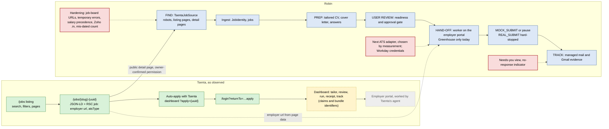

# Tsenta investigated with REA — evidence report and Robin implementation plan

| | |
|---|---|
| Status | Investigation report for review. **No Robin code was changed**; this file is the only addition to the repository. |
| Captured | 2026-10-12 (UTC). Tsenta's pages change daily; re-check a detail before relying on it. |
| Robin checkout | `C:\Users\jadak\Documents\antigravity\peaceful-chandrasekhar` (path verified), branch `phase8.5-managed-mail`, HEAD `d764209`, working tree clean before this file |
| Tooling | REA 6.4.0 (`rea-agents`, official CLI through `npx`), Node 24.16.0, Chrome 155.0.8059.39 headless, on the owner's Windows PC |
| Evidence | `C:\Users\jadak\Documents\antigravity\rea-evidence\tsenta-2026-10-12\` — kept **outside** the repository; index in [Appendix A](#appendix-a--evidence-index) |
| Safeguards kept | No account, sign-in, OAuth approval, form submission, request replay or employer-portal visit. PR #7 not merged, nothing deployed, no environment variable changed, `REAL_SUBMIT` untouched. |

**Labels.** Every finding carries one of three labels:

- **[V] Verified observation** — directly shown by the cited evidence. Two weaker kinds are marked separately:
  **[V-static]** an identifier or text that exists in Tsenta's *public* JavaScript (REA static analysis; the code was never run, so it shows what the client refers to, not what the server does), and
  **[V-claim]** something Tsenta publishes about itself (proves the claim is made, not that it is true).
- **[I] Inference** — a plausible explanation that still needs validation.
- **[U] Unknown** — cannot be established with the access that was available.

Evidence references such as `s08` or `c05` point to [Appendix A](#appendix-a--evidence-index).

---

## 1. Executive summary

- **What Tsenta is [V].** Three surfaces: `tsenta.com` (marketing site and a public job board; Next.js with server-rendered React Server Components), `dashboard.tsenta.com` (the product; a login-gated single-page app with Firebase sign-in) and `api.autojobs.me` (its API origin). Tsenta's website is **not an employer ATS**. Each job page carries the original employer URL in its page data, but the only visible application control, *Auto-apply with Tsenta*, opens `dashboard.tsenta.com/dashboard?apply=<job id>`, and an anonymous visitor is redirected to `/login?returnTo=…apply=<job id>` (s07, s08, s10).
- **What could be verified [V].** Discovery (search, filters, pagination, URL contract, direct URLs, robots and sitemaps), job-detail data and the hand-off into Tsenta's dashboard, the public login screen and the MCP connection instructions. **Everything after sign-in** — résumé and cover-letter review, form filling, required-field handling, submission, receipts and tracking — is **[U] at runtime**: it needs an account, which was outside the permitted scope. For those stages this report records Tsenta's own claims and the identifiers in its public bundles (for example the pipeline states `PENDING_RESUME_REVIEW` and `PENDING_SUBMIT_REVIEW` and the settings `autoApproveResume` and `autoSubmitApplication`), labelled as such.
- **Robin's Tsenta integration holds up [V, by code reading against live pages].** `TsentaJobSource` reads only public pages, checks `robots.txt` first, never uses Tsenta's dashboard link, drops impossible dates and never treats a Tsenta listing as complete. The live site still matches it: the path scopes and `?page=N` server-render (s09), and detail pages still carry JSON-LD plus the RSC `job` object with `atsType` and `url` (s08). Robin's fixture `tsenta-detail-zoho.html` is the same posting and still matches what the live page serves.
- **Five evidence-backed defects or gaps in Robin's Tsenta path (fix first):**
  1. A Tsenta posting whose employer URL is an **Indeed** page would be stored as the employer's application URL (s17; `JobIdentity.AGGREGATOR_HOSTS` contains only Tsenta hosts).
  2. Tsenta serves a **temporary error page with HTTP 200** ("We couldn't load this job right now"). 9 of 10 consecutive detail loads got it, and all 3 that were retried a few minutes later loaded normally (s15, s17). Robin counts such a page as malformed and keeps requesting.
  3. **Salary currency and period** are taken from JSON-LD values that Tsenta's own job data leaves empty (RSC `salaryCurrency:null`, `salaryPeriod:null` against JSON-LD `USD`/`YEAR`, s08), contrary to Robin's documented rule of never storing an amount without a known currency.
  4. The APPLY-side ATS matcher (`ats/AtsAdapters.java`, Zoho) does not recognise **`*.zohorecruit.in`**, which 5 of the 7 Zoho postings sampled use — as does Robin's own fixture.
  5. The **unfiltered newest-first listing** Robin crawls is topped by mis-dated postings: the 7 page-1 postings sampled carry `datePosted` values from 2027-08-27 to 2029-04-09, in descending order (s04, s08, s16). Robin discards those dates but spends its detail budget on them. The listing also accepts `q`, `workplaceType`, `location`, `sponsorship` and `page` query parameters, which server-render (s06, s09, s19).
- **Capability gaps against what Tsenta claims or references [V-claim/V-static → I]:** form inspection and filling on ATSes other than Greenhouse (none of the 11 employer URLs sampled was Greenhouse); Workday accounts with a stored candidate password; per-country work-authorisation answers; one "needs you" view across preparation, review, worker pauses and tracking; a no-response indicator. Tsenta's auto-approve and auto-submit settings are deliberately **not** recommended: `REAL_SUBMIT` stays hard-stopped and human approval stays mandatory.
- **Recommended next phase:** *Phase 8.6 — Tsenta source hardening* (defects 1–4, a mis-dated-posting counter and the documentation update; offline fixture tests only), followed by a *measured* choice of the next APPLY adapter (Section 12).

## 2. REA setup and readiness

| Check | Result |
|---|---|
| Documentation read | GitHub README (`morluto/rea`): REA is meant for software you own or are authorised to examine; the official setup is `npx rea-agents setup`, which shows a plan, registers REA's MCP server and workflow skill, and needs an agent restart. rea.tools *Browser observation* guide: start Chrome with a debugging port and a **separate profile**, then let REA observe while you perform the action. Documentation bundled with `rea-agents@6.4.0`: `README.md` and `skills/reverse-engineer-anything/references/` (`runtime-observation.md`, `javascript-applications.md`, `connection-and-recovery.md`). |
| Version | `rea-agents` 6.4.0 (`00-rea-version.txt`); Node v24.16.0 (REA needs ≥ 22.19 or ≥ 24.11) |
| Connected to this agent? | **No.** The agent session has no REA MCP tools. `rea doctor` (`01-rea-doctor.json`): Node and host healthy; workflow skill not installed; not registered with Claude Code, Claude Desktop or any other client; native disassemblers (Hopper, Ghidra, IDA) absent — not needed for web work. |
| Official setup | Reviewed with `rea setup --dry-run` (`02-rea-setup-dry-run.json`). The plan would rewrite `C:\Users\jadak\.claude.json` and `%APPDATA%\Claude\claude_desktop_config.json` (backups `*.rea.backup`) to register `node <npm cache>\_npx\dea9475797100b20\node_modules\rea-agents\scripts\rea.mjs mcp`, and install the skill under `~/.agents/skills` and `~/.claude/skills`. **Not applied:** the registered command points into the npx cache, which npm may evict (silently breaking both clients); it edits two client configurations; and this running session could not load a new MCP server before a restart. The CLI offers the same browser commands, so the investigation used it directly. |
| How REA ran | `npx -y rea-agents@6.4.0 <command> … --format json` on the owner's Windows machine. Nothing was added to Robin's dependencies and nothing was installed globally. |
| Network blocker | The cloud sandbox's egress proxy refuses `tsenta.com` (`CONNECT` answered 403 by policy), so REA could not run there; every capture ran on Windows through Desktop Commander. |
| REA limits met | `inspect-web-page` aborts with `target_changed` when the observed page loads a new document (`c02-inspect-landing.json`). The pricing request was therefore observed by clicking an in-page link (a client-side navigation) during the observation window, as the browser guide describes. Scenario captures block service workers (the dashboard tries to register `/sw.js`). The scenario `role` locator has no `searchbox` role, so CSS locators were used for the search field. |
| Commands used | `capture-browser-scenario` ×19 (`s01`–`s19`), `list-browser-targets`, `inspect-web-page` (3 retained captures, one of them the failure above; earlier attempts with a wrongly formatted option or a navigation that finished before REA attached were discarded and re-run), `analyze-web-bundle --fetch-source-maps` ×2, `discover-webmcp-tools` ×2, `doctor`, `setup --dry-run` |
| Capture settings | Headless Chrome with an REA-owned temporary profile per scenario; request bodies, response bodies and header values **off**; storage not captured. The passive CDP sessions used a separate throw-away profile, `%TEMP%\rea-cdp-tsenta-20261012` (anonymous state only; safe to delete); that browser was closed afterwards. |

To make REA permanent (an owner decision, not done): `npm install --global rea-agents@6.4.0`, then `rea setup --client claude_code --client claude_desktop`, review the printed plan, approve it, and restart both clients.

## 3. Target URLs and scope

| Origin / URL | What it is [V] | What was done |
|---|---|---|
| `https://tsenta.com/`, `/ai-agent`, `/auto-apply`, `/mcp`, `/ai-disclosure` | Marketing site (Next.js App Router, Turbopack chunks, RSC) | Captured anonymously (s01–s03, s05, s11) |
| `https://tsenta.com/jobs`, `/jobs/remote`, `/jobs/internships`, `/jobs/{slug}-{uuid}` | Public job board | Search, filters, pagination, location, direct URLs; 17 distinct detail pages requested, 11 returned job data (s04, s06–s09, s15–s19) |
| `robots.txt`, `sitemap.xml`, `sitemap-index.xml`, `jobs/sitemap/{n}.xml`, `ai.txt`, `llms.txt` | Crawler resources | Each read once; 2 of the 1,540 job sitemaps sampled (s11–s13) |
| `https://dashboard.tsenta.com/` | Tsenta's product app (Vite build, Firebase sign-in) | Only the anonymous redirect and the login screen (s10), plus public static JavaScript files (c04, c05, s14). Nothing typed or clicked there. |
| `https://api.autojobs.me/` | Tsenta's API origin | Only the public pricing request that the landing page makes by itself (c02-soft-nav). The MCP endpoint `/api/v1/mcp` is documented on `/mcp` but was **not** contacted. |
| Employer portals (Zoho Recruit, Workday, Workable, Indeed URLs found in page data) | The real application targets | URLs read from page data only; **not visited** |

**Which target matters for Robin.** [V] Tsenta's website is a *listing* source, not an employer portal; its application flow runs inside its own signed-in dashboard, which — by Tsenta's account [V-claim] — then works on the employer's portal for the user. Therefore: (1) Tsenta's public job board is a **discovery source** for Robin, already integrated as `PlatformKind.TSENTA`; (2) the **employer portal** behind each posting is Robin's application target; (3) Tsenta's dashboard is a **product reference only** — Robin must not integrate with it (no permission, and every route is behind sign-in). Ambiguity [V]: some of the "employer URLs" Tsenta records are not employer portals at all — a job board (Indeed) and Workable's public job board — see 4.2.

## 4. Verified workflows

### 4.1 Discovery, search, filters and pagination

- [V] `/jobs` shows 20 posting cards per page (`<a href="/jobs/{slug}-{uuid}"><article>…`) with numbered pagination: *Previous* (disabled on page 1), *1*–*5*, *Next* (s04).
- [V] Search is an `input[type=search]` labelled "Search jobs" with a *Search* button; searching adds `q=software+engineer` to the URL (s06).
- [V] Filters are toggle buttons with a `data-active` flag: Internship, Entry Level, Experienced, Remote, Hybrid, Onsite, Contract, Part Time, Full Time, 24h, 7d, 14d, 30d, Sponsors Visa. *Clear all* stays disabled until a filter is active (s04, s06, s09).
- [V] Every change is a client-side navigation that fetches an RSC payload (`GET /jobs?<parameters>&_rsc=…`, `text/x-component`). No JSON jobs API was used by the public pages in any capture (s06, s18).
- [V] URL contract: *Remote* → `workplaceType=REMOTE`; *Sponsors Visa* → `sponsorship=SPONSORS`; search → `q=`; *Next* → `page=2`; final URL `…/jobs?workplaceType=REMOTE&sponsorship=SPONSORS&q=software+engineer&page=2` (s06). Location: typing shows suggestion **buttons** computed in the page — no suggestion request appears on the network; choosing one sets `location=North+London` (s19); pressing Enter without choosing changes nothing (s06, s18).
- [V-static] The filter script reads or clears `page`, `location`, `datePosted`, `sponsorship` and `q` (c03). [I] `datePosted` carries the 24h/7d/14d/30d toggles. [U] the parameter names of the other toggles (job type, employment type), which were not exercised.
- [V] Direct loads return 200 without redirects and are server-rendered: `/jobs/remote` (heading "Remote Jobs"), `/jobs/internships` (heading "Internships"), `/jobs?page=2` (different cards from page 1) and `/jobs?workplaceType=REMOTE&sponsorship=SPONSORS&page=3` (s09).
- [V] Ordering and dates: page-1 cards 1–3 and 7–10 were opened; their `datePosted` values run from 2029-04-09 down to 2027-08-27 in card order — all in the future, all on Zoho Recruit (s04, s08, s16). [I] the unfiltered listing is sorted newest-first by `datePosted`, so mis-dated postings stay on top. [U] how many postings are mis-dated overall.
- [V] Near-duplicates: one filtered page showed 13 cards with the identical title "Mobile Software Engineering Expert - AI Training Projects" from one company, each with its own UUID (s06, final page). [U] whether they are different employer postings; the one that was loaded points to Workable's public job board (s17).
- [V] Crawler resources: `robots.txt` allows `/` for every agent, disallows `/private/` and `/admin/`, explicitly allows many AI crawlers and points to `/sitemap-index.xml` (s11). The index lists `/sitemap.xml` (113 URLs: marketing pages, blog posts and the four listing scopes — no postings) and 1,540 job sitemaps `/jobs/sitemap/0.xml` to `/jobs/sitemap/1539.xml`; both sampled (0 and 1539) were **empty** `<urlset>` documents (s11–s13). `ai.txt` allows training, inference and summarisation for every agent (s12).
- [V] Temporary failures: 9 of 10 consecutive detail loads returned HTTP 200 with the heading "We couldn't load this job right now", a *Try again* button and no job data (no JSON-LD, no RSC job object) (s15). The 3 that were retried a few minutes later loaded normally (s17). [U] the cause (upstream timeouts or per-client throttling) and the threshold, if any.

### 4.2 Job details and how application links open

- [V] From the list, a card opens the detail page through a client-side navigation (`?_rsc` fetch, no new document) (s07); a direct load is server-rendered (s08).
- [V] Visible content: *Back to jobs*; the company name with an arrow link to the company's website (`target=_blank`); the heading "{title} at {company} in {place}"; chips for seniority, workplace, employment type and salary; *Skills*, *Job Description*, *Requirements*, *Benefits*; and a side card "Interested in this role?" with a **single** call to action (s07, s08 and its screenshot).
- [V] The call to action is `<a href="https://dashboard.tsenta.com/dashboard?apply={same uuid}" target="_blank" rel="noopener noreferrer">Auto-apply with Tsenta</a>` on all 11 postings that returned job data (s08, s15–s17). **No link to the employer's application page is shown.**
- [V] The page embeds a schema.org `JobPosting` with the keys `title, description, datePosted, validThrough, employmentType, identifier, hiringOrganization, jobLocationType, applicantLocationRequirements, baseSalary, skills, url, directApply`; `directApply` is `false` and `url` is the Tsenta page itself (s08).
- [V] The RSC `job` object (present on a direct load) carries the employer URL and Tsenta's classification. Fields read with their values: `atsType`, `isSupportedAts`, `url`, `active`, `workplaceType`, `employmentType`, `jobType`, `roleFamily`, `seniorityLevel`, `sponsorship`, `citizenOnly`, `clearanceRequired`, `minimumDegreeRequired`, `yearsOfExperienceMin`/`Max`, `salaryMin`/`Max`/`Currency`/`Period`, `cities`, `states`, `countries`, `internTerms`, `internshipDuration`, `datePosted`, `companyName`, `companyWebsite` (s08).
- [V] The two data sources disagree on the same page: RSC has `salaryCurrency:null`, `salaryPeriod:null` and `countries:[]`, while JSON-LD says `currency:"USD"`, `unitText:"YEAR"` and `applicantLocationRequirements:"USA"`; the page shows "$10k+/yr" and "Location: Not specified" (s08 and its screenshot). [I] Tsenta's page renderer fills in USD, per-year and a USA default when its job data is empty.
- [V] Employer URLs of the 11 postings with data (a small, biased sample: 7 from the unfiltered page 1, 4 from a filtered software-engineering page): **Zoho Recruit 7** (`{tenant}.zohorecruit.in` five times and `.com` twice, path `/jobs/Careers/{id}/{slug}`), **Workday 2** (`{tenant}.wd5.myworkdayjobs.com` and `.wd12.`, path `/{site}/job/{location}/{slug}_{requisition}`), **Workable 1** (`jobs.workable.com/view/{id}/…`, Workable's public job board rather than an employer career page) and **Indeed 1** (`www.indeed.com/viewjob?jk=…`). `isSupportedAts` was `true` for all 11; Robin's own fixture shows it can be `false` (a Cornerstone `csod.com` posting in `tsenta-detail-unsupported.html`). Job-level `sponsorship` was `UNKNOWN` on all 11, including the 4 listed under the *Sponsors Visa* filter (s15, s17). [I] that filter does not use the job-level field (it may use employer-level data).

### 4.3 The visible application workflow

- [V] An anonymous visit to `/dashboard?apply={uuid}` is redirected in the browser to `/login?returnTo=%2Fdashboard%3Fapply%3D{uuid}`: the apply intent survives sign-in (s10). The landing page's *Log in* and *Sign up* links go to `dashboard.tsenta.com` with UTM parameters and land on `/login` (s01, s10).
- [V] Before sign-in the dashboard sends **no** request to Tsenta's API; its only data requests go to third-party telemetry (error monitoring and analytics) (s10).
- [V-static] After sign-in (c04, c05, s14): the `apply` URL parameter is read and then removed; routes include `/dashboard/v2/review`, `/dashboard/v2/finish`, `/dashboard/v2/applications/:id`, `/dashboard/v2/add-jobs`, `/dashboard/v2/inbox` and `/dashboard/v2/settings/:section`; lazily loaded modules include `review_shell`, `pending_review`, `submit_review_requirements`, `useReviewBeforeSubmit`, `resume_html_preview` and `review_conversation`.
- [V-claim] Tsenta signs in to the employer portal, fills every field (open-ended answers "in your voice"), uploads documents, submits and keeps a receipt; the user can watch live or run headless and replay later; the login screen adds that it creates Workday accounts (s02, s03, s10 screenshot, s11).
- [U] The real sequence of screens and steps, and whether the user approves each submission by default.

### 4.4 Résumé and cover-letter preparation and review

- [V-claim] A résumé and cover letter per role, generated from the job description, with keyword alignment, ATS-safe formatting, a diff of every change and an approve-or-edit gate before sending (s02, s11).
- [V-static] Settings `optimizationMode` (values `off`, `honest`, `aggressive`), `coverLetterMode`, `autoApproveResume`, `autoApproveCoverLetter` and `autoSubmitApplication`; a per-user "review before submit" switch; pipeline states `OPTIMIZING_RESUME`, `OPTIMIZING_CL`, `PENDING_RESUME_REVIEW`, `PENDING_CL_REVIEW`, `PENDING_SUBMIT_REVIEW`; the submit-review module refers to `jd`, `resume` and `cover` next to `tab` (c05, s14).
- [I] The review gates are per-user settings that can be switched off, which fits the auto-apply page's "No click required from you" (s03). [U] Their defaults, and what `aggressive` changes.

### 4.5 Form-field identification and pre-filling

- [V-claim] Form recognition and filling across 30+ ATSes, including sign-in, multi-page forms and uploads (s11). Tsenta's published list of 30 platforms is the list Robin already tracks in `PlatformKind`; the dashboard bundle names 34 platform identifiers plus `unknown`, adding `indeed`, `naukri`, `avature` and `bullhorn` (c05).
- [V-static] Identifiers `location`, `school`, `company`, `skill`, `degree`, `discipline`, `resume` (c05; [I] answer or autocomplete categories); the UI text "Job-Specific Questions"; and a per-country eligibility editor whose validation message asks for at least one country with both eligibility questions answered, offering `OPT` and `CPT` (c05).
- [U] How fields are detected and filled — nothing of it was observable at runtime.

### 4.6 Required fields, validation errors and incomplete applications

- [V] The public forms observed are job search, location and the login form. Nothing was submitted, so no validation message was triggered.
- [V-static] `WORKDAY_PASSWORD_REQUIRED` / "Workday password required", "You've already applied to this job." (a duplicate check), "Approval flow failed", "Auto-approval failed", a message ending "…page, then retry.", states `FAILED` and `SKIPPED`, a request flag `isRetry`, and routes for skipping in bulk and for an application rate limit (c05).
- [I] Missing data or credentials pause an application in a "needs" bucket until the user supplies them. [U] Actual behaviour.

### 4.7 Progress, submission confirmation and tracking

- [V-static] Pipeline states `OPTIMIZING`, `OPTIMIZING_RESUME`, `OPTIMIZING_CL`, `PENDING_REVIEW`, `PENDING_RESUME_REVIEW`, `PENDING_CL_REVIEW`, `PENDING_SUBMIT_REVIEW`, `READY`, `RUNNING`, `COMPLETED`, `SKIPPED`, `FAILED`; list buckets `tailoring`, `queued`, `submitted`, `needs`, `failed`, `skipped`, `all`; execution states `pending`, `running`, `completed`, `failed`, `cancelled` and environments `ELECTRON` and `CLOUD`; tracked statuses `APPLIED`, `GHOSTED`, `INTERVIEWING`, `REJECTED`, `OFFER`; an "apply trace" formatter and an export of tracked applications (c05, s14).
- [V-claim] Receipts listing fields, answers, résumé version and timestamp; recruiter replies routed back to the application, with statuses moving on their own (s02, s11).
- [U] What a receipt contains in practice, how `GHOSTED` is decided and how replies are matched.

### 4.8 Login, session and account behaviour (public part only)

- [V] Login screen: *Continue with Google*, an email address field with *Continue*, *Sign in with messaging (WhatsApp / iMessage)*, and terms and privacy links (s10). [V-static] Firebase Authentication code is bundled (`signInWithIdp`, `signInWithEmailLink`, phone sign-in, reCAPTCHA support) and the app checks `user.email_verified` (c05).
- [V] Third parties on the dashboard: Sentry (environment `production`, release `dashboard@0.1.0`), PostHog, Intercom, Google Tag Manager and the Meta pixel (s10).
- [V] MCP: `/mcp` documents `claude mcp add --transport http tsenta https://api.autojobs.me/api/v1/mcp` for Claude Code (with tabs for Claude Desktop & Web, Cursor and Codex CLI); access is approved through OAuth in the browser with Google sign-in, and the client keeps a short-lived token (s05). [U] The MCP tool list (it needs OAuth).
- [V-static] Workday password routes (`/api/v1/workday/password`, with a status route and deletion) and modules `firebase_session` and `profile_scope_bar`, the latter reading a `profileId` URL parameter (c05). [I] An account can hold several candidate profiles.
- [V] No WebMCP tools are declared on `/jobs` or on the dashboard login (c06, c07). No source map is declared by any of the 18 landing-page scripts or the 78 dashboard scripts (c03, c04).

Key screenshots (in `captures/`): listing `s04-jobs.s1.png`; filtered page 2 `s06-jobs-filters.s13.png`; job detail with the call to action `s08-job-detail-direct.s1.png`; login with `returnTo` `s10-dashboard-anonymous.s1.png`; MCP set-up page `s05-mcp.s1.png`; location filter applied `s19-jobs-location-suggestion.s5.png`.

## 5. Public network and API observations (redacted)

No cookies, tokens, header values or bodies were retained (capture settings in Section 2). Analytics project keys and advertising IDs that appear in third-party URLs are deliberately left out of this report.

| Request as observed | Status and type | Evidence | Notes |
|---|---|---|---|
| `GET https://tsenta.com/jobs?{workplaceType, sponsorship, q, location, page}&_rsc=…` | 200, `text/x-component` | s06, s19 | RSC payload of a client-side navigation; not JSON. `_rsc` is a cache-busting token. |
| `GET https://tsenta.com/jobs/{slug}-{uuid}?_rsc=…` | 200; many cancelled | s06, s07, s18 | Prefetch for visible cards; cancelled when the view changes |
| `GET https://tsenta.com/jobs/{slug}-{uuid}` (document) | 200 | s08, s15–s17 | Full server-rendered page; the temporary error page is also served with 200 |
| `GET https://api.autojobs.me/api/v1/public/pricing` | 200, `application/json`, 1,785 bytes on the wire | c02-soft-nav (shape); s01–s03 | Value-free shape recorded by REA: `{ data: [ { id, name, displayName, description, interval, market, currency, price, originalPrice, monthlyApps } × 9 ], message }` |
| `GET https://dashboard.tsenta.com/dashboard?apply={uuid}` | 200 document, then a browser-side redirect to `/login?returnTo=…` | s10 | No call to Tsenta's API before sign-in |
| `GET https://dashboard.tsenta.com/assets/*.js` | 200 | c04, c05, s14 | 78 scripts on the login page; none declares a source map |
| Third-party telemetry | various | all captures | Google Tag Manager/Analytics, Google Ads/DoubleClick, Meta pixel and PostHog on both sites; Sentry and Intercom on the dashboard |

**Referenced only — present in public dashboard bundles, never requested, all behind sign-in [V-static]** (c05): application list, search, counts, statistics, bulk skip and rate limit (`/api/v1/applications/…`); cloud executions in progress (`/api/v1/cloud-executions/running`); tracked-application export (`/api/v1/tracked-applications/export`); job recommendations and job-board options (`/api/v1/jobs/recommendations…`, `/api/v1/jobboard/…`); job-description fetch (`/api/v1/job-description/fetch`); résumé parsing at onboarding (`/api/v1/onboarding/parse-resume`, `/api/v1/onboarding/continue-without-parsing`); Workday password (`/api/v1/workday/password`, `/api/v1/workday/password/status`); subscription plan preview. Their payloads are [U]. Robin must not call any of them.

## 6. Workflow diagram

Green: verified with REA. Yellow, dashed: only claimed or referenced in bundles. Grey: unknown. Blue: existing Robin step (verified by reading the code at `d764209`). Red: proposed change.




## 7. Verified observations, inferences and unknowns

| Topic | Verified [V] | Inference [I] | Unknown [U] |
|---|---|---|---|
| Listing | 20 cards per page; server-rendered; RSC fetch per filter change; parameters `q`, `workplaceType`, `sponsorship`, `location`, `page`; path scopes return 200 (s04, s06, s09, s19) | Sorted newest-first by `datePosted`; `datePosted` parameter carries the age toggles | Other toggle parameter names; total size of the board |
| Data quality | 7 of 7 page-1 postings sampled are future-dated; JSON-LD and RSC disagree on salary and country; 13 same-title cards on one page; `sponsorship` is `UNKNOWN` even under the *Sponsors Visa* filter (s06, s08, s15–s17) | The page renderer fills USD, per-year and USA defaults; the visa filter uses employer-level data | How widespread each problem is |
| Availability | HTTP 200 temporary error page on 9 of 10 consecutive detail loads; the 3 retried pages recovered (s15, s17) | Upstream timeouts or per-client throttling | Threshold, if any; whether Robin's pace (1.5 s) can trigger it |
| Detail and hand-off | The only call to action is `dashboard?apply={uuid}`; `directApply:false`; the employer URL appears only in RSC data; anonymous visitors go to `/login?returnTo=…` (s08, s10) | Tsenta channels users into its dashboard rather than to employers | — |
| ATS mix | In 11 postings: Zoho Recruit 7, Workday 2, Workable job board 1, Indeed 1; `isSupportedAts:true` for all 11 (s08, s15–s17) | — | The distribution across the whole board |
| Application flow | Login redirect keeps the apply intent; no Tsenta API call before sign-in (s10) | Review gates are user settings that can be switched off | Every step after sign-in |
| Preparation | Claims plus bundle settings and states (s02, s11, c05, s14) | — | Defaults and runtime behaviour |
| Field filling | Bundle identifiers and the per-country eligibility editor (c05) | Per-country answers are reused across forms | Detection and filling method |
| Errors and incomplete applications | Bundle strings: Workday password required, duplicate application, approval failures, retry, skip (c05) | Missing data pauses an application in a "needs" bucket | Runtime behaviour |
| Tracking | Bundle states including `GHOSTED`; trace formatter; export (c05) | `GHOSTED` is time-based | Matching method; receipt content |
| Account | Firebase sign-in with Google, email and messaging options; OAuth for MCP (s05, s10, c05) | One account can hold several profiles | MCP tool list; session lifetime |
| Client code | No source maps; no WebMCP tools; module names and identifiers listed in Sections 4–5 (c03–c07) | — | All server-side logic |

## 8. Mapping the findings to Robin's code

File paths are relative to the repository root; Java paths are under `backend/src/main/java/com/personal/jobagent/`. "Robin today" was established by reading the code at `d764209`; nothing was executed against Tsenta from Robin.

| # | Finding (evidence) | Owning Robin component(s) | Robin today | Action |
|---|---|---|---|---|
| F1 | Indeed page recorded as the employer URL (s17) | `discovery/platform/adapters/TsentaJobSource.java` (`employerUrl`), `discovery/platform/JobIdentity.java` (`AGGREGATOR_HOSTS`, `isAggregatorUrl`), `jobs/JobsController.java` (hides aggregator URLs) | Only Tsenta hosts are rejected, so `www.indeed.com/viewjob…` would become `applicationUrl`, against the `NormalizedJob` contract ("never an aggregator URL") | **R1, P0** |
| F2 | Workable's public job board recorded as the employer URL (s17) | as F1, plus `ats/AtsAdapters.java` (`WorkableAdapter` matches any `workable.com`) | Stored as the application URL and labelled Workable on the APPLY side, although the employer's apply page is on `apply.workable.com` | **R1, P0** (policy confirmation) |
| F3 | Temporary error page served with HTTP 200 (s15, s17) | `TsentaJobSource.parseDetail`, `discovery/platform/BoardDiscoveryService.java` (detail loop), `discovery/platform/FailureCategory.java` | `Parsing.MalformedException` → `detail_failures`; the loop goes on requesting | **R2, P0** |
| F4 | JSON-LD salary defaults (s08) | `discovery/platform/Parsing.java` (`fromJsonLd`), `TsentaJobSource.parseDetail` | JSON-LD salary kept whenever RSC `salaryCurrency` is null | **R3, P0** |
| F5 | `*.zohorecruit.in` employer URLs (s08, s16) | `ats/AtsAdapters.java` (`ZohoAdapter` pattern `zohorecruit\.com` or `zoho\.com`), `ats/AtsAdapterRegistry.java` | `findAdapterForUrl` finds no adapter for `.in`, while discovery (`PlatformKind.ZOHO_RECRUIT`, `JobIdentity`) does recognise it | **R4, P0** |
| F6 | Mis-dated postings top the listing; filtered listings exist (s04, s06, s09, s16, s19) | `TsentaJobSource` (`SCOPES`, `list`), `discovery/platform/Normalize.java` (`postedAt`), `BoardDiscoveryService` (run counts), `docs/PHASE8_FIND_WORKFLOW.md` §12.4, `frontend/src/pages/SourcesPage.tsx` | Future dates are dropped (asserted in `TsentaJobSourceTest`); only the four unfiltered scopes are crawled | **R5, P1** (filters need owner approval) |
| F7 | Path scopes, pagination and detail structure unchanged (s08, s09) | `TsentaJobSource`, `TsentaJobSourceTest`, `backend/src/test/resources/discovery/platforms/tsenta-*.html` | Matches the live site | No change |
| F8 | `sponsorship` is `UNKNOWN` even under the *Sponsors Visa* filter (s15, s17) | `docs/PHASE8_FIND_WORKFLOW.md` §12.3 ("Sponsorship is never stored"), `jobs/HardFilterService.java` | Sponsorship from sources is not stored | No change — the evidence supports the rule |
| F9 | The apply intent survives sign-in (s10) | `frontend/src/pages/LoginPage.tsx` (`location.state.from`), `frontend/src/components/RouteGuards.tsx`, `frontend/src/pages/JobDetailPage.tsx` | Redirect target kept in router state | [U] whether a deep link survives a full page reload on `/login`; add a test (T25) |
| F10 | APPLY on ATSes other than Greenhouse (s15–s17 sample, s11, c05) | `ats/AtsAdapter.java` (`supportsLiveInspection`), `ats/GreenhouseAdapter.java`, `automation/GreenhouseFieldMapper.java`, `automation/InspectionPlanService.java`, `automation/GreenhouseExecutionPlanService.java`, migration `V036` (`source in ('GREENHOUSE_PUBLIC_FORM')`), `worker/src/plan.js`, `worker/src/browser_worker.js` | Only `GreenhouseAdapter` inspects forms live; the other adapters only match URLs | **R6, P1** (its own phase) |
| F11 | Workday password and account creation (c05, s10 claim) | `identity/EmployerCredentialService.java`, `mailbox/RegistrationIdentityService.java`, account sessions (`V040`–`V042`), worker steps `ACCOUNT_RESOLVE_IDENTITY` and `ACCOUNT_VERIFY_OTP` | The encrypted credential store has no caller yet; lifecycle plans still carry passwords | **R7, P2** (with R6) |
| F12 | Per-country work authorisation (c05) | `profile/VisaStatus.java`, `profile/ProfileController.java`, `profiles.work_eligibility` (`V001`), `jobs/HardFilterService.java`, `qa/ApplicationAnswerService.java`, `automation/GreenhouseFieldMapper.java`, `frontend/src/pages/ProfilePage.tsx` | One `visaStatus` for every country | **R8, P2** |
| F13 | One pipeline view with "needs" buckets (c05, s14) | `prep/PrepReadinessService.java`, `apply/ApplyReadinessService.java`, `application/ApplicationDecisionService.java`, `automation/AutomationPlanRepository.java`, `track/TrackVocabulary.java` (`Stage`), `frontend/src/pages/ApplicationsPage.tsx`, `frontend/src/pages/ReviewQueuePage.tsx`, `frontend/src/components/ApplicationPrepStatus.tsx` | Each readiness is derived per job but spread over several pages | **R9, P2** |
| F14 | No-response status `GHOSTED` (c05) | `track/TrackVocabulary.java`, `track/ApplicationTrackingService.java`, `frontend/src/components/ApplicationTrackPanel.tsx` | No such indicator | **R10, P3** |
| F15 | Auto-approve, auto-submit and `aggressive` optimisation (c05, s03) | `application/ApplicationDecisionService.java`, approval rules (`V034`, `frontend/src/pages/ApprovalRulesPage.tsx`), `apply/ApplyReadinessService.java`, `apply/ApplyPackageGuard.java`, `automation/AutomationController.java`, `worker/src/browser_worker.js` (`FORBIDDEN_REAL_SUBMISSION`) | Human approval is mandatory and `REAL_SUBMIT` is hard-stopped | **No change, deliberately** |
| F16 | Duplicate-application message (c05) | `apply/ApplicationIdentityService.java`, `apply/DuplicateApplicationException.java` | Owner-scoped duplicate detection exists | Add a near-duplicate Tsenta test (T26) |
| F17 | Receipts and "apply trace" (s11 claim, c05) | `track/ReceiptVerificationPolicy.java`, `track/TrackEvidenceRecorder.java`, `automation_steps.screenshot_ref` (`V009`) | Evidence-graded receipts and per-step screenshots exist | No change |
| F18 | Automated OTP filling (c05) | `mailbox/MailboxVerificationController.java`, `mailbox/managed/*`, worker `ACCOUNT_VERIFY_OTP` | Exists (real mail domain still pending from Phase 8.5) | No change |
| F19 | Add a job by URL (c05) | `jobs/JobsController.java` (`POST /jobs/import-url`), `discovery/platform/BoardImportService.java` | Exists (SSRF-safe) | No change |
| F20 | MCP connection through OAuth (s05) | `mcp/McpController.java`, `security/SecurityConfig.java` | `/mcp` needs a browser session and a CSRF token, so external agents cannot connect | **R11, P3** (optional) |

## 9. Gaps and prioritised recommendations

Priorities: **P0** — wrong data or wasted requests in a path Robin already runs; small, offline-testable. **P1** — clear value, needs an owner decision or a measurement first. **P2** — new capability. **P3** — optional. Test identifiers refer to Section 11.

### R1 (P0) — Job-board URLs are not employer application pages

- **Problem.** Tsenta's `url` is sometimes a job board — Indeed, or Workable's public board — and Robin would store it as the employer's application URL. `JobsController` hides only aggregator URLs, so the job page would present the Indeed page to the candidate as the employer's application page.
- **Evidence.** s17: Pelotech `atsType:"indeed"`, `https://www.indeed.com/viewjob?jk=…`; Gramian `atsType:"workable"`, `https://jobs.workable.com/view/…`. `JobIdentity.AGGREGATOR_HOSTS` lists only Tsenta hosts; `TsentaJobSource.employerUrl` rejects only Tsenta hosts.
- **Owner.** `JobIdentity` (single source of truth for "aggregator or job-board host"), used by `TsentaJobSource.employerUrl` and `JobsController`.
- **Implementation.** Replace the Tsenta-only set with a documented job-board classification: Tsenta hosts; `indeed.com` and its subdomains (observed: `www.indeed.com`); `jobs.workable.com` (observed). Add other boards only when a real URL is observed (the bundle names `naukri` but no URL was seen). In `TsentaJobSource.parseDetail` also read `atsType`; when it names a job board (`indeed`, `naukri`) or the URL is a job-board host, keep no application URL, so the posting takes the existing `skipped_no_employer_url` path, and count it separately as `skipped_job_board_url`. Matching is by exact host or dot-anchored suffix, never by substring.
- **Tests.** T1–T4. **Risk.** Low; it can only remove application URLs that were wrong.

### R2 (P0) — Treat Tsenta's temporary error page as an upstream failure and stop early

- **Problem.** A 200 page without job data counts as malformed, and the detail loop keeps requesting while Tsenta is degraded.
- **Evidence.** s15 (9 of 10 consecutive), s17 (3 of 3 recovered later); `BoardDiscoveryService` detail loop (`d764209`, lines 181–203) stops early only on `BUDGET_EXHAUSTED`, `RATE_LIMITED` or `ACCESS_DENIED`.
- **Owner.** `TsentaJobSource.parseDetail` (detection), `BoardDiscoveryService` (policy), the existing `FailureCategory.UPSTREAM_ERROR`.
- **Implementation.** Recognise the page structurally: a Tsenta job route whose HTML has neither a `JobPosting` nor an RSC job object for this UUID **and** shows the error state (its heading or *Try again* control). Raise `SafeHttpClient.FetchException` with `UPSTREAM_ERROR` instead of `MalformedException`; pages that do contain job data but cannot be parsed stay malformed. In `BoardDiscoveryService`, stop requesting details after *N* consecutive `UPSTREAM_ERROR`s (default 3, configurable), count `detail_unavailable`, leave the remaining postings `deferred`, and show the count with the run report. Do not retry inside the run: the next scheduled run retries naturally, because postings that were never fetched are not "known".
- **Tests.** T5–T8, T24. **Risk.** Low; it only reduces requests.

### R3 (P0) — RSC job data decides the salary when it is present

- **Problem.** The JSON-LD salary carries USD and per-year values that Tsenta's own job data does not state; Robin stores them.
- **Evidence.** s08 (RSC `salaryCurrency:null`, `salaryPeriod:null`; JSON-LD `USD`, `YEAR`; page "$10k+/yr"); `Parsing.fromJsonLd` sets the salary; `TsentaJobSource.parseDetail` overrides it only when the RSC currency is non-null; `docs/PHASE8_FIND_WORKFLOW.md` §12.3 forbids amounts without an ISO currency.
- **Owner.** `TsentaJobSource.parseDetail`.
- **Implementation.** When the RSC job object exists: use its minimum, maximum, currency and period if `salaryCurrency` is a valid ISO code; otherwise clear the salary instead of keeping the JSON-LD values. Update §12.4 ("detail → JSON-LD for … salary") accordingly.
- **Tests.** T9–T10. **Risk.** Fewer salaries shown for Tsenta postings — the honest outcome.

### R4 (P0) — Recognise `*.zohorecruit.in` on the APPLY side

- **Problem.** `AtsAdapterRegistry.findAdapterForUrl` returns nothing for Indian Zoho Recruit tenants, so APPLY readiness cannot even name the platform.
- **Evidence.** 5 of 7 Zoho URLs sampled use `.zohorecruit.in` (s08, s16), as does Robin's own fixture; `ats/AtsAdapters.java` matches only `zohorecruit.com` or `zoho.com`.
- **Owner.** `ats/AtsAdapters.java` (`ZohoAdapter`).
- **Implementation.** A host-anchored pattern for `zohorecruit.com` and `zohorecruit.in` only (the domains observed), consistent with `PlatformKind.ZOHO_RECRUIT` and `JobIdentity`.
- **Tests.** T11. **Risk.** Low.

### R5 (P1) — Report mis-dated postings, then crawl what is relevant

- **Problem.** The unfiltered newest-first listing spends the 40-detail budget on postings with impossible dates; Robin keeps them with an unknown posting date.
- **Evidence.** s04 card order with s08/s16 dates; filtered listings server-render (s09) and match the UI filters (s06, s19).
- **Owner.** `TsentaJobSource` (`SCOPES`, `parseIdentifier`, `list`), `BoardDiscoveryService` (counts), `docs/PHASE8_FIND_WORKFLOW.md` §12.4, `frontend/src/pages/SourcesPage.tsx`.
- **Implementation.** (a) Now: count `future_dated` — postings whose `datePosted` is more than a day ahead and was therefore dropped by `Normalize.postedAt` — and show it with the run. (b) **Only after the owner confirms that the permission covers filtered public listing pages:** accept an optional, allow-listed query on the Tsenta board identifier — `q` (at most 80 characters), `workplaceType` in {`REMOTE`, `HYBRID`, `ONSITE`} and `location` (at most 80 characters, one of the place names Tsenta itself suggests) — and let the adapter append `page=N`. Reject every other parameter. Never treat `sponsorship=SPONSORS` results as evidence of sponsorship (F8).
- **Tests.** T12–T14. **Risk.** (b) changes the documented crawl scope, hence the owner decision.

### R6 (P1, own phase) — Measure ATS coverage, then add the next live-inspection adapter

- **Problem.** Only Greenhouse supports live form inspection and execution planning. None of the 11 employer URLs sampled from Tsenta is Greenhouse, while Tsenta claims 30+ platforms.
- **Evidence.** `GreenhouseAdapter.supportsLiveInspection()` is the only `true`; `V036` limits captured form questions to `GREENHOUSE_PUBLIC_FORM`; Section 4.2 sample; s11 claims.
- **Implementation.** First a read-only report of Robin's own jobs from the last 30 days grouped by the platform of their application URL (`JobIdentity` and `PlatformRegistry` recognition) — choose the adapter from Robin's data, not from Tsenta's small sample. Then follow the Greenhouse pattern: a read-only `inspectForm` with tri-state required-ness and no invented questions, a field mapper with the same four classes (`SUPPORTED_AUTO`, `SUPPORTED_WITH_REVIEW`, `REQUIRES_HUMAN`, `UNSUPPORTED`), an execution plan ending in `MOCK_SUBMIT` or a pause, the existing worker steps, and fixtures saved from public forms. Workday additionally needs R7.
- **Tests.** T15–T16.

### R7 (P2) — Account-based portals: use `EmployerCredentialService`

- **Problem.** Workday needs a candidate account per employer; Tsenta keeps a Workday password and says it creates the accounts (s10 claim, c05). Robin has an encrypted store without a caller, and lifecycle plans still carry passwords.
- **Owner.** `identity/EmployerCredentialService.java`, `mailbox/RegistrationIdentityService.java`, the account-session lifecycle (`V040`–`V042`), worker `ACCOUNT_*` steps.
- **Implementation.** Generate a strong password per employer tenant on the server, store it encrypted, and release it only to the worker for that owner, application and open session (the same binding rules as the registration identity) — never in plan JSON, events or logs. The candidate can view and rotate it.
- **Tests.** T17–T18.

### R8 (P2) — Work authorisation per country

- **Problem.** A single `visaStatus` cannot answer the per-country questions forms ask ("authorised to work in X?", "need sponsorship in X?"); Tsenta models them per country (c05).
- **Owner.** `profile/VisaStatus.java`, `profile/ProfileController.java`, `profiles.work_eligibility`, `jobs/HardFilterService.java`, `qa/ApplicationAnswerService.java`, `automation/GreenhouseFieldMapper.java`, `frontend/src/pages/ProfilePage.tsx`.
- **Implementation.** Add `eligibility: [{ country, authorisedToWork: YES/NO/UNKNOWN, needsSponsorship: YES/NO/UNKNOWN }]` inside `work_eligibility`, keeping `visaStatus` for compatibility. The hard filter uses the job's country when it is known; a work-authorisation question is answered from this record only when the country is unambiguous, otherwise it stays `REQUIRES_HUMAN`.
- **Tests.** T19–T20.

### R9 (P2) — One derived "needs you" view

- **Problem.** The candidate cannot see in one place which applications wait for them: CV review, cover-letter approval, answers, the approval gate, a paused worker, TRACK link review.
- **Evidence.** Tsenta's buckets and states (c05, s14); Robin already derives every piece.
- **Owner.** A new read-only service in `application/` combining `PrepReadinessService`, `ApplyReadinessService`, `ApplicationDecisionService`, automation-plan status and TRACK link review; shown on `ApplicationsPage.tsx`.
- **Implementation.** Buckets `PREPARING`, `NEEDS_YOU` (with reason codes), `READY_FOR_APPROVAL`, `RUNNING`, `PAUSED`, `TRACKING`, `CLOSED`; computed on read, never stored; never "submitted" without verified evidence.
- **Tests.** T21–T22.

### R10 (P3) — No-response indicator

Derived after *N* days (default 21) without new evidence since the last verified submission or acknowledgement; displayed only, never stored as a status. Owner: `track/ApplicationTrackingService.java`, `ApplicationTrackPanel.tsx`. Tests: T23.

### R11 (P3, optional) — MCP access for external agents

Scoped personal access tokens (or OAuth) for `/mcp`, owner-scoped, read-mostly tools. Owner: `mcp/McpController.java`, `security/SecurityConfig.java`. Outside the eight workflows; design separately.

### Not recommended

Automatic approval of CVs or cover letters, automatic submission, and an "aggressive" optimisation mode. They contradict Robin's `REAL_SUBMIT` hard stop, its mandatory human approval and its rule that generated documents contain only verified facts.

## 10. Security and access limitations

- **Authority.** Only public pages were read, as any anonymous visitor would. Robin's crawl of Tsenta rests on the owner-confirmed permission for public listings (`docs/PHASE8_FIND_WORKFLOW.md` §12.4); this investigation stayed inside public, unauthenticated content, as the REA README requires for authorised analysis. `robots.txt` disallows `/private/` and `/admin/`; neither was requested.
- **Not done, on purpose.** No account, sign-in or OAuth approval (no authorised test account exists); no dashboard or API request beyond what the public pages sent by themselves; no employer-portal visit; no form submission; no replay of any request; no probing of private endpoints; no CAPTCHA, anti-bot or rate-limit testing; no cookies, tokens, header values, bodies or storage values captured.
- **Load.** 47 page loads in the scenario captures (20 of them direct job-detail pages, at least 1.5 s apart) plus a handful in the passive CDP session. The ten-page sample that met the temporary errors (s15) was scripted in advance and ran to its end; after it, no detail page was requested until three were retried a few minutes later (s17).
- **Static analysis.** Identifiers found in public bundles show what the client code refers to, not what Tsenta's servers do. Nothing from Tsenta's code, branding or assets is copied into Robin or into this report beyond identifiers and short interface strings quoted as evidence.
- **Evidence handling.** The evidence folder holds public page HTML, screenshots and third-party telemetry URLs (with public tracker identifiers). It is outside the repository and should not be committed. The throw-away browser profile `%TEMP%\rea-cdp-tsenta-20261012` can be deleted.
- **Unobservable without authorisation.** Every signed-in step (Sections 4.3–4.7). Legitimate ways to close that gap, best first:
  1. Ask Tsenta (`founders@tsenta.com`) for a demonstration account or product documentation, or for written permission to observe a test account.
  2. If the owner decides to open a Tsenta account with their own data and accepts Tsenta's terms: the owner signs in by hand in a separate browser profile, keeps "review before submit" switched on, never lets a run submit, and REA observes passively (`inspect-web-page` with the owner performing each action). No automated sign-in and no submissions.
  3. For employer-portal behaviour, keep using Robin's own approach: read-only inspection of public application forms, and the mock employer in the worker tests.

## 11. Proposed test cases (all offline: fixtures and mocks, nothing contacts Tsenta, employers or Mailgun)

| ID | Level and file | Scenario | Expected |
|---|---|---|---|
| T1 | Unit — `TsentaJobSourceTest` | Detail fixture derived from `tsenta-detail-zoho.html` with RSC `atsType:"indeed"` and `url` = `https://www.indeed.com/viewjob?jk=1` | `applicationUrl` is null; `sourceUrl` is the Tsenta page |
| T2 | Unit — `JobIdentityTest` | `isAggregatorUrl` for `https://www.indeed.com/viewjob?jk=1`, `https://uk.indeed.com/viewjob?jk=1`, `https://jobs.workable.com/view/x`, `https://apply.workable.com/acme/j/ABC/`, `https://indeed.com.evil.example/`, `https://notindeed.com/` | true, true, true, false, false, false |
| T3 | Web MVC — `JobsController` test | A stored job whose application URL is a job-board URL | Never presented as the employer's application page |
| T4 | Unit — `BoardDiscoveryServiceTest` | Tsenta detail with a job-board URL | Not ingested; `skipped_job_board_url` = 1; no application or plan created |
| T5 | Unit — `TsentaJobSourceTest` | Temporary-error fixture (heading and *Try again*, no JSON-LD, no RSC job) | `FetchException` with `UPSTREAM_ERROR`, not `MalformedException`; a page with job data but broken JSON stays `MalformedException` |
| T6 | Unit — `BoardDiscoveryServiceTest` | Three consecutive `UPSTREAM_ERROR` details out of ten | Detail requests stop; `detail_unavailable` = 3; remaining postings `deferred`; listing still partial; nothing closed or removed |
| T7 | Unit — `BoardDiscoveryServiceTest` | Errors interleaved with successes (error, ok, error, error, ok) | Only *consecutive* errors count towards the stop; successful postings ingested |
| T8 | Integration (PostgreSQL) — discovery IT | Run 1 meets temporary errors; run 2 serves the same postings normally | Run 2 ingests them exactly once; run 1 neither stored nor marked them |
| T9 | Unit — `TsentaJobSourceTest` (Zoho fixture) | RSC `salaryCurrency:null`, JSON-LD `USD`/`YEAR` | Salary minimum, maximum, currency and period all null |
| T10 | Unit — `TsentaJobSourceTest` | RSC `salaryCurrency:"GBP"`, `salaryPeriod:"YEAR"`, min and max; JSON-LD disagrees | RSC values stored |
| T11 | Unit — new `AtsAdapterRegistryTest` | `https://sehyog.zohorecruit.in/jobs/Careers/1/x`, `https://acme.zohorecruit.com/…`, `https://zohorecruit.in.evil.example/`, `https://example.com/?u=zohorecruit.in` | Zoho, Zoho, no match, no match |
| T12 | Unit — `TsentaJobSourceTest` | Board identifier `jobs` with `q=software engineer` and `workplaceType=REMOTE` (only after the owner's approval of R5b) | Requests `/jobs?q=software+engineer&workplaceType=REMOTE&page=1…N`; robots evaluated for `/jobs`; `sponsorship`, unknown parameters, `workplaceType=ANY` and over-long values rejected with `BoardConfigException`; values URL-encoded |
| T13 | Unit — `TsentaJobSourceTest` | Existing page-cap, budget, duplicate-card and empty-page tests run for a filtered identifier | Same guarantees as the unfiltered scopes |
| T14 | Unit — `BoardDiscoveryServiceTest` | Detail with `datePosted` two days ahead | Ingested with an unknown posting date; `future_dated` = 1 |
| T15 | Unit — next adapter (pattern) | Saved public form fixture | Required-ness tri-state; no invented question; demographic questions `UNSUPPORTED` |
| T16 | Worker — mock employer | Execution plan for the next adapter | Ends in `MOCK_SUBMIT` or a pause; a `REAL_SUBMIT` step causes the `FORBIDDEN_REAL_SUBMISSION` hard stop |
| T17 | Integration — `EmployerCredentialService` | Generate, store and release a Workday credential | Encrypted at rest; released only to the worker for the owning application and an open session; closed session answers 409; never in plan JSON, events or logs (log capture); deleted with the profile |
| T18 | Worker — mock employer | Restart in the middle of sign-up, then a failed login and a retry | Same credential reused; no second account created |
| T19 | Unit and IT — profile | Per-country eligibility | ISO country codes and enum values validated; old `visaStatus` still accepted; owner isolation |
| T20 | Unit — field mapping | "Authorised to work in the UK?" for a UK job, a job with no country and a multi-country job | Stored answer used only for the UK job; otherwise `REQUIRES_HUMAN`; demographic questions stay `UNSUPPORTED` |
| T21 | Unit and IT — pipeline view | Every combination of preparation, approval, plan and TRACK states | Expected bucket and reason; no "submitted" without verified evidence; another owner's applications never visible |
| T22 | Frontend — `ApplicationsPage` | Buckets with reasons; loading, empty and error states | Rendered as specified; errors never shown as empty success |
| T23 | Unit — tracking | No new evidence for 21 days after a verified acknowledgement; new evidence arrives; boundary times | Indicator appears, then clears; nothing written to the database |
| T24 | Unit — `TsentaJobSourceTest`/`BoardDiscoveryServiceTest` | 429 with `Retry-After`, 503, timeout, challenge page during details | `RATE_LIMITED` stops details (existing); 503 counts towards the `UPSTREAM_ERROR` stop; `TIMEOUT` reported; challenge stays `ACCESS_DENIED`, never worked around |
| T25 | Frontend — `RouteGuards` and `LoginPage` | Signed-out user opens a job's application workspace by deep link, signs in, and also after a full reload of `/login` | Lands on the requested workspace, or the limitation is documented |
| T26 | Unit — `JobIdentityTest` and `ApplicationIdentityService` test | Several Tsenta postings with the same title and employer but different UUIDs and employer URLs; two that share one ATS URL; an application started from the Tsenta copy while the direct-ATS copy exists | Different URLs stay separate postings (titles never merge); a shared ATS URL is one posting; the second application is reported as a duplicate |

## 12. The exact next implementation phase

**Phase 8.6 — Tsenta source hardening (FIND correctness).** Small and offline-testable; no change to PREP, APPLY or TRACK behaviour and none to the submission safeguards.

**Branch.** A new branch `phase8.6-tsenta-source-hardening`, cut from `phase8.5-managed-mail` while PR #7 is open, or from `main` once PR #7 is merged — the owner's choice. PR #7 stays unmerged.

**Order of work** (each step: failing test first, then the change):

1. **R4** — `ats/AtsAdapters.java`: host-anchored Zoho pattern for `zohorecruit.com` and `zohorecruit.in`. New `backend/src/test/java/com/personal/jobagent/ats/AtsAdapterRegistryTest.java` (T11).
2. **R3** — `TsentaJobSource.parseDetail`: the RSC salary decides whenever the RSC job object exists. Extend `TsentaJobSourceTest` (T9, T10) with the existing `tsenta-detail-zoho.html` fixture and an in-test substitution for the GBP case.
3. **R1** — `JobIdentity`: job-board host classification (Tsenta hosts, `indeed.com` and its subdomains, `jobs.workable.com`); `TsentaJobSource.parseDetail`: read `atsType`; `BoardDiscoveryService`: the `skipped_job_board_url` count. Tests T1–T4, with fixtures derived from `tsenta-detail-zoho.html` by substituting the RSC `url` and `atsType` (no new live capture committed).
4. **R2** — temporary-error detection in `TsentaJobSource`; the consecutive-failure stop and the `detail_unavailable` count in `BoardDiscoveryService`, behind a setting such as `app.discovery.detail-upstream-failure-limit` (default 3). New minimal fixture `tsenta-detail-temporarily-unavailable.html`, written by hand from the observed structure (heading, *Try again* button, no job data, no third-party scripts). Tests T5–T8 and T24.
5. **R5(a)** — the `future_dated` count in `BoardDiscoveryService` (T14). Show the new counts (`future_dated`, `detail_unavailable`, `skipped_job_board_url`) in the last-run summary of `frontend/src/pages/SourcesPage.tsx`, which today shows listed, new, updated and "partial listing", with a frontend test.
6. **Documentation** — `docs/PHASE8_FIND_WORKFLOW.md` §12.4 (salary source, job-board URLs, temporary errors, new counts), a Phase 8.6 entry in `docs/ROBIN_BUILD_STATUS.md`, and the status line of this report.

**Acceptance criteria.** T1–T11, T14 and T24 pass without network access. The existing `TsentaJobSourceTest`, `JobIdentityTest`, `BoardDiscoveryServiceTest` and `PlatformAdapterFixtureTest` pass unchanged except where the phase changes behaviour on purpose (the salary). Backend `mvn verify`, worker and frontend suites are green locally and in CI. Nothing changes under `apply/`, `automation/`, `worker/` or `track/`, and the `REAL_SUBMIT` guard tests still pass untouched.

**Out of scope for Phase 8.6.** R5(b) filtered crawling (waits for the owner's decision below) and R6–R11.

**Decisions needed from the owner.**

1. Does the Tsenta permission cover filtered public listing URLs (`/jobs?q=…&workplaceType=…&location=…`)? (R5b)
2. Treat `jobs.workable.com` as a job board (recommended) rather than as an employer application page? (R1)
3. Make REA a permanent MCP server for Claude Code and Claude Desktop (command in Section 2)?

**After Phase 8.6:** run the R6 measurement on Robin's own data (read-only), choose the next live-inspection adapter from it, and plan R7 together with it if the choice is Workday.

---

## Appendix A — Evidence index

Folder: `C:\Users\jadak\Documents\antigravity\rea-evidence\tsenta-2026-10-12\`. Each capture `captures/<name>.json` is the REA Evidence JSON for `scenarios/<name>.json` (scenario captures) or for a passive CDP command (`c…`); the scenario's own SHA-256 is recorded inside it as `parameters.scenario_sha256`. Screenshots, DOM snapshots and accessibility trees extracted from the Evidence files sit beside them as `<name>.s<step>.png`, `.dom.html` and `.a11y.txt` (written by the read-only helpers in `rea-evidence\tools\`). The same table, generated, is in `EVIDENCE_INDEX.md` in that folder.

| File | REA operation | evidence_id | SHA-256 of the file (prefix) | Start URL or target |
|---|---|---|---|---|
| `00-rea-version.txt` | version check | — | `072da8ec3a5569da…` | `6.4.0` |
| `01-rea-doctor.json` | `doctor` | — | `d95092d04c2925ba…` | — |
| `02-rea-setup-dry-run.json` | `setup --dry-run` | — | `9277d30e7ed09bbd…` | — |
| `c01-list-targets.json` | `list_browser_targets` | `ev_8ab6e0605da906480bf2f114d669b6866417fa853d39cf3a12df4c5debb7acbf` | `4ed452d552c57949…` | `https://tsenta.com/jobs` |
| `c02-inspect-landing.json` | `inspect_web_page` — failed, `target_changed` | — | `435a111cb06ee6dc…` | page navigated during observation |
| `c02-inspect-soft-nav-pricing.json` | `inspect_web_page` with JSON body shapes | `ev_51ee2e1e9ed79688b4d8b0be37264081464c913da06e208eef87dccc006b5fcd` | `9612856166ec8c1b…` | `https://tsenta.com/` (in-page navigation from `/jobs`) |
| `c03-bundle-tsenta-landing.json` | `analyze_web_bundle --fetch-source-maps` | `ev_97300c42fc15f2590e912eae3e47e347dd3a3438822b70e9fc9b9c4491711e74` | `ca49c237712807b6…` | `https://tsenta.com/` |
| `c04-bundle-dashboard-login.json` | `analyze_web_bundle --fetch-source-maps` | `ev_ec078e09b4d86b8cbba019964d104ff056f53d79d299541991c6c5c554d9d46d` | `4a4195cbe466d3c1…` | dashboard `/login?returnTo=…` |
| `c05-inspect-dashboard-login-sources.json` | `inspect_web_page` with script sources | `ev_0a74314515def64797742deba2619f8ee9b215df8ac582686b1e58529ae4a423` | `222162cbe9c790aa…` | dashboard `/login?returnTo=…` |
| `c06-webmcp-dashboard-login.json` | `discover_webmcp_tools` | `ev_93f71ea6ef7a076d5e81c2ffee8a42d3aad8a0582a290a159a75a1ad3d7d15a5` | `989526634fc6004d…` | dashboard `/login?returnTo=…` |
| `c07-webmcp-jobs.json` | `discover_webmcp_tools` | `ev_99ddf3b3d92c6e34564f6282813614b909c6812a928a3be6c78b4a36a25c419a` | `8672af16b25ca707…` | `https://tsenta.com/jobs` |
| `s01-landing.json` | `capture_browser_scenario` | `ev_b5df4c788ebad145cb107cf0aae066f00f4abf71dbaaef434f331ac61bf88f4a` | `62a96812f1480d53…` | `https://tsenta.com/` |
| `s02-ai-agent.json` | `capture_browser_scenario` | `ev_a2932d83f778c942b6f223417053ac2dcc980b2898dd33341ccf2aafa2d27878` | `43f3303f03d4cf50…` | `/ai-agent` |
| `s03-auto-apply.json` | `capture_browser_scenario` | `ev_0f46e48a028f57eb0390748229018b8673fabbad71d688d36fbb7ef48075a9a4` | `e96717194781504f…` | `/auto-apply` |
| `s04-jobs.json` | `capture_browser_scenario` | `ev_049c24b2368c2b5752f435a30fdcf4ccf5af7b31e36d32c61bcab6edd4bbd1b0` | `431693c1a4849b85…` | `/jobs` |
| `s05-mcp.json` | `capture_browser_scenario` | `ev_e16160342db2babaf7282d44055997c0389d0defb1988f2a52477c4bb017f9a4` | `bce301f26954412d…` | `/mcp` |
| `s06-jobs-filters.json` | `capture_browser_scenario`, 14 steps | `ev_4ecb8034b8aaf0458445a04a6610c939bdf360ba3ba0d8a5db38c8acdb5a6c3f` | `be4ef9f5f1dff12e…` | `/jobs`: Remote, Sponsors Visa, search, location + Enter, Next |
| `s07-job-detail-from-list.json` | `capture_browser_scenario` | `ev_50cd397266024e33e406493a889290a07de07b053f2ab4adb015b99f56a38c94` | `8b9deda86b919883…` | `/jobs`, then the first card |
| `s08-job-detail-direct.json` | `capture_browser_scenario` | `ev_11131765a6734e88e31b3e0b463219ddc808cb3027f4637d794d2b876b83aa06` | `ff24e4fb449aee88…` | `/jobs/sehyog-academy-senior-english-tutor-uk-curriculum-8d7f73a6-…` |
| `s09-jobs-direct-urls.json` | `capture_browser_scenario`, 8 steps | `ev_e6a3f00da95b141ad31a107c7b2578283eb2290e1e18298937c6d971529db7df` | `150782e317ff8f45…` | `/jobs/remote`, `/jobs?page=2`, `/jobs/internships`, a filtered page 3 |
| `s10-dashboard-anonymous.json` | `capture_browser_scenario` | `ev_3a4c4119a64b54395c7aedec9edffa93d1e7394f7c2d661944bb7c3aba7b69c4` | `3ba0474fad9405d1…` | `dashboard.tsenta.com/dashboard?apply=8d7f73a6-…`, then the *Log in* link target |
| `s11-disclosure-robots-sitemap.json` | `capture_browser_scenario` | `ev_c4d16f1c3a934c2d9031ba951f35b1ffbb9fda138c12a1c7bf561fdab4c4d089` | `2936044c1ffcf247…` | `/ai-disclosure`, `/robots.txt`, `/sitemap.xml` |
| `s12-machine-readable.json` | `capture_browser_scenario` | `ev_d82c417d037cfc7fc1362ae9bd59888be9e39d50d169d16ed687f339ea690442` | `cc992e4b81219b6b…` | `/sitemap-index.xml`, `/ai.txt`, `/llms.txt` |
| `s13-job-sitemaps.json` | `capture_browser_scenario` | `ev_073f90c45f76322ddb8a45c47cf1d7d42666286f28e4846f392b7e5c6f671ac9` | `2b51351c921494c8…` | `/jobs/sitemap/0.xml`, `/jobs/sitemap/1539.xml` |
| `s14-dashboard-review-chunks.json` | `capture_browser_scenario` | `ev_8f7a16600dd2a8faf638db327ab8e6ddb1796ba4e4bc8ee8e81e64d1522c1a17` | `4fbe22c967e02242…` | four public dashboard scripts (review modules) |
| `s15-detail-sample-swe.json` | `capture_browser_scenario`, 20 steps | `ev_f8db0b902173766858f3a1d741c341daf5409d832a97baf9789e060872a59ea9` | `9224728475ea3095…` | 10 detail pages from the filtered software-engineering list |
| `s16-detail-sample-general.json` | `capture_browser_scenario`, 12 steps | `ev_26c7f897a2d0f9a2caec37c808c29b7096ea426162faf97a9e6c6abd5fdccf7f` | `fc9fe6183b196031…` | 6 detail pages from the unfiltered page 1 |
| `s17-detail-retry.json` | `capture_browser_scenario` | `ev_c457408177da0e295de1c9b4e550fc6bd5a3ae2cb33f73bcfa19ae3f561913d2` | `990eb0111705c81d…` | 3 detail pages from s15, retried |
| `s18-jobs-location-filter.json` | `capture_browser_scenario` (last click failed: suggestions are buttons, not options) | `ev_3043f028da7c373169ce50bc74e82deaca9c89f915a5fd3b3b353a28c538ec32` | `fe7ef0a75bdcf154…` | `/jobs`, location typed |
| `s19-jobs-location-suggestion.json` | `capture_browser_scenario` | `ev_f915bdb45a5036ed85d7e4ebc109a53f32e1cc98d5b3041418fdd4ebbc9822c1` | `628f41249c2752ff…` | `/jobs`, location suggestion chosen |

## Appendix B — Reproducing the evidence

Run on a machine that can reach `tsenta.com`, from the evidence folder:

```bat
:: Command Prompt (cmd.exe). One scenario capture: headless Chrome, temporary profile, no bodies or header values.
npx -y rea-agents@6.4.0 capture-browser-scenario scenarios\s08-job-detail-direct.json --format json > captures\s08-job-detail-direct.json
:: Extract screenshots/DOM/accessibility tree and summarise steps and requests; then read the JSON-LD and RSC job fields.
node ..\tools\summarize-capture.mjs captures\s08-job-detail-direct.json
node ..\tools\jobposting-probe.mjs captures\s08-job-detail-direct.s1.dom.html

:: Passive CDP observation in a separate throw-away profile; you perform the action while REA observes.
start "" "C:\Program Files\Google\Chrome\Application\chrome.exe" --headless=new --remote-debugging-port=9333 --remote-debugging-address=127.0.0.1 --user-data-dir=%TEMP%\rea-cdp-tsenta https://tsenta.com/jobs
npx -y rea-agents@6.4.0 list-browser-targets http://127.0.0.1:9333 --format json
npx -y rea-agents@6.4.0 analyze-web-bundle http://127.0.0.1:9333 <targetId> --fetch-source-maps --observation-ms 3000 --format json
npx -y rea-agents@6.4.0 inspect-web-page http://127.0.0.1:9333 <targetId> --allowed-origins https://tsenta.com --allowed-origins https://api.autojobs.me --observation-ms 16000 --include-json-body-shapes --format json
npx -y rea-agents@6.4.0 discover-webmcp-tools http://127.0.0.1:9333 <targetId> --format json
```

Run the redirections from Command Prompt (or `cmd /c "…"`): Windows PowerShell 5 would write UTF-16, while the captures in the evidence folder are UTF-8. The helpers in `rea-evidence\tools\` only read local files and make no network requests.
