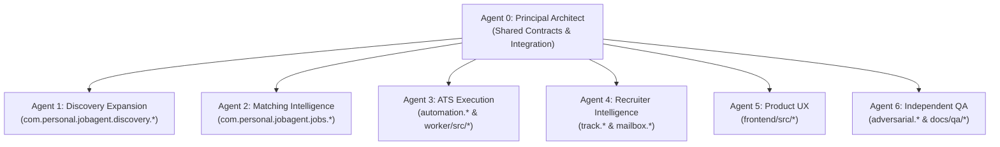

# Wave 2 Architecture & Implementation Plan: Competitive Product Development

**Lead Architect:** Agent 0 (Principal Architect & Multi-Agent Orchestrator)  
**Baseline Commit:** `1ed25d6` on `integration/wave-1`  
**Target Integration Branch:** `integration/wave-2`  
**Status:** **APPROVED & ACTIVE**  

---

## 1. Executive Summary & Competitive Mission

Robin is transitioning from a hardened engineering foundation into a customer-facing, market-leading autonomous career agent.

### 1.1 Competitive Positioning
- **Vs. Tsenta:** Tsenta relies on aggressive aggregator scraping, low-provenance job listings, hallucinatory CV tailoring, and unverified mock submissions. Robin beats Tsenta by delivering:
  1. *Authoritative direct employer & ATS discovery* with strict source ranking and provenance retention;
  2. *Fact-grounded tailoring* that deterministically blocks hallucinated credentials or prompt injections;
  3. *Verifiable application receipts* backed by cryptographic hashes and durable audit trails.
- **Learning from AIHawk (`Jobs_Applier_AI_Agent`):** AIHawk demonstrates the power of multi-platform coverage (LinkedIn, Indeed, etc.) but suffers from fragile DOM selectors, frequent anti-bot lockouts, ungrounded answers, and lack of receipt tracking. Robin adopts multi-source breadth while enforcing deterministic field mapping, defensive CAPTCHA detection, and tamper-proof submission confirmation.

### 1.2 Wave 2 Core Objectives
1. **Discovery:** Expand legally accessible career boards, track source health, measure actual unique job inventory, and prevent stale job drops.
2. **Matching Intelligence:** Multi-stage reranking (hard filters -> lexical/synonym -> seniority/experience -> explanation breakdown), benchmarked against a reproducible labelled evaluation dataset (`nDCG@10`, `Precision@10`, `Recall@10`).
3. **ATS Application Execution:** Prioritise Greenhouse, Ashby, Workday, Lever, and iCIMS. Advance Ashby & Greenhouse to verified sandbox submissions with receipts, error classifications, and browser recovery.
4. **Recruiter Intelligence & Tracking:** Complete PREP -> APPLY -> TRACK lifecycle with conversation threading (`emails.thread_id`), automated status transitions (`INTERVIEW`, `REJECTED`, `OFFER`), and stale application follow-ups.
5. **Product UX:** Polished, responsive React interface covering job discovery with match explanations and bookmarks, profile completeness, 1-click application package review, and visual application tracking.
6. **Independent QA & Security:** Adversarial verification of cross-tenant isolation, prompt injection resistance, zero hard filter violations, and concurrent event idempotency.

---

## 2. Multi-Agent Team Structure & Ownership Matrix

To prevent code conflicts and allow parallel execution, each agent is assigned exclusive ownership over distinct packages and files. No two agents may edit the same file.



### 2.1 File & Package Ownership

| Agent | Responsibility | Exclusive File / Package Scope | Branch Name | Worktree Path |
| :--- | :--- | :--- | :--- | :--- |
| **Agent 0** | Coordination & Architecture | Shared DTOs, `docs/agents/*`, root orchestration, merge coordinator | `integration/wave-2` | `.claude/worktrees/wave2-integration` |
| **Agent 1** | Discovery Expansion | `backend/src/main/java/com/personal/jobagent/discovery/**`<br/>`backend/src/test/java/com/personal/jobagent/discovery/**`<br/>`V061__discovery_source_health.sql` | `claude/wave2-agent1-discovery` | `.claude/worktrees/wave2-agent1-discovery` |
| **Agent 2** | AI Matching Intelligence | `backend/src/main/java/com/personal/jobagent/jobs/**` (except shared controller endpoints)<br/>`backend/src/test/java/com/personal/jobagent/jobs/**`<br/>`backend/src/test/resources/matching/**` | `claude/wave2-agent2-matching` | `.claude/worktrees/wave2-agent2-matching` |
| **Agent 3** | ATS Application Execution | `backend/src/main/java/com/personal/jobagent/automation/**`<br/>`backend/src/test/java/com/personal/jobagent/automation/**`<br/>`worker/src/**`<br/>`worker/test/**` | `claude/wave2-agent3-ats` | `.claude/worktrees/wave2-agent3-ats` |
| **Agent 4** | Recruiter Intelligence | `backend/src/main/java/com/personal/jobagent/track/**`<br/>`backend/src/main/java/com/personal/jobagent/mailbox/**`<br/>`backend/src/test/java/com/personal/jobagent/track/**`<br/>`backend/src/test/java/com/personal/jobagent/mailbox/**`<br/>`V063__application_follow_ups.sql` | `claude/wave2-agent4-tracking` | `.claude/worktrees/wave2-agent4-tracking` |
| **Agent 5** | Product UX & Frontend | `frontend/src/**`<br/>`V062__job_bookmarks.sql` | `claude/wave2-agent5-ux` | `.claude/worktrees/wave2-agent5-ux` |
| **Agent 6** | Independent QA & Security | `backend/src/test/java/com/personal/jobagent/adversarial/**`<br/>`docs/qa/**` | `claude/wave2-agent6-qa` | `.claude/worktrees/wave2-agent6-qa` |

---

## 3. Shared API & Event Contracts (Agent 0 Owned)

All agents must adhere strictly to these shared contracts:

### 3.1 Job Bookmarking Contract (Agent 5 <-> Agent 0 <-> Backend)
- **POST `/api/v1/jobs/{id}/bookmark`**: Creates a candidate bookmark.
  - Request: empty body.
  - Response: `{"bookmarked": true, "jobId": "uuid", "bookmarkedAt": "iso8601"}`
- **DELETE `/api/v1/jobs/{id}/bookmark`**: Removes a candidate bookmark.
  - Response: `{"bookmarked": false, "jobId": "uuid"}`
- **GET `/api/v1/jobs/bookmarks`**: Lists bookmarked jobs for the authenticated profile.

### 3.2 Matching Explanation Breakdown (Agent 2 <-> Agent 5)
In `JobMatchResponse`:
```json
{
  "jobId": "01a1ede2-...",
  "overallScore": 88,
  "recommendation": "APPLY",
  "breakdown": {
    "skillScore": 92,
    "experienceScore": 85,
    "seniorityScore": 90,
    "salaryScore": 80,
    "locationScore": 100
  },
  "explanation": "Strong match for Java/Spring Backend roles in London with hybrid flexibility.",
  "matchedSkills": ["Java", "Spring Boot", "PostgreSQL"],
  "missingSkills": ["Docker"],
  "hardFilterPassed": true
}
```

### 3.3 ATS Execution Verification Contract (Agent 3 <-> Agent 4 <-> Worker)
When an execution plan completes:
```json
{
  "planId": "uuid",
  "applicationId": "uuid",
  "status": "COMPLETED",
  "atsType": "ASHBY",
  "receipt": {
    "confirmationNumber": "ASH-991204",
    "timestamp": "2026-11-18T19:30:00Z",
    "sha256": "abcdef...",
    "verificationMethod": "DOM_CONFIRMATION_CONTRACT"
  },
  "fieldFillSummary": {
    "filledCount": 8,
    "gapCount": 0,
    "unsupportedFields": []
  }
}
```

### 3.4 Conversation Threading & Follow-Up Contract (Agent 4 <-> Agent 5)
In `ApplicationTimelineResponse`:
```json
{
  "applicationId": "uuid",
  "status": "INTERVIEW",
  "threads": [
    {
      "threadId": "thread-12345",
      "subject": "Interview with Fixture Co",
      "messageCount": 3,
      "lastMessageAt": "2026-11-18T10:00:00Z",
      "latestClassification": "INTERVIEW_INVITATION"
    }
  ],
  "followUp": {
    "due": false,
    "dueDate": "2026-11-25T09:00:00Z",
    "status": "NOT_NEEDED"
  }
}
```

---

## 4. Database Migration Roadmap

Three lock-safe, additive migrations are assigned for Wave 2:

1. **`V061__discovery_source_health.sql` (Agent 1):**
   ```sql
   ALTER TABLE job_sources ADD COLUMN IF NOT EXISTS health_status text NOT NULL DEFAULT 'HEALTHY';
   ALTER TABLE job_sources ADD COLUMN IF NOT EXISTS consecutive_failures int NOT NULL DEFAULT 0;
   ALTER TABLE job_sources ADD COLUMN IF NOT EXISTS last_successful_run_at timestamptz;
   ALTER TABLE job_sources ADD COLUMN IF NOT EXISTS error_summary text;
   CREATE INDEX IF NOT EXISTS job_sources_health_idx ON job_sources(health_status);
   ```

2. **`V062__job_bookmarks.sql` (Agent 5 & Backend):**
   ```sql
   CREATE TABLE IF NOT EXISTS job_bookmarks (
       id uuid PRIMARY KEY,
       profile_id uuid NOT NULL REFERENCES profiles(id) ON DELETE CASCADE,
       job_id uuid NOT NULL REFERENCES jobs(id) ON DELETE CASCADE,
       created_at timestamptz NOT NULL DEFAULT now(),
       CONSTRAINT uq_job_bookmarks_profile_job UNIQUE (profile_id, job_id)
   );
   CREATE INDEX IF NOT EXISTS job_bookmarks_profile_idx ON job_bookmarks(profile_id, created_at DESC);
   ```

3. **`V063__application_follow_ups.sql` (Agent 4):**
   ```sql
   ALTER TABLE applications ADD COLUMN IF NOT EXISTS follow_up_due_at timestamptz;
   ALTER TABLE applications ADD COLUMN IF NOT EXISTS follow_up_status text NOT NULL DEFAULT 'NONE';
   CREATE INDEX IF NOT EXISTS applications_follow_up_idx ON applications(profile_id, follow_up_status, follow_up_due_at);
   ```

---

## 5. Development Order & Milestones

Parallel execution will proceed across 4 staged phases:

1. **Phase 1 (Priority 1): Core Intelligence & Submission Engine**
   - **Agent 2 (Matching):** Reranking engine, seniority alignment, explanation breakdown, reproducible labelled dataset (`evaluation_dataset.json`), nDCG@10 benchmark.
   - **Agent 3 (ATS Execution):** Ashby sandbox submission verification, Greenhouse structured mapping, failure classification, session recovery.
2. **Phase 2 (Priority 2): Inventory & Recruiter Lifecycle**
   - **Agent 1 (Discovery):** Legally accessible sources expansion, source health tracking (`V061`), unique job vs raw duplicate metrics, safe deletion guard.
   - **Agent 4 (Tracking):** Recruiter conversation threading (`V060`/`V063`), automated status transitions, follow-up detector.
3. **Phase 3 (Priority 3): Customer Experience & Frontend Integration**
   - **Agent 5 (UX):** Job bookmarks (`V062`), match explanations, profile truth gauge, 1-click application package review, visual tracker timeline.
4. **Phase 4 (Priority 4): Combined Verification & Independent Security Sign-Off**
   - **Agent 6 (QA & Security):** Adversarial verification, cross-tenant isolation, full-stack regression.
   - **Agent 0 (Integration Lead):** Consolidation into `integration/wave-2`, full test suite execution, generation of `docs/agents/WAVE2_FINAL_REPORT.md`.

---

## 6. Strict Production Boundaries
- **No Production Connections:** Never connect to live Oracle DB `132.226.133.162` or `robin_restore`.
- **No Direct Master Merges:** All code lands on `integration/wave-2`.
- **No Production Deployments:** Render production service remains suspended.
- **Stop Condition:** Delivery of fully tested `integration/wave-2` branch with user sign-off.
